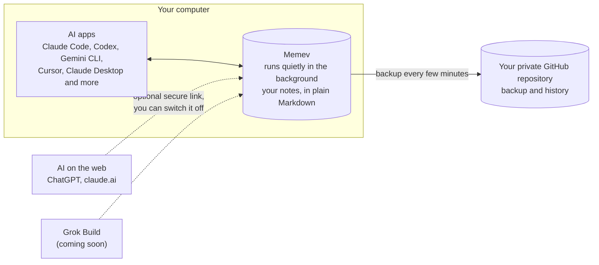
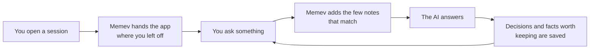

# Memev

One memory for every AI app you use.

Tell Claude Code about a decision on Monday and Cursor knows it on Tuesday. Memev keeps what your AI
apps learn in a folder of plain notes on your own computer, hands the right notes to whichever app
you open next, and backs everything up to a private GitHub repository that you own.

## How it fits together



## What happens when you chat



You don't have to ask for any of this. Memev refuses small talk and duplicates, so the notes stay
worth reading.

## Install

You need Node 22 or newer and git. Every path below sets up the same thing: it creates your notes
folder, starts Memev, connects the AI apps it finds on your computer and runs a self-test.

| Path | Who it's for | What happens on its own |
|---|---|---|
| **Ask your AI app to do it** | anyone already using Claude Code, Codex, Gemini CLI or Cursor | the app downloads Memev and runs the setup; you read the checklist it shows you |
| **Two commands from a download** | anyone comfortable with a terminal | the same setup, run by you |
| **npm from a download** | people who like a global `memev` command | the same, plus `memev` on your PATH |
| **Docker** | an always-on server or a home lab | Memev runs in a container; you connect apps by hand |
| `npx memev init` | everyone | coming soon (not on the npm registry yet) |
| One-line installer for macOS, Linux and Windows | everyone | coming soon |

**Ask your AI app.** Paste this into a session:

> Download the Memev repository, run `node bin/memev.mjs init` inside it, and show me the checklist
> it prints.

**Two commands.** In the folder you downloaded:

```sh
node bin/memev.mjs init
```

**npm.** In the same folder: `npm install -g . && memev init`

**Docker.** `docker compose up -d` builds the image on your machine; see [docs/DOCKER.md](docs/DOCKER.md).

After setup, two things may need you: one browser sign-in for the GitHub backup
(`memev github setup`), and a click in apps that ask before they trust a new tool. The checklist
says which. Details are in [docs/QUICKSTART.md](docs/QUICKSTART.md).

## Which tier?

| | Free | Business (planned) | Enterprise (planned) |
|---|---|---|---|
| For | one person, one computer | a company with 10 to 20 computers | larger or regulated organisations |
| Runs on | your computer | your company server, optional local AI model | your data centre, high availability, air-gapped option |
| Price (draft) | $0, for good | $199/month per 10 computers, $2,500 remote setup | by contract |
| Support | GitHub issues | business hours, response times by priority | named or embedded engineer |

Free is complete and is never limited ([CHARTER.md](CHARTER.md)). The company server, sign-in with
Google or Microsoft, and department permissions are planned, not built. See
[docs/tiers/](docs/tiers/README.md) for what each tier includes, how it is set up, its limits and a
worked 20-computer example. All prices are drafts.

## What you get

- **Your notes, your files.** Plain Markdown in `~/memev`, kept in git. Every change goes through a
  checksummed log first, so nothing is lost.
- **Works in many apps.** Claude Code, Codex, Gemini CLI, Cursor, Claude Desktop, Windsurf, VS Code
  and Zed, plus ChatGPT and claude.ai through the optional secure link.
- **Memory you can check.** `memev why` shows why a note came back; `memev audit` lists junk and
  stale notes; nothing is deleted behind your back.
- **Projects stay apart.** Notes from one project don't turn up in another.
- **Any language.** Chinese, Japanese, Korean, Cyrillic, Greek and Arabic notes are searchable.
- **No telemetry, no runtime dependencies.**

## Documentation

| | |
|---|---|
| [Quickstart](docs/QUICKSTART.md) | install, first session, everyday commands |
| [AI apps](docs/CLIENTS.md) | what is changed in each app, hooks vs instructions, undoing it |
| [Cloud access](docs/CLOUD.md) | the secure link, connector URLs, turning it off |
| [GitHub backup](docs/GITHUB.md) | `memev github setup` |
| [Docker](docs/DOCKER.md) | running Memev in a container |
| [Tiers and setup](docs/tiers/README.md) | Free, Business and Enterprise, services and rates (draft) |
| [Problems and solutions](docs/SOLUTIONS.md) | what users complain about and what Memev does about it |
| [Contracts](docs/CONTRACTS.md) | signed, immutable work contracts |
| [Troubleshooting](docs/TROUBLESHOOTING.md) | `memev doctor` and common fixes |
| [Security](SECURITY.md) and [threat model](docs/THREAT-MODEL.md) | |
| [Charter](CHARTER.md) | the free tier is never limited |
| [Pricing (draft)](docs/PRICING.md) | proposed prices; nothing is enforced |
| [Design](docs/DESIGN.md) | log, index, graph, recall, scale |
| [Hands-off runtime](docs/MAPPING.md) | everything Memev does without being asked |

## For developers

Memev is a local MCP server over a Markdown vault. Each session starts with a resume card, each
prompt gets the most relevant notes (in apps with hooks), and state is saved before a compaction.
The graph holds entities, links and claims with a status (fact, theory, conjecture) and provenance.
Recall is BM25 over note sections, filtered by project and permissions before ranking. Node 22,
nothing else. See [docs/DESIGN.md](docs/DESIGN.md).

## License

Apache-2.0. Includes a modified copy of Proofline (Apache-2.0); see [NOTICE](NOTICE).
