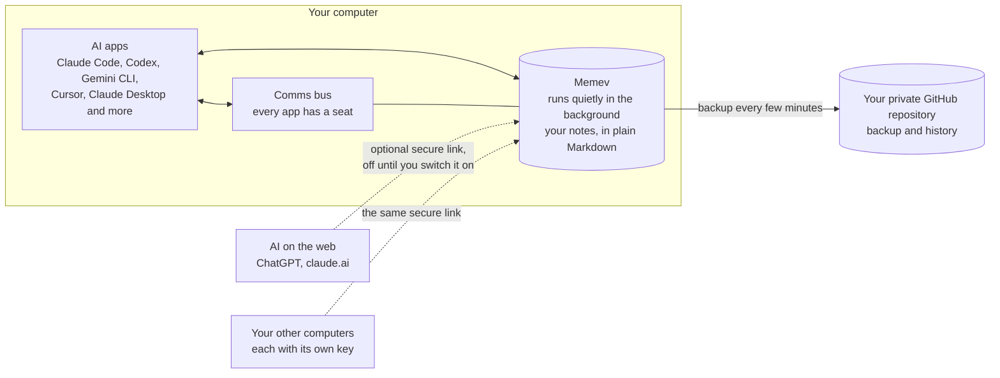
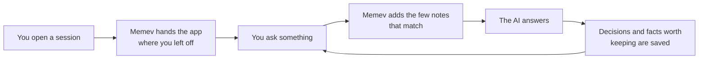

# Memev

Memory and recall stack for all of the AI apps you use, local system and cloud.

Run project dev on Claude code and Cursor knows about the context on Tuesday. Memev keeps what your AI
apps learn in a folder of plain notes on your own computer, hands the right notes to whichever app
you open next, and backs everything up to a private GitHub repository that you own.

One memory and one team channel, both on computers you own.

## How it fits together



## What happens when you chat



You don't have to ask for any of this. Memev refuses small talk and duplicates, so the notes stay
worth reading.

## Install

You need Node 22 or newer and git. Every path below sets up the same thing: it creates your notes
folder, starts Memev, connects the AI apps it finds on your computer and runs a self-test.

Memev runs on macOS and Linux. **Windows (preview):** setup, app connections, hooks and the doctor
have Windows code paths and tests, and a Windows job runs them on every change to `main`, but
Windows has not had a full lab run yet, and Memev does not
start at login there (run `memev start` after you sign in).
[docs/QUICKSTART.md](docs/QUICKSTART.md#windows-preview) says what differs.

| Path | Who it's for | What happens on its own |
|---|---|---|
| Ask your AI app to do it | anyone already using Claude Code, Codex, Gemini CLI or Cursor | the app downloads Memev and runs the setup; you read the checklist it shows you |
| One command in a download | anyone comfortable with a terminal | the same setup, run by you |
| npm, from a download | people who like a global `memev` command | the same, plus `memev` on your PATH |
| Docker | an always-on server or a home lab | Memev runs in a container; you connect apps by hand |
| `npx memev init` | everyone | coming soon (not on the npm registry yet) |
| One-line installer for macOS, Linux and Windows | everyone | coming soon |

To have your AI app do it, paste this into a session:

> Download the Memev repository, run `node bin/memev.mjs init` inside it, and show me the checklist
> it prints.

To do it yourself, run this in the folder you downloaded:

```sh
node bin/memev.mjs init
```

For a global `memev` command, run `npm install -g . && memev init` there instead. For Docker,
`docker compose up -d` builds the image on your machine; see [docs/DOCKER.md](docs/DOCKER.md).

After setup, two things may need you: one browser sign-in for the GitHub backup
(`memev github setup`), and a click in apps that ask before they trust a new tool. The checklist
says which. Details are in [docs/QUICKSTART.md](docs/QUICKSTART.md).

To see it work, run `memev ready` and open a new session in each app. It prints each app as it
joins, then "Ready: <app> and <app> share one memory" once one of them recalls something another
one saved.

## Which tier?

| | Free | Business (planned) | Enterprise (planned) |
|---|---|---|---|
| For | one person, one computer | a company with 10 to 20 computers | larger or regulated organisations |
| Runs on | your computer | your company server, optional local AI model | your data centre, high availability, air-gapped option |
| Price | free, for good | contact us | contact us |
| Support | GitHub issues | business hours, response times by priority | named or embedded engineer |

Free is complete and is never limited ([CHARTER.md](CHARTER.md)). The company server, sign-in with
Google or Microsoft, and department permissions are planned, not built. See
[docs/tiers/](docs/tiers/README.md) for what each tier includes, how it is set up, its limits and a
worked 20-computer example. Business and Enterprise, and the services around them, are priced on
your requirements: contact us.

## What you get

Your notes are plain Markdown in `~/memev`, kept in git. Every change is written to a checksummed
log first, so a crash or a bad edit can't lose anything. Claude Code, Codex, Gemini CLI, Cursor,
Claude Desktop, Windsurf, VS Code and Zed all use the same notes, and ChatGPT and claude.ai can too
through the optional secure link.

Your AI apps can also talk to each other. Each one gets a seat on a comms bus kept in the vault,
joins on its own, and keeps a heartbeat, so from one Claude Code session you can see who is there,
run a comms check, hand out tasks and put an app on hold. See [docs/BUS.md](docs/BUS.md).

You can check what Memev holds. `memev why` shows why a note came back, `memev audit` lists junk and
stale notes, and nothing is deleted behind your back. Notes from one project don't turn up in
another, and notes in Chinese, Japanese, Korean, Cyrillic, Greek or Arabic are searchable like any
other. There is no telemetry by default and nothing to install besides Node and git. One short anonymous
milestone report exists; it is off unless you turn it on with `memev report on`, and `memev report show`
prints exactly what it would send ([docs/METRICS.md](docs/METRICS.md)).

## Documentation

| | |
|---|---|
| [Quickstart](docs/QUICKSTART.md) | install, first session, everyday commands |
| [AI apps](docs/CLIENTS.md) | what is changed in each app, hooks vs instructions, undoing it |
| [Cloud access](docs/CLOUD.md) | the secure link, connector URLs, other computers, turning it on |
| [Comms bus](docs/BUS.md) | how your AI apps talk to each other, the roster and comms checks |
| [GitHub backup](docs/GITHUB.md) | `memev github setup` |
| [Docker](docs/DOCKER.md) | running Memev in a container |
| [Tiers and setup](docs/tiers/README.md) | Free, Business and Enterprise, and the services around them (draft) |
| [Problems and solutions](docs/SOLUTIONS.md) | what users complain about and what Memev does about it |
| [Contracts](docs/CONTRACTS.md) | signed, immutable work contracts |
| [Troubleshooting](docs/TROUBLESHOOTING.md) | `memev doctor` and common fixes |
| [Lab test plan](docs/testing/LAB-TEST-PLAN.md) | every test to run in a lab before a release, with expected results |
| [Security](SECURITY.md) and [threat model](docs/THREAT-MODEL.md) | |
| [Charter](CHARTER.md) | the free tier is never limited |
| [Pricing (draft)](docs/PRICING.md) | Free and Personal prices; everything else on request; the computer limit |
| [Design](docs/DESIGN.md) | log, index, graph, recall, scale |
| [Hands-off runtime](docs/MAPPING.md) | everything Memev does without being asked |

## For developers

Memev is a local MCP server over a Markdown vault. Each session starts with a resume card, each
prompt gets the most relevant notes (in apps with hooks), and state is saved before a compaction.
The graph holds entities, links and claims with a status (fact, theory, conjecture) and provenance.
Recall is BM25 over note sections, filtered by project and permissions before ranking. Node 22,
nothing else. See [docs/DESIGN.md](docs/DESIGN.md).

## License

Apache-2.0. Includes a modified copy of Proofline (Apache-2.0); see [NOTICE](NOTICE).
