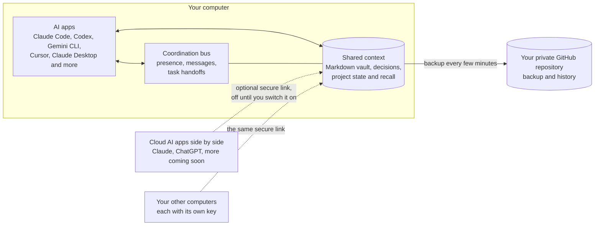
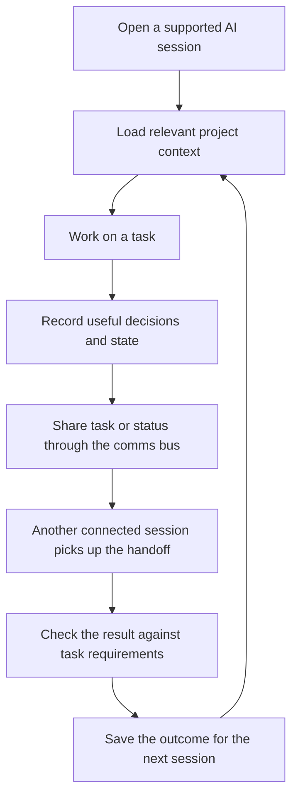

<div align="center">

<a href="media/memev-tiers.mp4"></a>

<sub><a href="media/memev-tiers.mp4">Watch the demo video</a> (4 min 55 s): how each tier works and how the tiers connect.</sub>

<h1>Memev</h1>

<p><strong>Distributed memory, coordination and intelligence for the AI tools and systems you already use.</strong><br>
Memev connects people, AI agents, applications, computers and independently operated sites through one governed architecture. Use the AI providers and tools you choose; Memev provides the shared context, coordination and distributed-system capabilities underneath.</p>

<p>


</p>

<p>
<code>npm install -g . && memev init</code>
</p>

<p>
<a href="docs/QUICKSTART.md">Quickstart</a> &middot;
<a href="docs/README.md">Documentation</a> &middot;
<a href="docs/ARCHITECTURE.md">Architecture</a> &middot;
<a href="docs/tiers/README.md">Tiers</a> &middot;
<a href="CHANGELOG.md">Changelog</a>
</p>

<p>Move between AI tools without rebuilding context or locking your work to one provider.<br>
Memev starts with local memory and coordination, then extends through the same architecture to multiple devices, people, projects, programmes, portfolios, departments, organisations and sites.<br>
Each deployment can retain control of its own data and operations while participating in authorised federation. Your notes remain inspectable and under your control.</p>

<p><strong>One shared working context. One coordination layer. Your data stays under your control.</strong></p>

</div>

## How it fits together

Memev connects three parts of AI work that are usually handled separately:

- **Shared context:** keep project decisions, constraints and useful prior work available across supported tools and sessions.
- **Coordination:** let connected sessions discover one another, check presence and hand off tasks through a shared communications bus.
- **Defined work:** describe expected outcomes and acceptance criteria in work contracts, then retain verification results where those checks are available.

The vault and coordination bus provide the common working layer. What happens next depends on the connected AI client and workflow: Memev supplies the shared context and coordination mechanisms, while agents and people carry out the work.



## How shared context and coordination work



Memev keeps project context available without making you copy the same background into every new session. Retrieval is scoped and relevance-based, so the shared context stays useful rather than becoming a transcript dump. Connected sessions can coordinate through the communications bus, and work contracts provide a way to state what a task must deliver and retain verification results where the relevant checks are available.

<p align="center">

</p>


## Federation: the same architecture at every scale

Memev is not tied to one AI provider, one agent framework, one computer or one central company vault. People use the AI tools they prefer. Memev provides the architecture through which those tools and the systems around them can share authorised context, coordinate work and maintain consistent distributed state.

The same core design applies at every scale:

- **One person:** one local memory used by several AI tools and agents.
- **One person, many devices:** independently used computers sharing the person's authorised state.
- **A small business:** people, devices and projects coordinate while retaining appropriate personal and business boundaries.
- **One site or many sites:** each site can operate its own Memev server and local memory; sites exchange only the state and information their policies permit.
- **An enterprise or portfolio:** departments, programmes, projects, business functions and locations can be connected without requiring one central memory server or one AI provider.
- **Federated organisations:** independent organisations can participate in shared projects, programmes and portfolios while retaining their own administration, data and authority. Where appropriate, they can also participate in explicitly authorised distributed computation.

This extends the current architecture; it does not replace the local vault, daemon, MCP integrations, communications bus, contracts or existing workflows. Federation adds governed site-to-site relationships and distributed capabilities around those foundations. Features beyond the current single-vault implementation are explicitly marked as planned or specified.

**Memory is local to its authority. Coordination crosses boundaries by permission. Organisational understanding spans the work that participants are authorised to share.**

See [Federation](docs/FEDERATION.md), [Organisational intelligence](docs/ORGANISATIONAL-INTELLIGENCE.md), [Federated computation](docs/FEDERATED-COMPUTATION.md) and [Data sovereignty](docs/DATA-SOVEREIGNTY.md).

## Install

You need Node 22 or newer and git. Every path below sets up the same thing: it creates your notes
folder, starts Memev, connects the AI apps it finds on your computer and runs a self-test. The
command at the top of this page installs Memev from this folder with npm; run it in a copy of this
repository. The rest of this section covers the other paths.

Memev runs on macOS and Linux. **Windows (preview):** setup, app connections, hooks and the doctor
have Windows code paths and tests, and a Windows job runs them on every change to `main`, but
Windows has not had a full lab run yet. Memev starts at login there through a per-user Task Scheduler
entry that `memev service install` creates. [docs/QUICKSTART.md](docs/QUICKSTART.md#windows-preview) says
what differs.

### All the install paths

| Path | Who it's for | What happens on its own |
|---|---|---|
| Ask your AI app to do it | anyone already using Claude Code, Codex, Gemini CLI or Cursor | the app downloads Memev and runs the setup; you read the checklist it shows you |
| One command in a download | anyone comfortable with a terminal | the same setup, run by you |
| npm, from a download | people who like a global `memev` command | the same, plus `memev` on your PATH |
| Docker | an always-on server or a home lab | Memev runs in a container; you connect apps by hand |
| `npx memev init` | everyone | coming soon (not on the npm registry yet) |
| One-line installer for macOS, Linux and Windows | everyone | coming soon |

To have your AI app do it, paste this into a session:

> Download the Memev repository, run `node bin/memev.mjs init` inside it, and show me the checklist
> it prints.

To do it yourself, run this in the folder you downloaded:

```sh
node bin/memev.mjs init
```

For a global `memev` command, run `npm install -g . && memev init` there instead. For Docker,
`docker compose up -d` builds the image on your machine; see [docs/DOCKER.md](docs/DOCKER.md).

After setup, two things may need you: one browser sign-in for the GitHub backup
(`memev github setup`), and a click in apps that ask before they trust a new tool. The checklist
says which. Details are in [docs/QUICKSTART.md](docs/QUICKSTART.md).

To see shared context working, run `memev ready` and open a new session in each app. It prints each
app as it joins, then confirms that connected apps share project context when one recalls something
another saved. For coordination, see [docs/BUS.md](docs/BUS.md); for defined work and verification,
see [docs/CONTRACTS.md](docs/CONTRACTS.md).

## Choose how you deploy Memev

The same core—shared context, coordination and defined work—applies across tiers. Deployment can grow from one local user to multiple devices, a small business, one or many sites, an enterprise or a federation of independent organisations. The difference is the topology, governance, operational control and services required—not which AI provider people must use.

| | Personal | Personal multi-device | Business | Corporate and Federation |
|---|---|---|---|---|
| For | one person using several AI tools with shared context | one person working across several computers | a small or growing organisation coordinating people, tools and projects | multi-site, international, portfolio-scale or independently federated deployments |
| AI apps | any supported mix of cloud and local AI tools | the same, on each computer | each person or team can use the AI providers and agents they choose, subject to policy | provider-neutral across sites, departments and organisations |
| Runs on | your computer, backed up to your own GitHub | your computers | one or more organisation-operated servers, according to deployment needs | independently operated site servers, optional regional services and governed peer connections |
| Distributed operation | local-first | multi-device state (planned convergence) | multiple people and projects | multi-site, multi-jurisdiction and cross-organisation federation (planned) |
| Price | free, for good | $12/month or $120/year (CHF 10 or CHF 100), early-supporter price | contact us | contact us |
| Trial | not needed | none | planned | scoped pilot |
| Support | GitHub issues | priority support | business hours, response times by priority | named or embedded engineer |

**Personal is free and complete** ([CHARTER.md](CHARTER.md)). It is one computer at a time, and you
move between computers through your own GitHub. Switch computers, lose nothing. Today git sync is
single-writer backup: if a second computer also pushes the same vault, `memev doctor` warns that
concurrent edits can conflict. Nothing is blocked, and a merge that conflicts is left for you. You
can connect several cloud AI apps side by side, such as Claude and ChatGPT (more are coming soon),
next to your local coding tools over MCP.

**Personal with more computers is the paid tier**: edit on two machines at once, nothing to resolve.
That merging is done by crdt-merge, the paid convergence engine; see
[The paid core: crdt-merge](#the-paid-core-crdt-merge). It is planned, not built yet.

**Business and Corporate are not based on one mandatory central vault or one AI provider.** The intended organisational model supports local memories and independently operated servers, with governed sharing and replication between authorised people, projects, departments and sites. A small business may run one site; a larger organisation may run several; an international enterprise may need jurisdiction-specific federation. People continue to use their preferred AI providers and agents. Personal and organisational scopes remain explicitly separated by identity, authority and policy. The detailed multi-site and cross-organisation capabilities are planned architectural extensions, not claims about the current single-vault implementation.

See [docs/tiers/](docs/tiers/README.md) for the deployment levels, status and limits, and [the architecture](docs/ARCHITECTURE.md) for the current implementation and intended federation model. Business, Corporate and federation services are subject to scope and delivery planning; contact us.

## The paid core: crdt-merge

The Memev core is open source (Apache-2.0) and free, and it stays that way. The convergence engine,
**crdt-merge**, with its merge strategies, lives in its own repository under its original licence
(currently BSL 1.1). It is never vendored into Memev: Memev calls it as an external dependency.

It powers the paid features:

- **Automatic merge across several computers at once** (Personal with more computers).
- **Governed convergence of supported shared state** across multiple devices and, as the structured-state contracts are developed, across people, projects and sites (planned).

Free users get one computer at a time through their own GitHub. Nothing is overwritten, and when two
copies conflict both versions are kept. Only licence information passes between an install and our side,
never vault data. See [docs/CONVERGENCE.md](docs/CONVERGENCE.md).

## What you get

### Shared context

Your project knowledge lives as plain Markdown in `~/memev`, kept in git. Every change is written to a checksummed log first. Claude Code, Codex, Gemini CLI, Cursor, Claude Desktop, Windsurf, VS Code and Zed can use the same notes, and cloud AI apps such as Claude and ChatGPT can connect side by side through the optional secure link. Session resume cards, project-aware recall, provenance and the graph help connected tools pick up relevant context instead of starting from scratch. See [docs/DESIGN.md](docs/DESIGN.md) and [docs/CLIENTS.md](docs/CLIENTS.md).

### Coordination between connected sessions

Each connected app gets a seat on Memev's communications bus, joins the roster and reports a heartbeat. From one session, you can see which peers are present, run a communications check, hand out tasks and put an app on hold. The bus gives supported agents a shared coordination channel; the exact execution of a handoff depends on the connected client and workflow. See [docs/BUS.md](docs/BUS.md).

### Defined work and verification

Work contracts let you record the task, expected deliverables, acceptance criteria and stop conditions. Where checks are run, their outcomes and receipts can be retained alongside the work. This makes it possible to distinguish a task being assigned from evidence that its requirements were met. See [docs/CONTRACTS.md](docs/CONTRACTS.md).

### Trust and control

You can inspect what Memev holds. `memev why` shows why a note came back, and `memev audit` lists junk and stale notes. Notes from one project are scoped away from another, and notes in Chinese, Japanese, Korean, Cyrillic, Greek or Arabic are searchable like any other. The vault stays on your computer and can be backed up to your own private GitHub repository. Cloud access is optional and off until you enable it; when you connect a cloud AI provider, that provider's own data handling still applies. Memev has no telemetry by default. The anonymous milestone report is off unless you turn it on with `memev report on`, and `memev report show` prints exactly what it would send ([docs/METRICS.md](docs/METRICS.md)).

## Documentation

Everything is indexed in [docs/README.md](docs/README.md), from this page down to each module and back
up. The main pages:

| | |
|---|---|
| [Quickstart](docs/QUICKSTART.md) | install, first session, everyday commands |
| [Architecture](docs/ARCHITECTURE.md) | what runs today and how the same architecture extends to multi-site federation |
| [Module map](docs/MODULES.md) | every module and what imports what, generated from the code; not a future architecture diagram |
| [Architectural interdependencies](docs/ARCHITECTURAL-INTERDEPENDENCIES.md) | how the current components fit together and what the wider architecture depends on |
| [AI apps](docs/CLIENTS.md) | what is changed in each app, hooks vs instructions, undoing it |
| [Cloud access](docs/CLOUD.md) | the secure link, connector URLs, other computers, turning it on |
| [Comms bus](docs/BUS.md) | how your AI apps talk to each other, the roster and comms checks |
| [GitHub backup](docs/GITHUB.md) | `memev github setup` |
| [Docker](docs/DOCKER.md) | running Memev in a container |
| [Tiers and setup](docs/tiers/README.md) | Personal, Personal with more computers, Business and Corporate, and the services around them (draft) |
| [The paid core: crdt-merge](docs/CONVERGENCE.md) | what is open, what is paid, what passes between an install and us |
| [Pricing (draft)](docs/PRICING.md) | the Personal price; Business and Corporate on request; the computer limit |
| [Problems and solutions](docs/SOLUTIONS.md) | what users complain about and what Memev does about it |
| [Contracts](docs/CONTRACTS.md) | signed, immutable work contracts |
| [Troubleshooting](docs/TROUBLESHOOTING.md) | `memev doctor` and common fixes |
| [Lab test plan](docs/testing/LAB-TEST-PLAN.md) | every test to run in a lab before a release, with expected results |
| [Security](SECURITY.md) and [threat model](docs/THREAT-MODEL.md) | |
| [Charter](CHARTER.md) | the free tier is never limited |
| [Design](docs/DESIGN.md) | log, index, graph, recall, scale |
| [Federation](docs/FEDERATION.md) | local ownership, site topologies, replication and cross-organisation boundaries |
| [Organisational intelligence](docs/ORGANISATIONAL-INTELLIGENCE.md) | work graph across people, projects, programmes, portfolios and functions |
| [Federated computation](docs/FEDERATED-COMPUTATION.md) | an additional capability: distributed execution, analytics, optimisation, evaluation and federated learning |
| [Data sovereignty](docs/DATA-SOVEREIGNTY.md) | jurisdiction-aware data, derived information, replication and recovery |
| [Hands-off runtime](docs/MAPPING.md) | everything Memev does without being asked |
| [Developing Memev](docs/DEVELOPING.md) | tests, the leak scan, changelog notes, regenerating the module map |

## For developers

Memev currently runs as a local MCP server and coordination layer built around a Markdown vault. Each session starts with a resume card, supported prompts can receive relevant project context (in apps with hooks), and state is saved before a compaction. The same core exposes the communications bus and work-contract mechanisms. The wider design extends these same responsibilities to independently operated nodes and sites through explicit federation contracts; it does not require a different AI provider or replace the current local architecture.
The graph holds entities, links and claims with a status (fact, theory, conjecture) and provenance.
Recall is BM25 over note sections, filtered by project and permissions before ranking. Node 22,
nothing else. See [docs/DESIGN.md](docs/DESIGN.md), the [module map](docs/MODULES.md) and
[docs/DEVELOPING.md](docs/DEVELOPING.md).

## License

Apache-2.0. Includes a modified copy of Proofline (Apache-2.0); see [NOTICE](NOTICE). The crdt-merge
convergence engine is a separate project under its own licence and is not part of this repository; see
[docs/LICENSING-NOTICE.md](docs/LICENSING-NOTICE.md).
