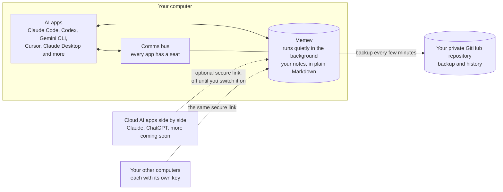
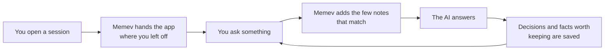

<div align="center">

<a href="media/memev-tiers.mp4"></a>

<sub><a href="media/memev-tiers.mp4">Watch the demo video</a> (4 min 55 s): how each tier works and how the tiers connect.</sub>

<h1>Memev</h1>

<p><strong>Shared context and coordination for the AI tools you already use.</strong><br>
Keep project knowledge consistent across AI sessions, and give supported agents a shared place to coordinate work.</p>

<p>


</p>

<p>
<a href="docs/QUICKSTART.md">Quickstart</a> &middot;
<a href="docs/README.md">Documentation</a> &middot;
<a href="docs/ARCHITECTURE.md">Architecture</a> &middot;
<a href="docs/tiers/README.md">Tiers</a> &middot;
<a href="CHANGELOG.md">Changelog</a>
</p>

<p>Move between supported AI tools without rebuilding the project context every time.<br>
Memev keeps shared project knowledge in plain Markdown on your own computer, makes relevant context available to connected tools, and provides a communications bus for agent presence, checks and task handoffs.<br>
Your notes remain inspectable and can be backed up to a private GitHub repository that you own.</p>

<p><strong>One shared working context. One coordination layer. Your data stays under your control.</strong></p>

</div>

## How it fits together

Memev is designed as a local-first coordination layer for AI work, not just a memory store. Shared context helps tools pick up where work left off; the communications bus gives connected sessions a way to discover one another and hand off tasks. The aim is to reduce repeated explanations, lost decisions and duplicated effort when people use several AI tools.

The current implementation is still evolving. Multi-computer convergence and the Business and Corporate tiers are planned work, not capabilities to assume are production-ready today.



## How shared context works



Memev is intended to keep useful project context available without making you manually copy and paste the same background into every new session. It filters for relevant notes so the shared context stays useful rather than becoming a transcript dump.

## Install

You need Node 22 or newer and git. Every path below sets up the same thing: it creates your notes
folder, starts Memev, connects the AI apps it finds on your computer and runs a self-test.

Memev runs on macOS and Linux. **Windows (preview):** setup, app connections, hooks and the doctor
have Windows code paths and tests, and a Windows job runs them on every change to `main`, but
Windows has not had a full lab run yet. Memev starts at login there through a per-user Task Scheduler
entry that `memev service install` creates. [docs/QUICKSTART.md](docs/QUICKSTART.md#windows-preview) says
what differs.

| Path | Who it's for | What happens on its own |
|---|---|---|
| Ask your AI app to do it | anyone already using Claude Code, Codex, Gemini CLI or Cursor | the app downloads Memev and runs the setup; you read the checklist it shows you |
| One command in a download | anyone comfortable with a terminal | the same setup, run by you |
| npm, from a download | people who like a global `memev` command | the same, plus `memev` on your PATH |
| Docker | an always-on server or a home lab | Memev runs in a container; you connect apps by hand |
| `npx memev init` | everyone | coming soon (not on the npm registry yet) |
| One-line installer for macOS, Linux and Windows | everyone | coming soon |

To have your AI app do it, paste this into a session:

> Download the Memev repository, run `node bin/memev.mjs init` inside it, and show me the checklist
> it prints.

To do it yourself, run this in the folder you downloaded:

```sh
node bin/memev.mjs init
```

For a global `memev` command, run `npm install -g . && memev init` there instead. For Docker,
`docker compose up -d` builds the image on your machine; see [docs/DOCKER.md](docs/DOCKER.md).

After setup, two things may need you: one browser sign-in for the GitHub backup
(`memev github setup`), and a click in apps that ask before they trust a new tool. The checklist
says which. Details are in [docs/QUICKSTART.md](docs/QUICKSTART.md).

To see it work, run `memev ready` and open a new session in each app. It prints each app as it
joins, then "Ready: <app> and <app> share one memory" once one of them recalls something another
one saved.

## Which tier?

| | Personal | Personal with more computers | Business (coming) | Corporate (coming) |
|---|---|---|---|---|
| For | one person, one computer at a time | one person, several computers at once | a company: all members' work data in one company vault that the company can see and search | the same model as Business, at larger scale, with one main corporate vault |
| AI apps | several cloud AI apps side by side (Claude, ChatGPT; more coming soon) and local coding tools via MCP | the same, on each computer | ONE AI provider for the organisation: one cloud AI service or an on-premises LLM | the same, with an air-gapped option |
| Runs on | your computer, backed up to your own GitHub | your computers | your company server | your data centre, high availability, air-gapped option |
| Two computers | one at a time: switch computers, lose nothing | edit on two machines at once, nothing to resolve (planned) | coming | coming |
| Price | free, for good | $12/month or $120/year (CHF 10 or CHF 100), early-supporter price | contact us | contact us |
| Trial | not needed | none | 5 members and 10 computers (planned); a sales-assisted pilot for on-premises, air-gapped or compliance-led organisations | a sales-assisted pilot (planned) |
| Support | GitHub issues | priority support | business hours, response times by priority | named or embedded engineer |

**Personal is free and complete** ([CHARTER.md](CHARTER.md)). It is one computer at a time, and you
move between computers through your own GitHub. Switch computers, lose nothing. Today git sync is
single-writer backup: if a second computer also pushes the same vault, `memev doctor` warns that
concurrent edits can conflict. Nothing is blocked, and a merge that conflicts is left for you. You
can connect several cloud AI apps side by side, such as Claude and ChatGPT (more are coming soon),
next to your local coding tools over MCP.

**Personal with more computers is the paid tier**: edit on two machines at once, nothing to resolve.
That merging is done by crdt-merge, the paid convergence engine; see
[The paid core: crdt-merge](#the-paid-core-crdt-merge). It is planned, not built yet.

**Business and Corporate are the same model at different scale, and both are coming.** Every
member's computer syncs its work data into one vault: one company vault for Business, one main
corporate vault for Corporate. The company can see and search everything in it. Each organisation
connects to **one AI provider**, either one cloud AI service or an on-premises LLM, over MCP. Members
keep private work outside Memev. An org admin invites members into the company vault; there is no
Team tier. A personal or home vault never crosses into a company: separate identities and keys, with
no grants, mounts or mixing. Anyone who leaves a company loses all vault access: access ends, keys
are revoked, devices are removed and the local cache is wiped. Licences count once per organisation,
by person and by computer. The Business trial is planned: 5 members and 10 computers, self-serve for
one hosted cloud AI provider; on-premises, air-gapped and compliance-led organisations get a
sales-assisted pilot.

See [docs/tiers/](docs/tiers/README.md) for what each tier includes, how it is set up, its limits and
a worked 20-person example, and [the architecture charts](docs/ARCHITECTURE.md#the-three-tiers) for
Personal, Business and Corporate side by side. Business and Corporate, and the services around them,
have no public price: contact us.

## The paid core: crdt-merge

The Memev core is open source (Apache-2.0) and free, and it stays that way. The convergence engine,
**crdt-merge**, with its merge strategies, lives in its own repository under its original licence
(currently BSL 1.1). It is never vendored into Memev: Memev calls it as an external dependency.

It powers the paid features:

- **Automatic merge across several computers at once** (Personal with more computers).
- **Team and business vault convergence** (Business and Corporate, both coming).

Free users get one computer at a time through their own GitHub. Nothing is overwritten, and when two
copies conflict both versions are kept. Only licence information passes between an install and our side,
never vault data. See [docs/CONVERGENCE.md](docs/CONVERGENCE.md).

## What you get

Your notes are plain Markdown in `~/memev`, kept in git. Every change is written to a checksummed
log first, so a crash or a bad edit can't lose anything. Claude Code, Codex, Gemini CLI, Cursor,
Claude Desktop, Windsurf, VS Code and Zed all use the same notes, and cloud AI apps such as Claude and
ChatGPT can too, side by side, through the optional secure link.

Connected AI sessions can also coordinate through Memev's communications bus. Each connected app gets a seat, joins the roster and reports a heartbeat. From one session, you can see which peers are present, run a communications check, hand out tasks and put an app on hold. This is the foundation for cross-agent coordination; it does not mean every workflow is yet fully autonomous. See [docs/BUS.md](docs/BUS.md).

You can check what Memev holds. `memev why` shows why a note came back, `memev audit` lists junk and
stale notes, and nothing is deleted behind your back. Notes from one project don't turn up in
another, and notes in Chinese, Japanese, Korean, Cyrillic, Greek or Arabic are searchable like any
other. There is no telemetry by default and nothing to install besides Node and git. One short anonymous
milestone report exists; it is off unless you turn it on with `memev report on`, and `memev report show`
prints exactly what it would send ([docs/METRICS.md](docs/METRICS.md)).

## Documentation

Everything is indexed in [docs/README.md](docs/README.md), from this page down to each module and back
up. The main pages:

| | |
|---|---|
| [Quickstart](docs/QUICKSTART.md) | install, first session, everyday commands |
| [Architecture](docs/ARCHITECTURE.md) | what runs today, and the Personal, Business and Corporate charts |
| [Module map](docs/MODULES.md) | every module and what imports what, generated from the code |
| [AI apps](docs/CLIENTS.md) | what is changed in each app, hooks vs instructions, undoing it |
| [Cloud access](docs/CLOUD.md) | the secure link, connector URLs, other computers, turning it on |
| [Comms bus](docs/BUS.md) | how your AI apps talk to each other, the roster and comms checks |
| [GitHub backup](docs/GITHUB.md) | `memev github setup` |
| [Docker](docs/DOCKER.md) | running Memev in a container |
| [Tiers and setup](docs/tiers/README.md) | Personal, Personal with more computers, Business and Corporate, and the services around them (draft) |
| [The paid core: crdt-merge](docs/CONVERGENCE.md) | what is open, what is paid, what passes between an install and us |
| [Pricing (draft)](docs/PRICING.md) | the Personal price; Business and Corporate on request; the computer limit |
| [Problems and solutions](docs/SOLUTIONS.md) | what users complain about and what Memev does about it |
| [Contracts](docs/CONTRACTS.md) | signed, immutable work contracts |
| [Troubleshooting](docs/TROUBLESHOOTING.md) | `memev doctor` and common fixes |
| [Lab test plan](docs/testing/LAB-TEST-PLAN.md) | every test to run in a lab before a release, with expected results |
| [Security](SECURITY.md) and [threat model](docs/THREAT-MODEL.md) | |
| [Charter](CHARTER.md) | the free tier is never limited |
| [Design](docs/DESIGN.md) | log, index, graph, recall, scale |
| [Hands-off runtime](docs/MAPPING.md) | everything Memev does without being asked |
| [Developing Memev](docs/DEVELOPING.md) | tests, the leak scan, changelog notes, regenerating the module map |

## For developers

Memev is a local MCP server and coordination layer built around a Markdown vault. Each session starts with a resume card, supported prompts can receive relevant project context (in apps with hooks), and state is saved before a compaction.
The graph holds entities, links and claims with a status (fact, theory, conjecture) and provenance.
Recall is BM25 over note sections, filtered by project and permissions before ranking. Node 22,
nothing else. See [docs/DESIGN.md](docs/DESIGN.md), the [module map](docs/MODULES.md) and
[docs/DEVELOPING.md](docs/DEVELOPING.md).

## License

Apache-2.0. Includes a modified copy of Proofline (Apache-2.0); see [NOTICE](NOTICE). The crdt-merge
convergence engine is a separate project under its own licence and is not part of this repository; see
[docs/LICENSING-NOTICE.md](docs/LICENSING-NOTICE.md).
