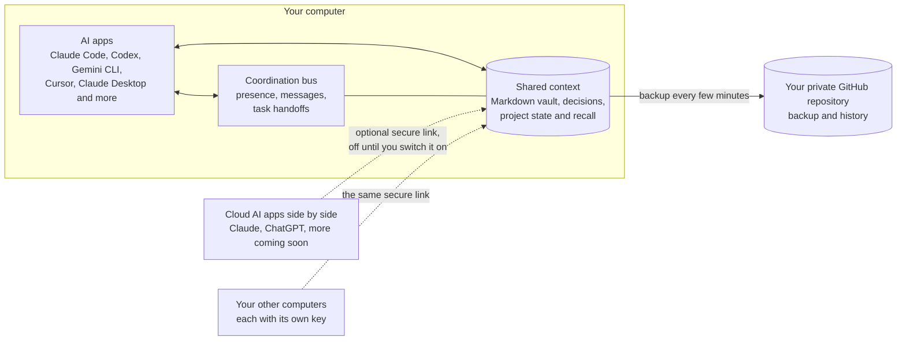
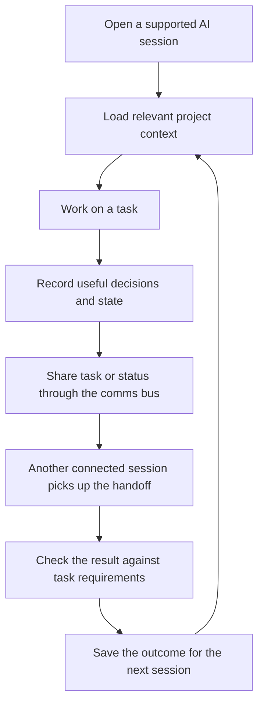

<div align="center">

<a href="media/memev-tiers.mp4"></a>

<sub><a href="media/memev-tiers.mp4">Watch the demo video</a> (4 min 55 s): how each tier works and how the tiers connect.</sub>

<h1>Memev</h1>

<p><strong>The infrastructure that turns an organisation's individual AI systems into one collective intelligence.</strong><br>
From a single computer to a global enterprise. From isolated intelligence to coordinated organisational reasoning.</p>

<p>


</p>

<p>
<code>npm install -g . && memev init</code>
</p>

<p>
<a href="docs/QUICKSTART.md">Quickstart</a> &middot;
<a href="docs/README.md">Documentation</a> &middot;
<a href="docs/ARCHITECTURE.md">Architecture</a> &middot;
<a href="docs/tiers/README.md">Tiers</a> &middot;
<a href="docs/PRICING.md">Pricing</a> &middot;
<a href="CHANGELOG.md">Changelog</a>
</p>

</div>

## What Memev is

Organisations are adopting AI in many places at once: individual employees, departments, business applications, internal platforms and external providers. Those systems often work in isolation. They have different context, different permissions and different views of the organisation. A decision in one department may never reach the systems that need it elsewhere; agents can duplicate work, contradict one another or act on stale assumptions.

**Memev is being built as the organisational intelligence layer that connects those systems.** It is intended to let an organisation's AI systems share authorised context, establish a consistent view of important state, reason across departmental boundaries and coordinate work — while each system keeps its specialist model, tools and responsibilities.

The ambition scales from several AI tools on one computer, to many computers in one office, multiple departments, offices in different countries and, ultimately, independent organisations. The number and location of connected systems should not fragment the organisation's collective intelligence.

This is the product direction, not a claim that the full organisational platform ships today. The current product is the **Free Core**: a complete, local-first foundation for one person on one computer, connecting supported AI apps through shared context, a coordination bus and work contracts. Multi-user company operation, cross-office federation and organisation-wide reasoning are planned extensions. The boundary between what exists and what is planned is explicit below and in the [architecture](docs/ARCHITECTURE.md).

The architecture is built around several connected responsibilities:

- **Connectivity:** connect existing AI clients, agents, business systems and services rather than replacing them.
- **Shared organisational state:** make authorised information, decisions, relationships and operational context available where it is needed.
- **Coordination:** let connected AI systems discover peers, exchange messages, hand off work and coordinate dependencies.
- **Consensus and conflict handling:** distinguish agreed state from uncertainty or disagreement; preserve evidence and authority rather than forcing superficial agreement.
- **Trust and control:** enforce identity, scope, delegated authority, provenance and policy at the relevant boundaries.
- **Verification:** retain the work specification, evidence and checks needed to distinguish a reported result from an accepted one.

Memev is provider-neutral in its direction: it should connect the AI systems and business applications an organisation already chooses. It is not intended to be another chat interface, project-management suite, model provider or agent runtime.

Federation and cross-organisation operation are planned, not shipped. The decisions behind the plans are recorded in [docs/scope-one/DECISIONS.md](docs/scope-one/DECISIONS.md), and their relationship to the work breakdown is in [docs/scope-one/RECONCILIATION.md](docs/scope-one/RECONCILIATION.md).

## Who it is for

| If you are | What is available or planned | Why it matters |
|---|---|---|
| One person using several AI tools | **Free Core, available now:** one local vault shared by supported AI apps, with recall, graph, hooks, contracts, communications bus, doctor and GitHub backup | Your tools can work from the same durable context instead of starting from separate silos |
| A developer building AI systems | **Free Core, available now:** local MCP integration, agent communications primitives and signed work contracts | Build and test workflows on an inspectable foundation without a paid core licence |
| A team adopting AI across departments | **Business, planned:** a company environment, organisation-level identity and policy, shared organisational context and administration | Connect departmental AI without requiring every department to replace its existing tools |
| A large or regulated enterprise | **Corporate, planned:** private deployment, stronger identity and audit integrations, with controlled organisational boundaries | Extend the same architecture across business units and operating environments |
| An organisation with several offices or countries | **Multi-site federation, planned:** independently operated nodes and authorised exchange of state and computation | Extend organisational intelligence across locations while preserving local control |

## Plans by tier

The tier decision of 31 October 2026 is recorded in [docs/scope-one/DECISIONS.md](docs/scope-one/DECISIONS.md). There is no Federated tier: everything above Personal is a conversation.

| | Free (core) | Personal | Contact us |
|---|---|---|---|
| For | one person, one computer at a time | one person, up to 3 computers | teams, organisations, and sites that want to federate |
| Price | free, for good | $12/month or $120/year (CHF 10 or CHF 100), early-supporter price | contact us |
| What it includes | the whole core: vault, recall, graph, hooks, contracts, comms bus, doctor, GitHub backup, several cloud AI apps side by side | everything in Free, with the same vault on up to 3 computers over the secure link, priority support | scoped with you: see below |
| Trial | the free core is the trial | none | a Business trial and a sales-assisted pilot are planned ([docs/BUSINESS-TRIAL.md](docs/BUSINESS-TRIAL.md)) |
| Status | available now | available now for what exists today; merging, hosted sync, backup and relay are planned | planned, no dates |

The tier names in the app and the licence tooling today are Personal for the free core and Personal with more computers for the paid tier. [docs/PRICING.md](docs/PRICING.md) and [docs/tiers/README.md](docs/tiers/README.md) use those names and say what is built and what is planned for each. The free core is never limited ([CHARTER.md](CHARTER.md)).

## How it fits together

The target architecture connects an organisation's existing AI systems and business applications through a common infrastructure. It does not require one model, one agent framework or one centralised application to do everything.

At the organisational scale, Memev is intended to provide:

- **Connections** to AI clients, agents, models, business applications and external services.
- **An organisational context and state layer** that makes authorised information and decisions available across departments.
- **Coordination and reasoning** so specialist systems can identify dependencies, exchange work and contribute to cross-functional outcomes.
- **Consensus, trust and verification** so shared state, authority, evidence and unresolved disagreement remain explicit.
- **Distributed operation** across computers, departments, offices and, eventually, independently operated organisations.

The diagram below shows the **Free Core deployment that exists today**, not the future multi-office architecture. The wider organisational and federation architecture is described in [docs/ARCHITECTURE.md](docs/ARCHITECTURE.md), [docs/ORGANISATIONAL-INTELLIGENCE.md](docs/ORGANISATIONAL-INTELLIGENCE.md) and [docs/FEDERATION.md](docs/FEDERATION.md).



## How the Free Core works today



The Free Core gives one person a shared local foundation across supported AI sessions. It provides durable project context, scoped recall, a communications bus for connected sessions, and work contracts with checks. It does not yet provide organisation-wide inference, cross-department consensus, multi-user company operation or multi-office federation; those are planned capabilities, not current Free Core features.

<p align="center">

</p>

## Install

You need Node 22 or newer and git. Every path below sets up the same thing: it creates your notes
folder, starts Memev, connects the AI apps it finds on your computer and runs a self-test. The
command at the top of this page installs Memev from this folder with npm; run it in a copy of this
repository. The rest of this section covers the other paths.

Memev runs on macOS and Linux. **Windows (preview):** setup, app connections, hooks and the doctor
have Windows code paths and tests, and a Windows job runs them on every change to `main`, but
Windows has not had a full lab run yet. Memev starts at login there through a per-user Task Scheduler
entry that `memev service install` creates. [docs/QUICKSTART.md](docs/QUICKSTART.md#windows-preview) says
what differs.

### All the install paths

| Path | Who it's for | What happens on its own |
|---|---|---|
| Ask your AI app to do it | anyone already using Claude Code, Codex, Gemini CLI or Cursor | the app downloads Memev and runs the setup; you read the checklist it shows you |
| One command in a download | anyone comfortable with a terminal | the same setup, run by you |
| npm, from a download | people who like a global `memev` command | the same, plus `memev` on your PATH |
| Docker | an always-on server or a home lab | Memev runs in a container; you connect apps by hand |
| `npx memev init` | everyone | coming soon (not on the npm registry yet) |
| One-line installer for macOS, Linux and Windows | everyone | coming soon |

To have your AI app do it, paste this into a session:

> Download the Memev repository, run `node bin/memev.mjs init` inside it, and show me the checklist
> it prints.

To do it yourself, run this in the folder you downloaded:

```sh
node bin/memev.mjs init
```

For a global `memev` command, run `npm install -g . && memev init` there instead. For Docker,
`docker compose up -d` builds the image on your machine; see [docs/DOCKER.md](docs/DOCKER.md).

After setup, two things may need you: one browser sign-in for the GitHub backup
(`memev github setup`), and a click in apps that ask before they trust a new tool. The checklist
says which. Details are in [docs/QUICKSTART.md](docs/QUICKSTART.md).

To see shared context working, run `memev ready` and open a new session in each app. It prints each
app as it joins, then confirms that connected apps share project context when one recalls something
another saved. For coordination, see [docs/BUS.md](docs/BUS.md); for defined work and verification,
see [docs/CONTRACTS.md](docs/CONTRACTS.md).

## Plans and roadmap

Every line below says whether it exists. Nothing in the second and third lists is available to use today.

### Available now

- The vault: Markdown notes in git, a checksummed log, project-aware recall, provenance and the entity graph. `memev import` brings in existing project folders, AI history and chat exports.
- MCP access for the supported AI apps, with hooks where an app supports them, and optional cloud AI connectors over a secure link.
- The communications bus: seats, roster, heartbeats, communications checks, task handoffs and holds.
- Work contracts with signed, immutable specs and checks that run through `memev verify`.
- Device keys, a licence checked offline, and the computer limit.
- Backup to your own private GitHub repository.
- The call-out boundary to a separately licensed convergence engine (WO-05-A, [docs/CONVERGENCE.md](docs/CONVERGENCE.md)). The engine itself is not in this repository and no released Memev merges through it yet.

### In progress

- The project engine: the project store, the project state machine and the coordinator are merged and tested, and are being wired into one execution path. Tracked in the Scope One work breakdown (pull request #324) and in [docs/scope-one/RECONCILIATION.md](docs/scope-one/RECONCILIATION.md).
- The paid-engine client behind a flag, off by default (pull request #201), with the trial licence and entitlement work (#154, #163, #177).
- Correctness fixes in the crdt-merge engine itself, in its own repository.
- The programme decomposition of the wider plan, as proposed and unsigned contracts: [docs/scope-one/programme/README.md](docs/scope-one/programme/README.md).
- Documentation and tier alignment to the owner decisions of 31 October 2026.

### Planned

- Automatic merging when several computers edit one vault at once, through crdt-merge (Personal).
- Hosted end-to-end encrypted sync, hosted encrypted backup and a stable relay address.
- A company vault with an admin console, one AI provider per organisation, sign-in with Google Workspace or Microsoft Entra ID, roles, an egress log, and a Business trial.
- A single replicated event model across the log, the bus and project state, and evidence receipts for accepted work.
- Federation across independent sites. It is specified in [docs/FEDERATION.md](docs/FEDERATION.md) and is being built in the SO-F contracts, one part at a time. It is not available in any release.

## What you get in the Free Core

The Free Core is the complete core product for one person on one computer at a time. It is free for good, not a time-limited trial or a feature-restricted demo. It includes the capabilities that work today, and those capabilities will not be removed, capped, slowed or put behind a payment prompt. See the [Memev Charter](CHARTER.md).

### Shared context

Your project knowledge lives as plain Markdown in `~/memev`, kept in git. Every change is written to a checksummed log first. Claude Code, Codex, Gemini CLI, Cursor, Claude Desktop, Windsurf, VS Code and Zed can use the same notes, and cloud AI apps such as Claude and ChatGPT can connect side by side through the optional secure link. Session resume cards, project-aware recall, provenance and the graph help connected tools pick up relevant context instead of starting from scratch. To start with what you have already worked on, `memev import` reads project folders, AI history files, and chat export zips, previews what it found, and writes tagged, undoable notes with no model or network calls ([docs/IMPORT.md](docs/IMPORT.md)). See [docs/DESIGN.md](docs/DESIGN.md) and [docs/CLIENTS.md](docs/CLIENTS.md).

### Coordination between connected sessions

Each connected app gets a seat on Memev's communications bus, joins the roster and reports a heartbeat. From one session, you can see which peers are present, run a communications check, hand out tasks and put an app on hold. The bus gives supported agents a shared coordination channel; the exact execution of a handoff depends on the connected client and workflow. See [docs/BUS.md](docs/BUS.md).

### Defined work and verification

Work contracts let you record the task, expected deliverables, acceptance criteria and stop conditions. Where checks are run, their outcomes and receipts can be retained alongside the work. This makes it possible to distinguish a task being assigned from evidence that its requirements were met. See [docs/CONTRACTS.md](docs/CONTRACTS.md).

### Trust and control

You can inspect what Memev holds. `memev why` shows why a note came back, and `memev audit` lists junk and stale notes. Notes from one project are scoped away from another, and notes in Chinese, Japanese, Korean, Cyrillic, Greek or Arabic are searchable like any other. The vault stays on your computer and can be backed up to your own private GitHub repository. Cloud access is optional and off until you enable it; when you connect a cloud AI provider, that provider's own data handling still applies. Memev has no telemetry by default. The anonymous milestone report is off unless you turn it on with `memev report on`, and `memev report show` prints exactly what it would send ([docs/METRICS.md](docs/METRICS.md)).

## Documentation

Everything is indexed in [docs/README.md](docs/README.md), from this page down to each module and back
up. The main pages:

| | |
|---|---|
| [Quickstart](docs/QUICKSTART.md) | install, first session, everyday commands |
| [Architecture](docs/ARCHITECTURE.md) | what runs today, and the Personal, Business and Corporate charts |
| [Module map](docs/MODULES.md) | every module and what imports what, generated from the code |
| [AI apps](docs/CLIENTS.md) | what is changed in each app, hooks vs instructions, undoing it |
| [Cloud access](docs/CLOUD.md) | the secure link, connector URLs, other computers, turning it on |
| [Comms bus](docs/BUS.md) | how your AI apps talk to each other, the roster and comms checks |
| [Set up your office](docs/OFFICE.md) | one vault, inviting teammates, the lead, the roster and what is shared |
| [GitHub backup](docs/GITHUB.md) | `memev github setup` |
| [Docker](docs/DOCKER.md) | running Memev in a container |
| [Tiers and setup](docs/tiers/README.md) | Free core, Personal, and the contact-us tiers, and the services around them (draft) |
| [The paid core: crdt-merge](docs/CONVERGENCE.md) | what is open, what is paid, what passes between an install and us |
| [Pricing (draft)](docs/PRICING.md) | the Personal price; everything above on request; the computer limit |
| [Decisions](docs/scope-one/DECISIONS.md) | the owner decisions on the engine and the tiers |
| [Reconciliation](docs/scope-one/RECONCILIATION.md) | how the plans line up with the Scope One work breakdown |
| [Problems and solutions](docs/SOLUTIONS.md) | what users complain about and what Memev does about it |
| [Contracts](docs/CONTRACTS.md) | signed, immutable work contracts |
| [Troubleshooting](docs/TROUBLESHOOTING.md) | `memev doctor` and common fixes |
| [Lab test plan](docs/testing/LAB-TEST-PLAN.md) | every test to run in a lab before a release, with expected results |
| [Security](SECURITY.md) and [threat model](docs/THREAT-MODEL.md) | |
| [Charter](CHARTER.md) | the free tier is never limited |
| [Design](docs/DESIGN.md) | log, index, graph, recall, scale |
| [Hands-off runtime](docs/MAPPING.md) | everything Memev does without being asked |
| [Developing Memev](docs/DEVELOPING.md) | tests, the leak scan, changelog notes, regenerating the module map |

## For developers

Memev is a local MCP server and coordination layer built around a Markdown vault. Each session starts with a resume card, supported prompts can receive relevant project context (in apps with hooks), and state is saved before a compaction. The same core exposes the communications bus and work-contract mechanisms, bringing context, coordination and verification into one project workflow.
The graph holds entities, links and claims with a status (fact, theory, conjecture) and provenance.
Recall is BM25 over note sections, filtered by project and permissions before ranking. Node 22,
nothing else. See [docs/DESIGN.md](docs/DESIGN.md), the [module map](docs/MODULES.md) and
[docs/DEVELOPING.md](docs/DEVELOPING.md).

## Licensing

- **Memev core: Apache-2.0.** The code in this repository is Apache-2.0 and stays that way. It includes a modified copy of Proofline (Apache-2.0); see [NOTICE](NOTICE).
- **crdt-merge: BSL 1.1, separately licensed.** The convergence engine is a separate project in its own repository, licensed under the Business Source License 1.1 by its licensor, and it carries patents (see its PATENTS file). It is never copied or vendored into Memev. Memev reaches it only across the provider boundary, so including it can never relicense it. Its change date to Apache-2.0 is 2028-03-29; a lawyer review of that date is an open item.
- **Commercial terms:** anything beyond the free core and Personal, including federated services, is agreed through contact us.

See [docs/LICENSING-NOTICE.md](docs/LICENSING-NOTICE.md), [docs/CONVERGENCE.md](docs/CONVERGENCE.md) and [docs/PRICING.md](docs/PRICING.md).
