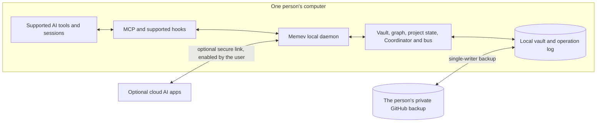
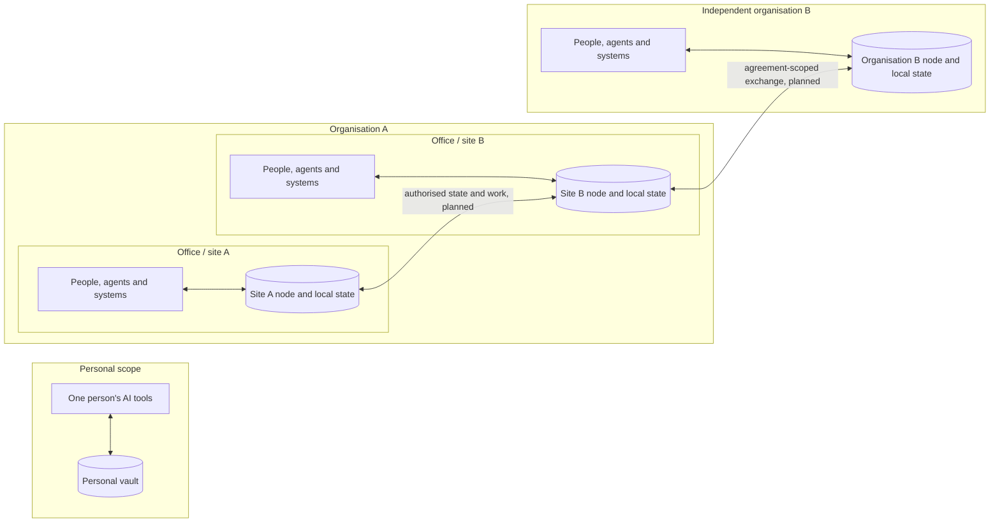
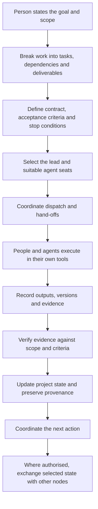

<div align="center">

<a href="media/memev-tiers.mp4"></a>

<sub><a href="media/memev-tiers.mp4">Watch the demo video</a> (4 min 55 s): how each tier works and how the tiers connect.</sub>

<h1>Memev</h1>

<p><strong>The infrastructure for collective intelligence across people, AI systems and organisations.</strong><br>
From one person's AI tools to multi-office enterprises and independent organisations working together.</p>

<p>


</p>

<p><strong>Closed preview — invite only.</strong> The repository is private and the npm package is not published. You need repository access and the clone URL supplied by the Memev maintainer before you can install.</p>

<p>
<code>npm install -g . && memev init</code>
</p>

<p>
<a href="docs/QUICKSTART.md">Quickstart</a> &middot;
<a href="docs/FREE-CORE-PREVIEW.md">Free Core Preview</a> &middot;
<a href="docs/KNOWN-ISSUES.md">Known Issues</a> &middot;
<a href="docs/README.md">Documentation</a> &middot;
<a href="docs/ARCHITECTURE.md">Architecture</a> &middot;
<a href="docs/tiers/README.md">Tiers</a> &middot;
<a href="docs/PRICING.md">Pricing</a> &middot;
<a href="CHANGELOG.md">Changelog</a>
</p>

</div>

## What Memev is

Organisations are adopting AI across individuals, teams, departments, business applications and external providers. But adding more AI systems does not automatically make an organisation more intelligent. Each system can hold a different picture of the work. Decisions become detached from execution, dependencies are missed, effort is duplicated and nobody has a reliable view of what has actually been agreed, completed or verified.

**Memev is the connective operating infrastructure that lets those systems contribute to a shared, governed picture of work.** It connects people, AI applications, agents, projects, programmes, business systems and, in the planned architecture, independently operated sites and organisations. The systems keep their specialist models and tools. Memev supplies the shared state, coordination, authority and evidence that allow their work to fit together.

The local vault is a foundation, not the product boundary. The product is the wider system built around it: a structured model of work, a communications and hand-off layer, a project state machine, a lead-agent and coordination model, contracts, verification, identity, trust, policy, convergence and federation.

### The capabilities that work together

- **Connect.** Bring supported AI clients and agents into the same working environment. Connectors for additional agent frameworks, business applications and external systems are part of the planned integration programme.
- **Understand the work.** Relate people, agents, teams, projects, programmes, portfolios, tasks, requirements, decisions, artefacts, dependencies, risks and commitments. The intended model follows work and its relationships, not just conversations or files.
- **Share authorised state.** Give each connected participant the context and project records it is permitted to use, with source, version and provenance retained. Personal and organisational scopes remain separate.
- **Coordinate execution.** Let a person choose a lead AI, see connected seats, exchange messages, hand work between agents and manage task state. The local ProjectStore and Coordinator provide claims, leases, dispatch control, recovery and lifecycle rules; agents and people execute in their own tools.
- **Govern authority and access.** Bind actions to identities, scopes, credentials, permissions and policy. At larger scales, the design adds site relationships, data classifications, jurisdiction rules and explicit trust between independent participants.
- **Verify outcomes.** Define obligations and acceptance criteria in work contracts. Bind evidence to the relevant scope and artefact. Keep requested, accepted, observed and verified work distinct. A completion message is not proof, and a converged record is not automatically a true or authorised decision.
- **Converge and federate.** The architecture is designed to reconcile supported structured state across computers and independently operated nodes without asking a language model to choose which record wins. The separate crdt-merge engine is reached through a defined provider boundary. Multi-writer convergence and operational federation are not shipped in the current Free Core.

### What collective intelligence means here

Collective intelligence is not one large model, a shared chat room or a central database containing everything. It is the result of many specialist systems and people working against a connected, permission-aware view of the work, while retaining their own tools, responsibilities and control.

A change made in one project can matter somewhere else. A decision can affect a dependency, a delivery commitment, a supplier, a risk or a programme milestone. Memev's intended organisational intelligence layer will connect those relationships, identify possible downstream effects, show the evidence and uncertainty, and route the necessary decision to an authorised person. It must not turn an inference into an accepted fact or silently change an approved commitment.

For example, a battery-system project may change a module's dimensions or thermal limits while a separate mechanical integration project still relies on the previous interface. Procurement, installation and programme milestones may also depend on that earlier specification. The intended Memev workflow is to identify the changed source and version, surface affected work and its owners, show why the dependency may matter, mark affected work for review and route a decision. The source records remain attributable and the approved state changes only through the authorised process.

**That cross-project discovery is a planned capability, not a feature available in this preview.** The local graph and finding model provide foundations, but automatic discovery, impact analysis and decision routing still require implementation and end-to-end validation.

### One architecture, increasing reach

The same principles are intended to apply at each scale:

1. **One person:** several AI tools share one person's project context and coordinate on one computer.
2. **One office:** a company connects its people and AI systems to one governed company environment and a shared view of company work.
3. **Many offices and countries:** independently operated site nodes exchange the state they are authorised to share, with local policy, ownership and continuity.
4. **Independent enterprises:** customers, suppliers, contractors, partners or research organisations coordinate selected work under explicit agreements without merging their private organisational records.

The first level is the current Free Core. The larger organisational and federated levels are the product direction and are labelled as planned below. See [Architecture](docs/ARCHITECTURE.md), [Organisational intelligence](docs/ORGANISATIONAL-INTELLIGENCE.md), [Federation](docs/FEDERATION.md) and [Data sovereignty](docs/DATA-SOVEREIGNTY.md).

## Who it is for

Memev is designed to grow with the scope of work being coordinated. The Free Core is useful on its own; business and federation capabilities extend the same architecture rather than replacing the individual product.

| Scope | What Memev is intended to provide | Availability |
|---|---|---|
| **Individual professional or developer** | Supported AI tools share one person's project context, local state, communications bus and governed task workflow | Free Core, one person on one computer; closed preview |
| **AI and agent developers** | An inspectable MCP and coordination foundation for connecting tools, recording project state, defining work and checking outcomes | Free Core capabilities in closed preview; broader adapters planned |
| **One-office business** | One company environment for members, AI systems and company projects, with shared organisational context, identity, administration and policy | Business, planned |
| **Multi-office or international organisation** | Coordination across departments, sites and countries, with local ownership, controlled replication, jurisdiction-aware policy and continuity during network partitions | Corporate and agreed multi-site services, planned |
| **Independent enterprises working together** | A governed connection between separate organisations for a shared programme, project, supply chain, delivery or research effort. Each organisation retains its own identity, data, operators and policies; only agreed information and work cross the boundary | Cross-organisation federation under a Business or Corporate agreement, planned |

A small team can start with each person using the Free Core independently. That is not yet a shared company workspace. Business is the planned step that introduces one company environment and administration; multi-site and cross-enterprise operation add separate trust and sovereignty boundaries.

## Plans by tier

The tier decision of 31 October 2026 is recorded in [docs/scope-one/DECISIONS.md](docs/scope-one/DECISIONS.md). There is no separate Federated tier. Federation is a planned service capability agreed within Business or Corporate scope, not another self-serve plan.

| | Free Core | Personal with more computers | Business | Corporate |
|---|---|---|---|---|
| **Scope** | One person, one computer at a time | One person, up to 3 computers | One organisation; first release is one company node and vault | One large organisation, with multi-site and jurisdictional requirements |
| **Price** | Free, for good | $12/month or $120/year (CHF 10 or CHF 100), early-supporter price | Contact us | Contact us |
| **Includes** | The complete local core: vault, recall, graph, supported AI integrations, hooks, contracts, project state, Coordinator, evidence-backed task lifecycle, communications bus, diagnostics and GitHub backup | Free Core on the person's additional computers over the secure link, with device credentials and priority support | Planned company environment, member identity, shared company vault, administration, policy and support | Planned controlled deployment, stronger identity and audit integration, and the multi-site architecture |
| **Status** | Closed preview, invite only | Paid multi-computer capability for current supported use; simultaneous multi-writer convergence remains planned | Planned; not available to buy today | Planned; not available to buy today |

The names in the application and licence tooling are Personal for the free core and Personal with more computers for the paid tier. [docs/PRICING.md](docs/PRICING.md) and [docs/tiers/README.md](docs/tiers/README.md) explain the current names and boundaries. The Free Core remains free for good under the [Memev Charter](CHARTER.md).

### Federation is a service scope, not a separate tier

A Business or Corporate agreement may include a multi-site federation design or cross-organisation collaboration once those capabilities are built and validated. The scope is defined by the participating organisations, nodes, trust relationships, jurisdictions, data classes, workloads, governance and support requirements. It is not priced as a simple extra computer or a generic sixth tier.

This distinction is deliberate:

- **Business, one node:** the first company deployment is one company vault. Members' company work is shared into that environment under the company's rules; personal vaults remain separate.
- **Business with several sites / Corporate:** sites can operate their own nodes and exchange permitted state under an agreed federation design. Corporate adds the stronger deployment and governance requirements of a large organisation.
- **Independent organisations:** each enterprise keeps its own node, operator, identity, policy and source records. A bilateral or multi-party agreement defines exactly what can be discovered, read, replicated, computed, retained or exported.

These are planned capabilities. The existence of a tier name, service description, schema or signed contract does not mean a complete operational service is available. See [Federation](docs/FEDERATION.md), [Data sovereignty](docs/DATA-SOVEREIGNTY.md), [Federated computation](docs/FEDERATED-COMPUTATION.md) and [pricing](docs/PRICING.md).

## How it fits together

Memev has a local foundation today and a wider distributed architecture as its target. The two should not be confused.

### The Free Core running today

The current Free Core runs as a local service around one person's vault. Supported AI applications connect through MCP and hooks. The daemon, local project engine, vault, graph and communications bus provide the shared working environment. Optional remote access and GitHub backup are under the operator's control.



This is the current single-person deployment, not a company or federation diagram.

### The intended organisational and federated architecture

At organisational scale, Memev is intended to connect the work of many people and AI systems without requiring one model, one agent framework or one central memory service to own everything.



The personal vault does not silently become part of a company vault. A company can begin with one node. A multi-site organisation can add independently operated site nodes. Independent enterprises can establish a separate relationship for a defined programme or workload. In each case, the receiving node checks identity, relationship, scope and policy before accepting a contribution.

The target is not unrestricted replication. It is **controlled participation**: source ownership stays visible, local policy remains authoritative, and each participant shares only the state or computation it has agreed to share. A regional service may assist with discovery or routing, but the federation design does not make one central coordinator the owner of every site's memory or the sequencer of ordinary updates.

The organisational and federated diagrams describe planned deployment models. They are not available in the current release. See [Architecture](docs/ARCHITECTURE.md) and [Federation](docs/FEDERATION.md).

## How governed work moves through Memev

A project workflow is more than a prompt followed by an agent's claim that it is done. Memev's local project engine provides the structure for work to move through defined states, with contracts and evidence keeping the result accountable.



The local ProjectStore and Coordinator enforce task transitions, dependencies, claims, leases, dispatch control and recovery. Contracts define what is required. Verification binds evidence to the relevant scope and artefact; operator acceptance remains a separate decision. The communications bus gives connected sessions a way to exchange status and hand-offs. The exact execution of a hand-off still depends on the connected client and workflow.

At larger scales, the same discipline is intended to extend across teams and sites: a change is attributable to its source, dependent work can be identified, permissions are checked at the boundary, and an unresolved semantic conflict is surfaced rather than silently overwritten. Cross-project discovery and cross-node workflows remain planned.

Shared context is one visible example of the foundation, not the whole product:

<p align="center">

</p>

## Install

You need Node 22 or newer and git. Every path below sets up the same thing: it creates your notes
folder, starts Memev, connects the AI apps it finds on your computer and runs a self-test. The
command at the top of this page installs Memev from this folder with npm; run it in a copy of this
repository. The rest of this section covers the other paths.

Memev runs on macOS and Linux. **Windows (preview):** setup, app connections, hooks and the doctor
have Windows code paths and tests, and a Windows job runs them on every change to `main`, but
Windows has not had a full lab run yet. Memev starts at login there through a per-user Task Scheduler
entry that `memev service install` creates. [docs/QUICKSTART.md](docs/QUICKSTART.md#windows-preview) says
what differs.

### All the install paths

| Path | Who it's for | What happens on its own |
|---|---|---|
| Ask your AI app to do it | invited testers who have access to the private repository and already use Claude Code, Codex, Gemini CLI or Cursor | the app clones the repository URL supplied with the invitation and runs setup; you read the checklist it shows you |
| One command in a download | invited testers with repository access and a terminal | the same setup, run by you |
| npm, from a download | people who like a global `memev` command | the same, plus `memev` on your PATH |
| Docker | an always-on server or a home lab | Memev runs in a container; you connect apps by hand |
| `npx memev init` | everyone | coming soon (not on the npm registry yet) |
| One-line installer for macOS, Linux and Windows | everyone | coming soon |

To have your AI app do it, paste this into a session:

> Clone the private Memev repository using the URL supplied with my preview invitation, run `node bin/memev.mjs init` inside it, and show me the checklist it prints.

To do it yourself, run this in the folder you downloaded:

```sh
node bin/memev.mjs init
```

For a global `memev` command, run `npm install -g . && memev init` there instead. For Docker,
`docker compose up -d` builds the image on your machine; see [docs/DOCKER.md](docs/DOCKER.md).

After setup, two things may need you: one browser sign-in for the GitHub backup
(`memev github setup`), and a click in apps that ask before they trust a new tool. If an AI ran init
without a terminal, the first fresh session also asks which connected AI should lead; choose once
and Memev records it. The checklist says which. Details are in [docs/QUICKSTART.md](docs/QUICKSTART.md).

To see shared context working, run `memev ready` and open a new session in each app. It prints each
app as it joins, then confirms that connected apps share project context when one recalls something
another saved. For coordination, see [docs/BUS.md](docs/BUS.md); for defined work and verification,
see [docs/CONTRACTS.md](docs/CONTRACTS.md).

## Plans and roadmap

The product vision is broader than the current preview. The status below separates implemented local capabilities, work still being integrated and the organisational architecture that remains planned. A signed contract or a documented schema is not, by itself, a shipped feature.

### Available in the current local foundation

- **Durable project records:** Markdown vault, checksummed operation log, git history, project-aware recall, provenance and the local entity graph. `memev import` can bring in project folders, AI history and chat exports.
- **Supported AI connectivity:** MCP access for supported applications, hooks where a client supports them, and optional cloud AI connectors over a secure link.
- **Agent coordination:** communications-bus seats, roster, heartbeats, messages, communications checks, task hand-offs and holds. The person chooses the lead; Memev does not silently appoint one.
- **Local project lifecycle:** ProjectStore, task state machine and Coordinator, including claims, leases, dispatch control, recovery and evidence-bound verification. The broader workspace UI and some end-to-end integrations remain in progress.
- **Defined and checked work:** signed work specifications, acceptance criteria, stop conditions and checks through `memev verify`.
- **Identity and operator control:** device credentials, offline licence checks, optional remote access and backup to the operator's own private GitHub repository.
- **Federation foundations only:** contribution validation, local admission, relationship records and deny-by-default policy evaluation have code and tests. They are not connected to an inter-node transport or an operational federation service.
- **A separate convergence boundary:** the call-out boundary to crdt-merge exists. The engine is in its own repository and no released Memev build currently merges through it.

### In progress

- Completing the persistent project workspace and end-to-end user journey around the local project engine, including the lead area, plans, architecture views, decisions, blockers, artefacts and recovery paths.
- Completing the secure single-writer behaviour around the vault daemon and CLI.
- Completing the paid-engine client, licence validation and entitlement paths. The client is behind a flag and off by default; multi-writer convergence is not enabled in the Free Core.
- Resolving the remaining signed-contract implementation gaps, independent review and release checks.
- Completing the invited preview's automated known-issues inventory and 72-hour Free Core soak before any wider release.

### Planned organisational capabilities

- **Business, one office:** one company vault and server, member identity, administration, roles, provider policy, data labels and an egress record.
- **Corporate and multi-site operation:** independently operated site nodes, scoped relationships, controlled replication, local policy, jurisdiction-aware data handling, partition tolerance and tested recovery.
- **Organisational intelligence:** a canonical work graph across people, projects, programmes, portfolios, artefacts, decisions and commitments; permission-aware retrieval; cross-project and cross-functional impact discovery with evidence and measurable accuracy.
- **External-enterprise federation:** explicit trust and agreements between independent organisations, scoped exchange of work and evidence, and clear ownership at every boundary.
- **Federated computation:** authorised parallel work, analytics, optimisation, model evaluation and, where separately designed and validated, federated learning. Data-local execution is not automatically a privacy guarantee.
- **Broader integrations:** agent frameworks, software delivery systems, business communication tools and enterprise systems through explicit adapters and data contracts.

These capabilities are specified in the architecture and work programme, but they are not available in this preview. Follow delivery status through [Scope One reconciliation](docs/scope-one/RECONCILIATION.md), the [work breakdown](docs/scope-one/WBS.md) and the relevant architecture pages.

## What you get in the Free Core

The Free Core is the complete core product for one person on one computer at a time. It is free for good, not a time-limited trial or a feature-restricted demo. It includes the capabilities that work today, and those capabilities will not be removed, capped, slowed or put behind a payment prompt. See the [Memev Charter](CHARTER.md).

### Governed work and verification

Work contracts define obligations, deliverables, acceptance criteria and stop conditions. The
ProjectStore and Coordinator retain project and task state, dependencies, claims, leases, dispatch
and recovery. Evidence is checked against the task's scope and artifact; a completion report alone
does not make work verified, and verification is not the same as operator acceptance. See
[docs/PROJECTS.md](docs/PROJECTS.md) and [docs/CONTRACTS.md](docs/CONTRACTS.md).

### Coordination between connected people and agents

Each connected app gets a seat on Memev's communications bus, joins the roster and reports a
heartbeat. From one session, you can see which peers are present, run a communications check, hand
out tasks and put an app on hold. The bus gives supported agents a shared coordination channel;
the exact execution of a handoff depends on the connected client and workflow. See
[docs/BUS.md](docs/BUS.md).

### Shared project state and provenance

Project records, decisions and knowledge live as inspectable Markdown in `~/memev`, backed by a
checksummed log and git history. Claude Code, Codex, Gemini CLI, Cursor, Claude Desktop, Windsurf,
VS Code and Zed can use the same authorised records, and cloud AI apps such as Claude and ChatGPT
can connect side by side through the optional secure link. Session resume cards, project-aware
recall, provenance and the graph help connected tools use relevant context rather than starting
from scratch. `memev import` can preview project folders, AI history files and chat exports before
writing tagged, undoable records with no model or network calls ([docs/IMPORT.md](docs/IMPORT.md)).
See [docs/DESIGN.md](docs/DESIGN.md) and [docs/CLIENTS.md](docs/CLIENTS.md).

### Sovereignty and operator control

The vault stays on your computer and can be backed up to your own private GitHub repository.
Cloud access is optional and off until you enable it; when you connect a cloud AI provider, that
provider's own data handling still applies. Memev has no telemetry by default. The anonymous
milestone report is off unless you turn it on with `memev report on`, and `memev report show`
prints exactly what it would send ([docs/METRICS.md](docs/METRICS.md)). `memev why` and
`memev audit` let you inspect the supporting knowledge and provenance layer.

## Documentation

Everything is indexed in [docs/README.md](docs/README.md), from this page down to each module and back
up. The main pages:

| | |
|---|---|
| [Quickstart](docs/QUICKSTART.md) | install, first session, everyday commands |
| [Architecture](docs/ARCHITECTURE.md) | what runs today, and the Personal, Business and Corporate charts |
| [Module map](docs/MODULES.md) | every module and what imports what, generated from the code |
| [AI apps](docs/CLIENTS.md) | what is changed in each app, hooks vs instructions, undoing it |
| [Cloud access](docs/CLOUD.md) | the secure link, connector URLs, other computers, turning it on |
| [Comms bus](docs/BUS.md) | how your AI apps talk to each other, the roster and comms checks |
| [Set up your office](docs/OFFICE.md) | one vault, inviting teammates, the lead, the roster and what is shared |
| [GitHub backup](docs/GITHUB.md) | `memev github setup` |
| [Docker](docs/DOCKER.md) | running Memev in a container |
| [Tiers and setup](docs/tiers/README.md) | Free core, Personal, and the contact-us tiers, and the services around them (draft) |
| [The paid core: crdt-merge](docs/CONVERGENCE.md) | what is open, what is paid, what passes between an install and us |
| [Pricing (draft)](docs/PRICING.md) | the Personal price; everything above on request; the computer limit |
| [Decisions](docs/scope-one/DECISIONS.md) | the owner decisions on the engine and the tiers |
| [Reconciliation](docs/scope-one/RECONCILIATION.md) | how the plans line up with the Scope One work breakdown |
| [Problems and solutions](docs/SOLUTIONS.md) | what users complain about and what Memev does about it |
| [Contracts](docs/CONTRACTS.md) | signed, immutable work contracts |
| [Troubleshooting](docs/TROUBLESHOOTING.md) | `memev doctor` and common fixes |
| [Lab test plan](docs/testing/LAB-TEST-PLAN.md) | every test to run in a lab before a release, with expected results |
| [Security](SECURITY.md) and [threat model](docs/THREAT-MODEL.md) | |
| [Charter](CHARTER.md) | the free tier is never limited |
| [Design](docs/DESIGN.md) | log, index, graph, recall, scale |
| [Hands-off runtime](docs/MAPPING.md) | everything Memev does without being asked |
| [Developing Memev](docs/DEVELOPING.md) | tests, the leak scan, changelog notes, regenerating the module map |

## For developers

Memev is local-first operating infrastructure for human and AI work, exposed through MCP and
supported hooks. It combines shared project state, a coordination bus, work contracts and
verification with an inspectable local record substrate. The ProjectStore and Coordinator govern
task lifecycle, claims, leases, dispatch and recovery; agents and people execute work in their own
tools. The vault preserves project records, entities, links, claims and provenance. Recall is BM25
over note sections, filtered by project and permissions before ranking. Node 22, no runtime
dependencies. See [docs/ARCHITECTURE.md](docs/ARCHITECTURE.md), [docs/PROJECTS.md](docs/PROJECTS.md),
the [module map](docs/MODULES.md) and [docs/DEVELOPING.md](docs/DEVELOPING.md).

## Licensing

- **Memev core: Apache-2.0.** The code in this repository is Apache-2.0 and stays that way. It includes a modified copy of Proofline (Apache-2.0); see [NOTICE](NOTICE).
- **crdt-merge: BSL 1.1, separately licensed.** The convergence engine is a separate project in its own repository, licensed under the Business Source License 1.1 by its licensor, and it carries patents (see its PATENTS file). It is never copied or vendored into Memev. Memev reaches it only across the provider boundary, so including it can never relicense it. Its change date to Apache-2.0 is 2028-03-29; a lawyer review of that date is an open item.
- **Commercial terms:** anything beyond the free core and Personal, including federated services, is agreed through contact us.

See [docs/LICENSING-NOTICE.md](docs/LICENSING-NOTICE.md), [docs/CONVERGENCE.md](docs/CONVERGENCE.md) and [docs/PRICING.md](docs/PRICING.md).
