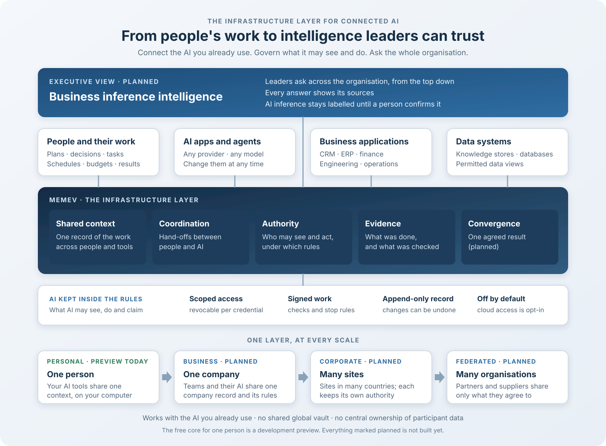
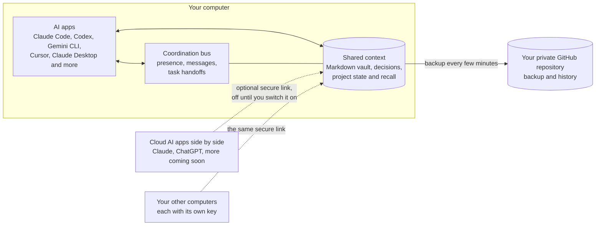
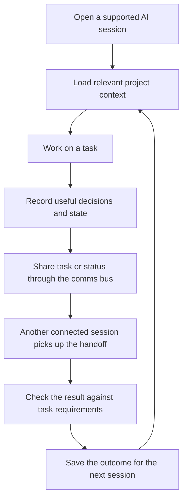

<div align="center">

<a href="media/memev-tiers.mp4"></a>

<sub><a href="media/memev-tiers.mp4">Watch the demo video</a> (4 min 55 s): how each tier works and how the tiers connect.</sub>

<h1>Memev</h1>

<p><strong>The connective infrastructure for AI.</strong><br>
Connect the work. Share context. Coordinate intelligence.</p>

<p align="center">

</p>

<p><strong>Memev is the connective infrastructure for AI.</strong> It enables individuals, teams and organisations to connect their AI providers, memory systems, agents, services, people and machines through shared communications, context and federated infrastructure.</p>

<p>It starts as a valuable free personal product, grows through teams and enterprise deployments, and extends through the Federated tier to connect independent organisations and the wider systems on which industries depend.</p>

<p>


</p>

<p>
<code>npm install -g . && memev init</code>
</p>

<p>
<a href="docs/QUICKSTART.md">Quickstart</a> &middot;
<a href="docs/README.md">Documentation</a> &middot;
<a href="docs/ARCHITECTURE.md">Architecture</a> &middot;
<a href="docs/tiers/README.md">Tiers</a> &middot;
<a href="docs/PRICING.md">Pricing</a> &middot;
<a href="CHANGELOG.md">Changelog</a>
</p>

</div>

## What Memev is, and why it matters

AI is spreading across personal tools, teams, departments and business systems. But the systems people choose often remain isolated: providers do not share the same context, agents cannot reliably communicate across environments, and useful knowledge is trapped in individual applications or machines.

**Memev connects that landscape.** It provides shared communications and context so authorised AI providers, memory systems, agents, services, people and machines can exchange information and coordinate without requiring everyone to use the same model, agent framework or business application. Memev works alongside those systems; it does not replace them.

The product has two equally important dimensions:

- **A valuable personal product from day one.** The Free Core gives an individual a practical local-first way to connect supported AI tools, preserve and retrieve context, and coordinate sessions. Personal use is not merely a trial of an enterprise product: it is a complete and worthwhile starting point.
- **An architecture that scales.** The same connective foundations are intended to extend across multiple computers, teams, departments, offices and organisations, with identity, permissions, provenance, policy and federation appropriate to each boundary.

Memev's own vault, context retrieval, communications bus and work-contract mechanisms are important parts of that foundation, but they are not the product boundary. The wider connector ecosystem is intended to include AI providers, external memory systems, agent platforms, collaboration tools, operational applications, data services and business-intelligence systems through provider-neutral interfaces. The planned connection registry covers discovery, configuration, identity, permissions, health and lifecycle, with consistent interfaces for reading, writing, searching, updating, handoffs and provenance. It connects the systems people use with the work they produce in them.

## From individual work to organisational intelligence

Memev is intended to connect not only the applications an organisation uses, but also the work its people and systems produce. Project plans, specifications, documents, decisions, tasks, schedules, budgets, procurement changes, operational updates, engineering artefacts and delivery commitments can contribute to the relevant personal, team, company or site vault. AI applications and agents are both participants in this process: they can contribute work and decisions, and retrieve the authorised context needed to continue or analyse that work.

The **Memev brain** is the evolving, evidence-linked understanding built from that authorised work. It relates people, departments, projects, programmes, portfolios, systems, decisions, requirements, milestones, dependencies, risks, changes and commitments. It is not simply a transcript store or a chatbot. The vault provides the governed information foundation; the graph, project state, provenance and shared context connect the information; connected AI and analytical systems apply inference to it.

The intended flow is:

1. **People and systems do the work** in the applications they already use.
2. **Memev captures or references authorised work** through integrations and adapters, preserving source identity, versions, provenance and applicable policy.
3. **The vault and shared context relate the work** across projects, teams and sites, subject to each participant's permissions and data-sovereignty rules.
4. **Authorised AI models, agents and business-intelligence systems analyse that context**, identify relationships and infer possible downstream effects.
5. **People receive an organisation-wide view** of project and programme state, cross-functional clashes, dependencies, emerging risks, decisions required and recommended actions, with evidence and accountable owners.

For example, imagine five offices working on one international programme. An engineering team changes a component specification; procurement in another office is still ordering against the previous version; manufacturing has scheduled around the old dimensions; finance has forecast the old cost; and the programme office is reporting the original delivery date. Memev's intended organisational-intelligence layer would relate those authorised work records, identify the potential clash and trace its effects across procurement, manufacturing, cost and delivery. Executives could see the programme's current state and the evidence behind the issue instead of relying on five disconnected status reports.

Important findings must show their source records, versions, provenance, uncertainty, freshness and affected owners. An AI-inferred relationship is a lead to investigate, not automatically an established fact; consequential findings require authorised validation or a defined verification process. Memev is intended to surface conflicts and support decisions, not silently approve changes or rewrite commitments.

This does not require every source document or database to be copied into one central repository. Depending on policy, a vault or site node may hold the source, a permitted projection, a reference, a verified summary or a query interface. Source data, derived information, model context, indexes, caches, backups and computation all need appropriate governance. A user's personal vault does not automatically become company property, and an organisation's authorised shared view does not grant every user, agent or site unrestricted access.

The wider connector model also brings business intelligence and inference into the same governed system: operational data can support analysis, decision support, forecasting and model inference without making Memev itself the CRM, ERP, data warehouse or model provider. Data sovereignty is cross-cutting, covering ownership, residency, purpose, policy enforcement, permissions, auditability and provenance across local, team and federated boundaries. Each integration and governance path must be implemented and validated before it is described as supported.

**The boundary between current capability and product direction matters.** The Free Core currently provides local-first context, supported AI-client integrations, the communications bus, work contracts and the other capabilities listed under [Plans and roadmap](#plans-and-roadmap). The personal vault, recall, graph, import and coordination foundations exist today. The universal connection registry, broad ingestion from business systems, company-wide knowledge view, automated cross-project detection, organisation-wide executive intelligence and operational multi-site federation are not yet shipped as an end-to-end capability. The architecture and staged design are documented in [Organisational intelligence](docs/ORGANISATIONAL-INTELLIGENCE.md), [Projects](docs/PROJECTS.md), [Federation](docs/FEDERATION.md), [Data sovereignty](docs/DATA-SOVEREIGNTY.md) and [Federated computation](docs/FEDERATED-COMPUTATION.md).

## Who it is for

Memev starts with the individual because personal AI connectivity is valuable in its own right. Teams and organisations extend the same architecture with additional identity, policy, administration and federation requirements.

| If you are | What you get | Why it matters |
|---|---|---|
| One person using several AI tools | One vault that Claude Code, Codex, Gemini CLI, Cursor, Claude Desktop, Windsurf, VS Code and Zed can all read, plus cloud AI apps over the optional secure link | You stop re-explaining the project to every tool, and you can read and edit every note yourself |
| One person on several computers | The same vault on up to 3 computers over the secure link, each computer with its own key (Personal) | Your work follows you. Automatic merging of simultaneous edits is planned, and today git sync is single-writer backup |
| A developer building agents | An MCP server, a communications bus with seats, heartbeats and task handoffs, and work contracts with checks | A shared place for agents to coordinate, and a record that separates "assigned" from "verified" |
| A team or an organisation | A conversation with us about a company vault, one AI provider for the organisation, sign-in and roles, services and support (contact us) | These are planned. We scope them with you rather than sell them before they exist |
| An organisation with several sites | Corporate multi-site federation (planned) | Each site keeps its own authority and shares only authorised state |
| Independent organisations on a shared programme | Federated tier (planned) | Partners connect through explicit, bilateral trust and scope without surrendering their local systems or data |
| An industry or research network | Federated tier (planned) | Multiple organisations coordinate selected work, evidence and computation under their own policies |

## Five tiers, one connective architecture

Memev grows by the scope of coordination required. The first four tiers serve an individual, a multi-device individual, a single organisation and a large multi-site organisation. The fifth tier connects **independent organisations** that need to work together without becoming one organisation or placing all of their data under one authority.

| Tier | Scope | What it is for | Commercial position |
|---|---|---|---|
| **Personal** | One person, one computer | A complete free core: connect supported AI tools, preserve context, coordinate sessions and keep control of the local vault | Free, for good; available now |
| **Personal with more computers** | One person, up to 3 computers | The same personal vault and AI context across the person's computers | $12/month or $120/year (CHF 10 or CHF 100), early-supporter price; available for current capabilities |
| **Business** | One organisation, initially one node | Connect members, AI tools and company work under organisational identity, policy and administration | Contact us; planned |
| **Corporate** | One large organisation, multiple sites and jurisdictions | Coordinate departments, programmes and portfolios across independently operated sites within one corporate trust domain | Contact us; planned |
| **Federated** | Multiple independent organisations | Connect customers, suppliers, partners, contractors, research institutions and public/private participants around shared programmes, projects, evidence and computation | Contact us; planned |

Business and Corporate describe coordination inside one organisation. **Federated is a distinct fifth tier** for coordination between organisations that retain separate ownership, operators, trust roots, policies and legal responsibilities. It is not a requirement to merge participants into one company vault.

The Federated tier is intended to include scoped federation membership, bilateral agreements, identity and trust between participants, authorised work and evidence exchange, cross-organisation project/programme context, policy-aware queries, operational visibility, and (where separately specified and validated) federated computation. The commercial scope will be defined by the number and type of participating organisations, trust relationships, sites, jurisdictions, workloads, governance requirements, support and deployment model—not by a simple per-computer price.

**Availability is not implied by the tier name.** The Federated tier is a product and commercial target, not a currently purchasable or operational service. Node-to-node transport, cross-organisation admission, trust exchange, sovereign policy enforcement, federated reasoning and computation require implementation and end-to-end validation. See [Federation](docs/FEDERATION.md), [Data sovereignty](docs/DATA-SOVEREIGNTY.md), [Federated computation](docs/FEDERATED-COMPUTATION.md) and [pricing](docs/PRICING.md).

The tier names in the app and licence tooling today still cover the current Personal and Personal-with-more-computers offers. Business, Corporate and Federated licensing, entitlements and service delivery must be implemented before those tiers are sold. The free core remains free ([CHARTER.md](CHARTER.md)).
## How it fits together

Memev is the connective layer between people, their work, the systems they use and the AI capabilities they authorise. The illustration shows the intended product boundary: Memev connects existing systems and relates their work; it is not itself the model provider, memory vendor, agent framework, CRM, ERP or business application.

- **Connect:** integrate AI providers, memory systems, agents, business services, people and machines through supported interfaces.
- **Capture work:** ingest, reference or query authorised plans, documents, decisions, tasks, operational updates and other work products from the systems people already use.
- **Build shared context:** relate that work to people, projects, programmes, portfolios, decisions, requirements, dependencies and evidence in the appropriate vault and graph.
- **Communicate and coordinate:** let connected participants exchange messages, discover peers and hand off work through a shared communications bus.
- **Analyse and infer:** make permissioned context available to authorised AI models, agents and business-intelligence systems to identify possible clashes, dependencies, risks and downstream effects.
- **Control and verify:** apply identity, permissions, provenance, data-sovereignty rules and work-contract checks; keep inferred findings distinct from verified facts.
- **Federate:** extend authorised exchange and computation across computers, teams, departments and independent sites as those capabilities are delivered.

The local vault, recall, graph, communications bus and work-contract mechanisms provide important parts of the current personal foundation. The broader architecture is provider-neutral: connected systems retain their specialist capabilities, while Memev supplies the connective mechanisms and governed context. The organisation-wide work ingestion, cross-project reasoning and federated views are product direction, not a claim that every connector or workflow is already operational.



## How shared context and coordination work

The diagram below shows the current personal workflow: supported AI sessions use the local vault and communications bus. The wider organisational work-to-intelligence flow described above is an architectural target and is delivered in stages.



Memev keeps project context available without making you copy the same background into every new session. Retrieval is scoped and relevance-based, so the shared context stays useful rather than becoming a transcript dump. Connected sessions can coordinate through the communications bus, and work contracts provide a way to state what a task must deliver and retain verification results where the relevant checks are available.

<p align="center">

</p>

## Install

You need Node 22 or newer and git. Every path below sets up the same thing: it creates your notes
folder, starts Memev, connects the AI apps it finds on your computer and runs a self-test. The
command at the top of this page installs Memev from this folder with npm; run it in a copy of this
repository. The rest of this section covers the other paths.

Memev runs on macOS and Linux. **Windows (preview):** setup, app connections, hooks and the doctor
have Windows code paths and tests, and a Windows job runs them on every change to `main`, but
Windows has not had a full lab run yet. Memev starts at login there through a per-user Task Scheduler
entry that `memev service install` creates. [docs/QUICKSTART.md](docs/QUICKSTART.md#windows-preview) says
what differs.

### All the install paths

| Path | Who it's for | What happens on its own |
|---|---|---|
| Ask your AI app to do it | anyone already using Claude Code, Codex, Gemini CLI or Cursor | the app downloads Memev and runs the setup; you read the checklist it shows you |
| One command in a download | anyone comfortable with a terminal | the same setup, run by you |
| npm, from a download | people who like a global `memev` command | the same, plus `memev` on your PATH |
| Docker | an always-on server or a home lab | Memev runs in a container; you connect apps by hand |
| `npx memev init` | everyone | coming soon (not on the npm registry yet) |
| One-line installer for macOS, Linux and Windows | everyone | coming soon |

To have your AI app do it, paste this into a session:

> Download the Memev repository, run `node bin/memev.mjs init` inside it, and show me the checklist
> it prints.

To do it yourself, run this in the folder you downloaded:

```sh
node bin/memev.mjs init
```

For a global `memev` command, run `npm install -g . && memev init` there instead. For Docker,
`docker compose up -d` builds the image on your machine; see [docs/DOCKER.md](docs/DOCKER.md).

After setup, two things may need you: one browser sign-in for the GitHub backup
(`memev github setup`), and a click in apps that ask before they trust a new tool. The checklist
says which. Details are in [docs/QUICKSTART.md](docs/QUICKSTART.md).

To see shared context working, run `memev ready` and open a new session in each app. It prints each
app as it joins, then confirms that connected apps share project context when one recalls something
another saved. For coordination, see [docs/BUS.md](docs/BUS.md); for defined work and verification,
see [docs/CONTRACTS.md](docs/CONTRACTS.md).

## Plans and roadmap

Memev's product direction is broader than the current release. Every line below distinguishes what exists from what is in progress or planned. The connective infrastructure vision does not mean that every provider, external memory system, business application or federated deployment is already integrated.

### Available now

- The vault: Markdown notes in git, a checksummed log, project-aware recall, provenance and the entity graph. `memev import` brings in existing project folders, AI history and chat exports.
- MCP access for the supported AI apps, with hooks where an app supports them, and optional cloud AI connectors over a secure link.
- The communications bus: seats, roster, heartbeats, communications checks, task handoffs and holds.
- Work contracts with signed, immutable specs and checks that run through `memev verify`.
- Device keys, a licence checked offline, and the computer limit.
- Backup to your own private GitHub repository.
- The call-out boundary to a separately licensed convergence engine (WO-05-A, [docs/CONVERGENCE.md](docs/CONVERGENCE.md)). The engine itself is not in this repository and no released Memev merges through it yet.

### In progress

- The project engine: the project store, the project state machine and the coordinator are merged and tested, and are being wired into one execution path. Tracked in the Scope One work breakdown (pull request #324) and in [docs/scope-one/RECONCILIATION.md](docs/scope-one/RECONCILIATION.md).
- The paid-engine client behind a flag, off by default (pull request #201), with the trial licence and entitlement work (#154, #163, #177).
- Correctness fixes in the crdt-merge engine itself, in its own repository.
- The programme decomposition of the wider plan, as proposed and unsigned contracts: [docs/scope-one/programme/README.md](docs/scope-one/programme/README.md).
- Documentation and tier alignment to the owner decisions of 31 October 2026.

### Planned

- Automatic merging when several computers edit one vault at once, through crdt-merge (Personal).
- Hosted end-to-end encrypted sync, hosted encrypted backup and a stable relay address.
- A company vault with an admin console, one AI provider per organisation, sign-in with Google Workspace or Microsoft Entra ID, roles, an egress log, and a Business trial.
- A single replicated event model across the log, the bus and project state, and evidence receipts for accepted work.
- Federation across independent sites. It is specified in [docs/FEDERATION.md](docs/FEDERATION.md) and is being built in the SO-F contracts, one part at a time. It is not available in any release.

## What you get

### Shared context

Your project knowledge lives as plain Markdown in `~/memev`, kept in git. Every change is written to a checksummed log first. Claude Code, Codex, Gemini CLI, Cursor, Claude Desktop, Windsurf, VS Code and Zed can use the same notes, and cloud AI apps such as Claude and ChatGPT can connect side by side through the optional secure link. Session resume cards, project-aware recall, provenance and the graph help connected tools pick up relevant context instead of starting from scratch. To start with what you have already worked on, `memev import` reads project folders, AI history files, and chat export zips, previews what it found, and writes tagged, undoable notes with no model or network calls ([docs/IMPORT.md](docs/IMPORT.md)). See [docs/DESIGN.md](docs/DESIGN.md) and [docs/CLIENTS.md](docs/CLIENTS.md).

### Coordination between connected sessions

Each connected app gets a seat on Memev's communications bus, joins the roster and reports a heartbeat. From one session, you can see which peers are present, run a communications check, hand out tasks and put an app on hold. The bus gives supported agents a shared coordination channel; the exact execution of a handoff depends on the connected client and workflow. See [docs/BUS.md](docs/BUS.md).

### Defined work and verification

Work contracts let you record the task, expected deliverables, acceptance criteria and stop conditions. Where checks are run, their outcomes and receipts can be retained alongside the work. This makes it possible to distinguish a task being assigned from evidence that its requirements were met. See [docs/CONTRACTS.md](docs/CONTRACTS.md).

### Trust and control

You can inspect what Memev holds. `memev why` shows why a note came back, and `memev audit` lists junk and stale notes. Notes from one project are scoped away from another, and notes in Chinese, Japanese, Korean, Cyrillic, Greek or Arabic are searchable like any other. The vault stays on your computer and can be backed up to your own private GitHub repository. Cloud access is optional and off until you enable it; when you connect a cloud AI provider, that provider's own data handling still applies. Memev has no telemetry by default. The anonymous milestone report is off unless you turn it on with `memev report on`, and `memev report show` prints exactly what it would send ([docs/METRICS.md](docs/METRICS.md)).

## Documentation

Everything is indexed in [docs/README.md](docs/README.md), from this page down to each module and back
up. The main pages:

| | |
|---|---|
| [Quickstart](docs/QUICKSTART.md) | install, first session, everyday commands |
| [Architecture](docs/ARCHITECTURE.md) | what runs today, and the Personal, Business and Corporate charts |
| [Organisational intelligence](docs/ORGANISATIONAL-INTELLIGENCE.md) | work graph, cross-functional reasoning, evidence and findings |
| [Federation](docs/FEDERATION.md) and [data sovereignty](docs/DATA-SOVEREIGNTY.md) | site boundaries, permissions, residency and governed exchange |
| [Federated computation](docs/FEDERATED-COMPUTATION.md) | distributed analysis, inference, optimisation and execution |
| [Module map](docs/MODULES.md) | every module and what imports what, generated from the code |
| [AI apps](docs/CLIENTS.md) | what is changed in each app, hooks vs instructions, undoing it |
| [Cloud access](docs/CLOUD.md) | the secure link, connector URLs, other computers, turning it on |
| [Comms bus](docs/BUS.md) | how your AI apps talk to each other, the roster and comms checks |
| [Set up your office](docs/OFFICE.md) | one vault, inviting teammates, the lead, the roster and what is shared |
| [GitHub backup](docs/GITHUB.md) | `memev github setup` |
| [Docker](docs/DOCKER.md) | running Memev in a container |
| [Tiers and setup](docs/tiers/README.md) | Free core, Personal, and the contact-us tiers, and the services around them (draft) |
| [The paid core: crdt-merge](docs/CONVERGENCE.md) | what is open, what is paid, what passes between an install and us |
| [Pricing (draft)](docs/PRICING.md) | the Personal price; everything above on request; the computer limit |
| [Decisions](docs/scope-one/DECISIONS.md) | the owner decisions on the engine and the tiers |
| [Reconciliation](docs/scope-one/RECONCILIATION.md) | how the plans line up with the Scope One work breakdown |
| [Problems and solutions](docs/SOLUTIONS.md) | what users complain about and what Memev does about it |
| [Contracts](docs/CONTRACTS.md) | signed, immutable work contracts |
| [Troubleshooting](docs/TROUBLESHOOTING.md) | `memev doctor` and common fixes |
| [Lab test plan](docs/testing/LAB-TEST-PLAN.md) | every test to run in a lab before a release, with expected results |
| [Security](SECURITY.md) and [threat model](docs/THREAT-MODEL.md) | |
| [Charter](CHARTER.md) | the free tier is never limited |
| [Design](docs/DESIGN.md) | log, index, graph, recall, scale |
| [Hands-off runtime](docs/MAPPING.md) | everything Memev does without being asked |
| [Developing Memev](docs/DEVELOPING.md) | tests, the leak scan, changelog notes, regenerating the module map |

## For developers

Memev is a local MCP server and coordination layer built around a Markdown vault. Each session starts with a resume card, supported prompts can receive relevant project context (in apps with hooks), and state is saved before a compaction. The same core exposes the communications bus and work-contract mechanisms, bringing context, coordination and verification into one project workflow.
The graph holds entities, links and claims with a status (fact, theory, conjecture) and provenance.
Recall is BM25 over note sections, filtered by project and permissions before ranking. Node 22,
nothing else. See [docs/DESIGN.md](docs/DESIGN.md), the [module map](docs/MODULES.md) and
[docs/DEVELOPING.md](docs/DEVELOPING.md).

## Licensing

- **Memev core: Apache-2.0.** The code in this repository is Apache-2.0 and stays that way. It includes a modified copy of Proofline (Apache-2.0); see [NOTICE](NOTICE).
- **crdt-merge: BSL 1.1, separately licensed.** The convergence engine is a separate project in its own repository, licensed under the Business Source License 1.1 by its licensor, and it carries patents (see its PATENTS file). It is never copied or vendored into Memev. Memev reaches it only across the provider boundary, so including it can never relicense it. Its change date to Apache-2.0 is 2028-03-29; a lawyer review of that date is an open item.
- **Commercial terms:** anything beyond the free core and Personal, including federated services, is agreed through contact us.

See [docs/LICENSING-NOTICE.md](docs/LICENSING-NOTICE.md), [docs/CONVERGENCE.md](docs/CONVERGENCE.md) and [docs/PRICING.md](docs/PRICING.md).
