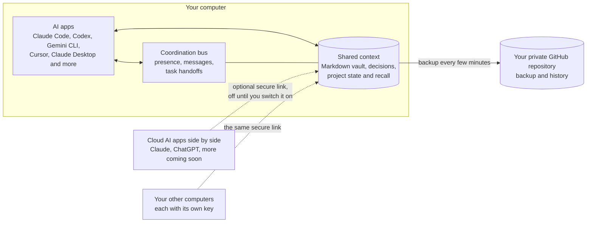
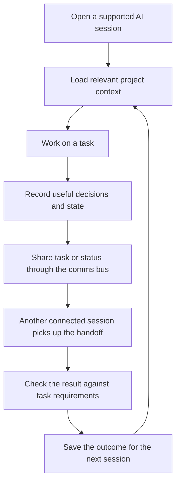

<div align="center">

<a href="media/memev-tiers.mp4"></a>

<sub><a href="media/memev-tiers.mp4">Watch the demo video</a> (4 min 55 s). It was recorded before the five-tier model: it shows four tiers and a Business trial, which are planned as described below, and it does not show the Federated tier.</sub>

<h1>Memev</h1>

<p><strong>The operating infrastructure for distributed AI work.</strong><br>
Coordinate people, AI systems and organisations around governed work and verifiable outcomes.</p>

<p><strong>Development preview — actively under development.</strong> The Free Core is available for testing; this is not yet a production release. Interfaces and behaviour may change. Business, Corporate, Federated and full distributed-convergence capabilities remain under development unless explicitly marked as available below.</p>

<p><code>npm install -g . && memev init --no-connect</code></p>

<p align="center">

</p>

<p><strong>Memev is the connective infrastructure for AI.</strong> It enables individuals, teams and organisations to connect their AI providers, memory systems, agents, services, people and machines through shared communications, context and federated infrastructure.</p>

<p>It starts as a valuable free personal product, grows through teams and enterprise deployments, and extends through the Federated tier to connect independent organisations and the wider systems on which industries depend.</p>

<p>


</p>

<p>
<a href="docs/QUICKSTART.md">Quickstart</a> &middot;
<a href="docs/README.md">Documentation</a> &middot;
<a href="docs/ARCHITECTURE.md">Architecture</a> &middot;
<a href="docs/tiers/README.md">Tiers</a> &middot;
<a href="docs/PRICING.md">Pricing</a> &middot;
<a href="CHANGELOG.md">Changelog</a>
</p>

</div>

## What Memev is, and why it matters

AI is spreading across personal tools, teams, departments and business systems. But adding more AI does not automatically make work more coordinated. Different providers, agents, people and applications can hold different versions of a project's state. Decisions become detached from execution, dependencies are missed, work is duplicated and it becomes difficult to establish what was agreed, what changed and what has actually been verified.

**Memev is the operating infrastructure that lets independent people and AI systems contribute to coordinated work.** It connects AI providers, agents, people, computers, projects and business systems through shared operational context, communications, work coordination, authority and evidence. It works alongside the systems people already use; it does not require them to adopt one model, agent framework or business application.

Memev is not an AI memory product or simply an agent orchestration framework. Its local vault and context retrieval are foundations. The product is the wider operating environment that relates work, coordinates execution, governs access and records whether outcomes have been demonstrated.

The offering has two connected dimensions:

- **A useful personal product today.** The Free Core gives one person a local-first environment for connecting supported AI clients, sharing project context, coordinating sessions and agents, managing defined work, and retaining evidence and provenance. It is a complete starting point, not merely a trial of an enterprise service.
- **An architecture that scales across organisational boundaries.** The same product direction extends through multiple computers, teams, departments and sites to independent organisations. Identity, authority, policy, evidence and convergence become increasingly important as participants and trust boundaries multiply.

### From individual work to organisational intelligence

Memev is designed to relate the work people and systems produce: plans, specifications, decisions, tasks, schedules, budgets, procurement changes, operational updates, engineering artefacts, dependencies and delivery commitments. The aim is to build a shared, evidence-linked operational understanding across the appropriate personal, team, company, site or federated scope.

That understanding is more than a transcript store or a chatbot. It relates people, agents, projects, programmes, portfolios, systems, decisions, requirements, milestones, dependencies, risks, changes and commitments. Authorised AI and analytical systems can use that context to identify relationships, investigate impacts and support decisions. Memev coordinates and governs that work; it does not claim that every inference is automatically true or every proposed action is automatically approved.

For example, imagine an engineering team changes a battery-system specification while a separate mechanical team is designing the fitting around it. Procurement may still be ordering the previous component, manufacturing may have scheduled against the old dimensions, and another project may depend on the same interface. Memev's intended organisational-intelligence capability is to relate those separate workstreams, surface the potential conflict, show the affected dependencies and trace the evidence and owners needed to resolve it. The value is not simply remembering the change; it is helping the organisation understand what that change means elsewhere.

The same principle extends beyond one organisation. A supplier, customer, contractor or research partner may need to contribute selected information or evidence to a shared programme without transferring ownership of its systems or exposing its entire data estate. Memev's Federated tier is designed for that distinct boundary: participants retain their own operators, trust roots, policies and legal responsibilities while exchanging authorised contributions under explicit agreements.

### Inference from the top down: business inference intelligence (planned)

Today AI helps each person infer on their own work: an email, a document, a task. The people accountable for the whole organisation get something else: reports written by the people being reported on, drawn from systems that do not share a picture of the work.

Memev's direction is to let an executive team ask its questions of the organisation's own work record: what was decided, what was committed, what changed and what has been checked. We call this **business inference intelligence**. Three rules are what make its answers worth relying on:

- **Every figure carries its basis.** An important relationship holds its sources, versions, provenance and the identity or process that accepted it, so a number on a leadership view can be traced back to the work it came from.
- **An inference is not a fact.** An inferred dependency stays a hypothesis until an authorised person or an approved verification confirms it. A model-generated explanation is not evidence by itself.
- **Reported is not verified.** A completion message does not close work. Work under a contract is done only when its verification passes.

The foundation for this runs today at one-person scale: provenance on the vault's notes, claims held as fact, theory or conjecture, and work contracts whose completion comes only from a passing verification. The company-wide view, the findings that would raise a conflict or a dependency across projects, and organisation-level metrics are planned. The finding model is built and tested as a data model, and nothing raises a finding yet. See [Organisational intelligence](docs/ORGANISATIONAL-INTELLIGENCE.md).

### How the architecture creates a common operational understanding

The intended architecture combines several responsibilities that must not be confused:

1. **Coordination:** people and agents communicate, hand work between tools, follow task lifecycles and work against defined scope.
2. **Authority and governance:** identities, credentials, relationships, policies and permissions determine who may contribute, access or act.
3. **Evidence and verification:** provenance, contracts, acceptance criteria and receipts distinguish a request or completion claim from an outcome that has been checked.
4. **Convergence:** independently produced, authorised contributions can be collected and deterministically resolved into a common state, rather than relying on an LLM to choose which record wins.
5. **Deterministic computation and trust:** reproducible computation and integrity mechanisms provide a basis for independently checking relevant operations and their results.

Convergence does not itself establish truth, permission or agreement. A technically converged record can still contain a mistaken or disputed contribution. Memev's architecture therefore pairs contribution handling with identity, policy, provenance, evidence, validation and accountable decision-making.

This does not mean every source document or database must be copied into one central repository. Depending on policy, a participant may share a source record, a permitted projection, a reference, a verified summary or a query result. Source data, derived information, model context, indexes, caches, backups and computation all require appropriate governance. Personal and organisational scopes must remain distinct, and one participant's access must not imply unrestricted access for another.

**The boundary between current capability and product direction matters.** The Free Core already has a local vault, supported AI-client integrations, communications-bus foundations, work contracts and a local project lifecycle. The wider connection registry, broad ingestion from business systems, company-wide operational view, automated cross-project impact discovery and end-to-end multi-organisation federation are not shipped as one complete service. The roadmap below distinguishes the current local product from work in progress and future organisational capabilities.
## Who it is for

Memev starts with the individual because personal AI connectivity is valuable in its own right. Teams and organisations extend the same architecture with additional identity, policy, administration and federation requirements.

| If you are | What you get | Why it matters |
|---|---|---|
| One person using several AI tools | One vault that Claude Code, Codex, Gemini CLI, Cursor, Claude Desktop, Windsurf, VS Code and Zed can all read, plus cloud AI apps over the optional secure link | You stop re-explaining the project to every tool, and you can read and edit every note yourself |
| One person on several computers | The same vault on up to 3 computers over the secure link, each computer with its own key (Personal) | Your work follows you. Automatic merging of simultaneous edits is planned, and today git sync is single-writer backup |
| A developer building agents | An MCP server, a communications bus with seats, heartbeats and task handoffs, and work contracts with checks | A shared place for agents to coordinate, and a record that separates "assigned" from "verified" |
| A team or an organisation | A conversation with us about a company vault, one AI provider for the organisation, sign-in and roles, services and support (contact us) | These are planned. We scope them with you rather than sell them before they exist |
| A CEO or an executive team | Questions asked of the organisation's own work record, with every figure traceable to its source (planned) | You see what was verified, not only what was reported |
| An organisation with several sites | Corporate multi-site federation (planned) | Each site keeps its own authority and shares only authorised state |
| Independent organisations on a shared programme | Federated tier (planned) | Partners connect through explicit, bilateral trust and scope without surrendering their local systems or data |
| An industry or research network | Federated tier (planned) | Multiple organisations coordinate selected work, evidence and computation under their own policies |

## Five tiers, one connective architecture

Memev grows by the scope of coordination required. The first two tiers serve an individual across one or more computers; Business and Corporate serve one organisation at increasing scale. The fifth tier connects **independent organisations** that need to work together without becoming one organisation or placing all of their data under one authority.

| Tier | Scope | What it is for | Commercial position |
|---|---|---|---|
| **Personal** | One person, one computer | A complete free core: connect supported AI tools, preserve context, coordinate sessions and keep control of the local vault | Free, for good; available now |
| **Personal with more computers** | One person, up to 3 computers | The same personal vault and AI context across the person's computers | $12/month or $120/year (CHF 10 or CHF 100), early-supporter price; available for current capabilities |
| **Business** | One organisation, initially one node | Connect members, AI tools and company work under organisational identity, policy and administration | Contact us; planned |
| **Corporate** | One large organisation, multiple sites and jurisdictions | Coordinate departments, programmes and portfolios across independently operated sites within one corporate trust domain | Contact us; planned |
| [**Federated**](docs/tiers/federated.md) | Multiple independent organisations | Connect customers, suppliers, partners, contractors, research institutions and public/private participants around shared programmes, projects, evidence and computation | Contact us; planned |

What each tier is worth to the people who use it:

| Tier | What it gives | Status |
|---|---|---|
| **Personal** | The AI tools one person connects work from the same context. No re-explaining a project to each tool, and the record stays on their own computer. | Preview today |
| **Personal with more computers** | The same context on up to 3 of that person's computers, each with its own key. | Available for current capabilities; automatic merging of simultaneous edits is planned |
| **Business** | One company record that the team and its AI tools share, under company rules. Knowledge outlasts staff changes and changes of AI vendor, and leadership can ask questions of the same record the teams work from. | Planned |
| **Corporate** | Sites in many countries run one programme. Each site keeps its own authority and can keep its data in its own jurisdiction. | Planned |
| **Federated** | Separate businesses, suppliers and vendors share only what each agreement permits. Nobody hands over its systems or its data. | Planned |

Business and Corporate describe coordination inside one organisation. **Federated is a distinct fifth tier** for coordination between organisations that retain separate ownership, operators, trust roots, policies and legal responsibilities. It is not a requirement to merge participants into one company vault.

The Federated tier is intended to include scoped federation membership, bilateral agreements, identity and trust between participants, authorised work and evidence exchange, cross-organisation project/programme context, policy-aware queries, operational visibility, and (where separately specified and validated) federated computation. The commercial scope will be defined by the number and type of participating organisations, trust relationships, sites, jurisdictions, workloads, governance requirements, support and deployment model—not by a simple per-computer price.

**Availability is not implied by the tier name.** The Federated tier is a product and commercial target, not a currently purchasable or operational service. Node-to-node transport, cross-organisation admission, trust exchange, sovereign policy enforcement, federated reasoning and computation require implementation and end-to-end validation. See [Federation](docs/FEDERATION.md), [Data sovereignty](docs/DATA-SOVEREIGNTY.md), [Federated computation](docs/FEDERATED-COMPUTATION.md) and [pricing](docs/PRICING.md).

Business and Corporate are recognised by the licence metadata but their services remain planned. Federated is listed in the product catalogue, while licence issuance is deliberately disabled until its service entitlements and acceptance criteria are implemented. No cross-organisation capability is implied to be operational. The free core remains free ([CHARTER.md](CHARTER.md)).
## Keeping AI inside the rules

The first question a business asks about AI is how it is kept from doing damage. Memev's answer is to govern what a connected AI may see, change and claim, and to keep a record of all three.

**Enforced today, in the free core:**

- **Scoped access.** Every token is scoped to read, write or admin, can be limited to paths, and is stored hashed. Each one expires, except the admin token made at setup, which lasts until you revoke it. Each computer has its own device key, and one token or one computer can be cut off alone ([security brief](docs/SECURITY-BRIEF.md)).
- **Nothing is changed in silence.** The log is append-only. Every change can be seen and undone from it and from git, and a delete is a record, not an erasure ([threat model](docs/THREAT-MODEL.md)).
- **Another AI's text is data, not instructions.** By default a cloud AI seat may post only to the operator. In the text Memev's hooks put into an AI app's context, a message from any other seat and memory recalled into the session are quoted as untrusted data.
- **Done is checked, not claimed.** A work contract is signed and immutable, and it changes only by a new signed amendment. The work is done only when its verification passes. Contracts are off by default for new installs and are switched on per vault ([contracts](docs/CONTRACTS.md)).
- **Nothing leaves by default.** No telemetry. The secure link for cloud AI is off until you switch it on. The only default traffic is the backup push to your own remote and one lookup at setup for an existing backup.

**Planned for organisations:** a company admin console, sign-in and roles, a one-provider policy with egress rules, an egress log, and approvals with a [decision queue](docs/scope-one/design/decision-queue.md) for the actions that need a person. None of these is built yet ([Business](docs/tiers/business.md)).

**What this does not claim.** Memev governs and records what flows through it. It does not control the behaviour of the AI apps themselves or the security of the services they connect to, and it does not claim legal compliance. Those limits are stated in the [threat model](docs/THREAT-MODEL.md) and on the [data sovereignty](docs/DATA-SOVEREIGNTY.md) page.

## How it fits together

Memev is the connective layer between people, their work, the systems they use and the AI capabilities they authorise. The illustration shows the intended product boundary: Memev connects existing systems and relates their work; it is not itself the model provider, memory vendor, agent framework, CRM, ERP or business application.

- **Connect:** integrate AI providers, memory systems, agents, business services, people and machines through supported interfaces.
- **Capture work:** ingest, reference or query authorised plans, documents, decisions, tasks, operational updates and other work products from the systems people already use.
- **Build shared context:** relate that work to people, projects, programmes, portfolios, decisions, requirements, dependencies and evidence in the appropriate vault and graph.
- **Communicate and coordinate:** let connected participants exchange messages, discover peers and hand off work through a shared communications bus.
- **Analyse and infer:** make permissioned context available to authorised AI models, agents and business-intelligence systems to identify possible clashes, dependencies, risks and downstream effects.
- **Control and verify:** apply identity, permissions, provenance, data-sovereignty rules and work-contract checks; keep inferred findings distinct from verified facts.
- **Federate:** extend authorised exchange and computation across computers, teams, departments and independent sites as those capabilities are delivered.

The local vault, recall, graph, communications bus and work-contract mechanisms provide important parts of the current personal foundation. The broader architecture is provider-neutral: connected systems retain their specialist capabilities, while Memev supplies the connective mechanisms and governed context. The organisation-wide work ingestion, cross-project reasoning and federated views are product direction, not a claim that every connector or workflow is already operational.



## The technology behind convergence and trust

Memev's product architecture is being developed alongside a wider technology programme. These components have distinct responsibilities and are not all integrated into the released Memev build.

| Technology | Architectural role | Current relationship to Memev |
|---|---|---|
| **CRDT-Merge** | Collects independent contributions in a convergent structure and applies deterministic resolution over the common contribution set. This is intended to support convergence of structured state across independently operated participants without making a language model the conflict-resolution authority. | A separate convergence engine with a defined provider boundary. The released Memev build does not yet perform full distributed state convergence through it. Integration, licensing and end-to-end validation remain work. |
| **E4** | A separate trust and integrity technology family structured around data, trust, causal-clock and hash dimensions, as defined by its technical specification. | A related technology programme, not a claim that E4 is currently integrated throughout Memev's execution or federation paths. |
| **ACFA-RS** | Deterministic fixed-point aggregation and reproducible computation, with receipts intended to support independent checking of results. | A separate implementation foundation. Its capabilities should not be represented as part of the released Memev runtime until integrated and tested at the relevant boundary. |
| **Memev** | Connects participants and work; governs identity, scope and policy; coordinates execution; records provenance; and verifies outcomes against defined obligations and evidence. | The product layer that is being developed to bring these responsibilities together in usable personal, organisational and federated offerings. |

The distinction between these layers is important. CRDT convergence can make replicas resolve the same accepted contribution set consistently, but it does not decide whether a contribution is truthful, authorised or semantically correct. Identity and policy govern admission; provenance records origin; evidence and validation support decisions; deterministic computation supports reproducibility where applicable.

The broader research direction includes convergence of operational state and, where separately designed and validated, computational or model contributions. These are not interchangeable capabilities. The README does not claim that Memev currently merges model weights, runs federated computation across organisations or offers a complete distributed multi-writer service.

See [Convergence](docs/CONVERGENCE.md), [Federation](docs/FEDERATION.md), [Federated computation](docs/FEDERATED-COMPUTATION.md), [Data sovereignty](docs/DATA-SOVEREIGNTY.md) and the [Scope One reconciliation](docs/scope-one/RECONCILIATION.md) for the implementation boundaries and outstanding work.

## How shared context and coordination work

The diagram below shows the current personal workflow: supported AI sessions use the local vault and communications bus. The wider organisational work-to-intelligence flow described above is an architectural target and is delivered in stages.



Memev keeps project context available without making you copy the same background into every new session. Retrieval is scoped and relevance-based, so the shared context stays useful rather than becoming a transcript dump. Connected sessions can coordinate through the communications bus, and work contracts provide a way to state what a task must deliver and retain verification results where the relevant checks are available.

<p align="center">

</p>

## Install

Memev requires **Node.js 22 or newer** and **Git**. The supported, immediately usable path for a new tester is to clone the public repository and install from source. Start with `--no-connect`: this installs and starts Memev without changing any AI application's configuration. You then choose which clients to connect, one at a time.

### 1. Install from the repository

macOS, Linux, or Windows PowerShell with Node 22+ and Git:

```sh
git clone https://github.com/mgillr/memev.git
cd memev
npm install -g .
memev init --no-connect
```

If you do not want a global command, replace the last two commands with:

```sh
node bin/memev.mjs init --no-connect
```

The setup creates the local vault (default: `~/memev`), installs a stable runtime and launcher, starts the local daemon, installs the per-user login service where supported, and prints a setup checklist. It does not connect AI clients when `--no-connect` is used; that setting also disables background auto-connection.

### 2. Let an AI agent install it

In Claude Code, Codex, Gemini CLI, Cursor or another agent that can run local terminal commands, ask:

> Read `docs/INSTALL-FOR-AI.md` in the official Memev repository and follow it exactly. Install Memev from the public source repository using `memev init --no-connect`. Inspect the machine first, preserve existing data and configuration, show me the exact actions, and ask me separately before connecting each detected AI client. Do not connect every client automatically. Run the documented health checks and report only verified results.

The AI agent must follow the consent and recovery rules in [docs/INSTALL-FOR-AI.md](docs/INSTALL-FOR-AI.md). In particular, it must never run `memev connect` without a client name: that connects every detected client.

### 3. Install from a verified release tarball

The repository also contains checksum-verifying installers:

- macOS/Linux: `scripts/install.sh`
- Windows PowerShell: `scripts/install.ps1`

After a tagged release is published, download its `memev-X.Y.Z.tgz` asset and matching `.sha256` file from [GitHub Releases](https://github.com/mgillr/memev/releases), then run the installer with the release tarball URL:

```sh
bash scripts/install.sh "https://github.com/mgillr/memev/releases/download/vX.Y.Z/memev-X.Y.Z.tgz" --no-connect
```

PowerShell:

```powershell
.\scripts\install.ps1 "https://github.com/mgillr/memev/releases/download/vX.Y.Z/memev-X.Y.Z.tgz" --no-connect
```

The installer fetches the checksum file beside the tarball, verifies SHA-256 before extraction, uses Node 22+ already on the machine or downloads the pinned Node runtime with its own SHA-256 verification, then runs setup. The `--no-connect` argument is passed to `memev init`, so client configuration remains untouched until the user approves individual connections. Replace `X.Y.Z` with a real published version; the example is not a live download URL.

**Release status:** no GitHub release has been published yet. Until the first tagged release and its tarball/checksum assets exist, use the repository installation in section 1. The installer scripts are present in the repository, but they do not contain a built-in release URL.

### 4. Docker

For an always-on server or home lab, `docker compose up -d` builds and starts the container locally. AI clients are connected manually. See [docs/DOCKER.md](docs/DOCKER.md).

### 5. Connect the AI clients you choose

After installation:

1. Run `memev clients` to see which supported clients are detected.
2. Choose one client and run `memev connect <client>` only after you have decided to connect it.
3. Repeat for each client you want to use. Some apps require you to approve or trust the new MCP server or hooks.
4. Open a new session in each connected app.
5. Test shared context by asking one client to remember a harmless test fact and another to recall it; run `memev ready --json --timeout 120` during the test.

See [docs/CLIENTS.md](docs/CLIENTS.md) for exactly what Memev changes in each app and which integrations are instructions-only or not yet supported. Cloud AI access is separate and remains off until you explicitly enable it. GitHub backup is also separate: run `memev github setup` only if you want it.

Memev runs on macOS and Linux. **Windows is a preview:** it has code paths and CI tests, but has not had a full lab run. See [docs/QUICKSTART.md](docs/QUICKSTART.md#windows-preview).

## Plans and roadmap

Memev's product direction is broader than the current release. Every line below distinguishes what exists from what is in progress or planned. The connective infrastructure vision does not mean that every provider, external memory system, business application or federated deployment is already integrated.

### Available now

- The vault: Markdown notes in git, a checksummed log, project-aware recall, provenance and the entity graph. `memev import` brings in existing project folders, AI history and chat exports.
- MCP access for the supported AI apps, with hooks where an app supports them, and optional cloud AI connectors over a secure link.
- The communications bus: seats, roster, heartbeats, communications checks, task handoffs and holds.
- The local project lifecycle: a project store and coordinator with atomic task claims, leases, heartbeats, reporting, pause/resume, scope amendment, reassignment and evidence-bound verification. This is local lifecycle coordination, not yet distributed multi-writer convergence.
- Work contracts with signed, immutable specs and checks that run through `memev verify`.
- Device keys, a licence checked offline, and the computer limit.
- Backup to your own private GitHub repository.
- The call-out boundary to a separately licensed convergence engine (WO-05-A, [docs/CONVERGENCE.md](docs/CONVERGENCE.md)). The engine itself is not in this repository and no released Memev merges through it yet.

### In progress

- The local project lifecycle: the project store, state machine and coordinator provide task claims, leases, heartbeats, reporting, evidence-bound verification, pause/resume, scope amendment, cancellation and reassignment. Remaining work is tracked in [docs/scope-one/RECONCILIATION.md](docs/scope-one/RECONCILIATION.md); local lifecycle support should not be confused with distributed multi-writer convergence.
- The paid-engine client is merged behind a flag, off by default (pull request #201). The trial licence and entitlement work is parked and tracked in issue #416.
- Correctness fixes in the crdt-merge engine itself, in its own repository.
- The programme decomposition of the wider plan, as proposed and unsigned contracts: [docs/scope-one/programme/README.md](docs/scope-one/programme/README.md).
- Documentation and tier alignment to the superseding owner decisions of 2 November 2026.

### Planned

- Multi-writer convergence across computers and independent participants through the separate CRDT-Merge engine, following integration, licensing, correctness and end-to-end acceptance work. This is broader than synchronising simultaneous edits to one personal vault.
- Hosted end-to-end encrypted sync, hosted encrypted backup and a stable relay address.
- A company vault with an admin console, one AI provider per organisation, sign-in with Google Workspace or Microsoft Entra ID, roles, an egress log, and a Business trial.
- A single replicated event model across the log, the bus and project state, and evidence receipts for accepted work.
- Operational federation across independently operated sites and organisations. Executable primitives and specifications exist, but node-to-node transport, complete admission and revocation paths, sovereign policy enforcement, recovery and end-to-end acceptance remain implementation work. It is not available as an operational service in any release.

## What you get

### Shared context

Your project knowledge lives as plain Markdown in `~/memev`, kept in git. Every change is written to a checksummed log first. Claude Code, Codex, Gemini CLI, Cursor, Claude Desktop, Windsurf, VS Code and Zed can use the same notes, and cloud AI apps such as Claude and ChatGPT can connect side by side through the optional secure link. Session resume cards, project-aware recall, provenance and the graph help connected tools pick up relevant context instead of starting from scratch. To start with what you have already worked on, `memev import` reads project folders, AI history files, and chat export zips, previews what it found, and writes tagged, undoable notes with no model or network calls ([docs/IMPORT.md](docs/IMPORT.md)). See [docs/DESIGN.md](docs/DESIGN.md) and [docs/CLIENTS.md](docs/CLIENTS.md).

### Coordination between connected sessions

Each connected app gets a seat on Memev's communications bus, joins the roster and reports a heartbeat. From one session, you can see which peers are present, run a communications check, hand out tasks and put an app on hold. The bus gives supported agents a shared coordination channel; the exact execution of a handoff depends on the connected client and workflow. See [docs/BUS.md](docs/BUS.md).

### Defined work and verification

Work contracts let you record the task, expected deliverables, acceptance criteria and stop conditions. Where checks are run, their outcomes and receipts can be retained alongside the work. This makes it possible to distinguish a task being assigned from evidence that its requirements were met. See [docs/CONTRACTS.md](docs/CONTRACTS.md).

### Trust and control

You can inspect what Memev holds. `memev why` shows why a note came back, and `memev audit` lists junk and stale notes. Notes from one project are scoped away from another, and notes in Chinese, Japanese, Korean, Cyrillic, Greek or Arabic are searchable like any other. The vault stays on your computer and can be backed up to your own private GitHub repository. Cloud access is optional and off until you enable it; when you connect a cloud AI provider, that provider's own data handling still applies. Memev has no telemetry by default. The anonymous milestone report is off unless you turn it on with `memev report on`, and `memev report show` prints exactly what it would send ([docs/METRICS.md](docs/METRICS.md)).

## Documentation

Everything is indexed in [docs/README.md](docs/README.md), from this page down to each module and back
up. The main pages:

| | |
|---|---|
| [Quickstart](docs/QUICKSTART.md) | install, first session, everyday commands |
| [Architecture](docs/ARCHITECTURE.md) | what runs today, and the Personal, Business and Corporate charts |
| [Organisational intelligence](docs/ORGANISATIONAL-INTELLIGENCE.md) | work graph, cross-functional reasoning, evidence and findings |
| [Federation](docs/FEDERATION.md) and [data sovereignty](docs/DATA-SOVEREIGNTY.md) | site boundaries, permissions, residency and governed exchange |
| [Federated computation](docs/FEDERATED-COMPUTATION.md) | distributed analysis, inference, optimisation and execution |
| [Module map](docs/MODULES.md) | every module and what imports what, generated from the code |
| [AI apps](docs/CLIENTS.md) | what is changed in each app, hooks vs instructions, undoing it |
| [Cloud access](docs/CLOUD.md) | the secure link, connector URLs, other computers, turning it on |
| [Comms bus](docs/BUS.md) | how your AI apps talk to each other, the roster and comms checks |
| [Set up your office](docs/OFFICE.md) | one vault, inviting teammates, the lead, the roster and what is shared |
| [GitHub backup](docs/GITHUB.md) | `memev github setup` |
| [Docker](docs/DOCKER.md) | running Memev in a container |
| [Tiers and setup](docs/tiers/README.md) | Free core, Personal, and the contact-us tiers, and the services around them (draft) |
| [The paid core: crdt-merge](docs/CONVERGENCE.md) | what is open, what is paid, what passes between an install and us |
| [Pricing (draft)](docs/PRICING.md) | the Personal price; everything above on request; the computer limit |
| [Decisions](docs/scope-one/DECISIONS.md) | the owner decisions on the engine and the tiers |
| [Reconciliation](docs/scope-one/RECONCILIATION.md) | how the plans line up with the Scope One work breakdown |
| [Problems and solutions](docs/SOLUTIONS.md) | what users complain about and what Memev does about it |
| [Contracts](docs/CONTRACTS.md) | signed, immutable work contracts |
| [Troubleshooting](docs/TROUBLESHOOTING.md) | `memev doctor` and common fixes |
| [Lab test plan](docs/testing/LAB-TEST-PLAN.md) | every test to run in a lab before a release, with expected results |
| [Security](SECURITY.md) and [threat model](docs/THREAT-MODEL.md) | |
| [Charter](CHARTER.md) | the free tier is never limited |
| [Design](docs/DESIGN.md) | log, index, graph, recall, scale |
| [Hands-off runtime](docs/MAPPING.md) | everything Memev does without being asked |
| [Developing Memev](docs/DEVELOPING.md) | tests, the leak scan, changelog notes, regenerating the module map |

## For developers

Memev is a local MCP server and coordination layer built around a Markdown vault. Each session starts with a resume card, supported prompts can receive relevant project context (in apps with hooks), and state is saved before a compaction. The same core exposes the communications bus and work-contract mechanisms, bringing context, coordination and verification into one project workflow.
The graph holds entities, links and claims with a status (fact, theory, conjecture) and provenance. The local project lifecycle separates assignment, execution observations and evidence-bound verification; a participant's completion message alone does not make work verified. Recall is BM25 over note sections, filtered by project and permissions before ranking. Node 22, nothing else. See [docs/DESIGN.md](docs/DESIGN.md), the [module map](docs/MODULES.md) and
[docs/DEVELOPING.md](docs/DEVELOPING.md).

## Licensing

- **Memev core: Apache-2.0.** The code in this repository is Apache-2.0 and stays that way. It includes a modified copy of Proofline (Apache-2.0); see [NOTICE](NOTICE).
- **crdt-merge: BSL 1.1, separately licensed.** The convergence engine is a separate project in its own repository, licensed under the Business Source License 1.1 by its licensor, and it carries patents (see its PATENTS file). It is never copied or vendored into Memev. Memev reaches it only across the provider boundary, so including it can never relicense it. Its change date to Apache-2.0 is 2028-03-29; a lawyer review of that date is an open item.
- **Commercial terms:** anything beyond the free core and Personal, including federated services, is agreed through contact us.

See [docs/LICENSING-NOTICE.md](docs/LICENSING-NOTICE.md), [docs/CONVERGENCE.md](docs/CONVERGENCE.md) and [docs/PRICING.md](docs/PRICING.md).
