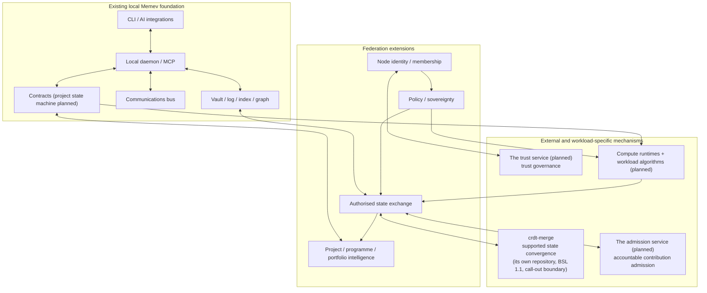

# Architectural interdependencies

Part of the [Memev documentation](README.md). Up: the [README](../README.md). Related:
[MODULES.md](MODULES.md), [ARCHITECTURE.md](ARCHITECTURE.md), [FEDERATION.md](FEDERATION.md),
[ORGANISATIONAL-INTELLIGENCE.md](ORGANISATIONAL-INTELLIGENCE.md),
[FEDERATED-COMPUTATION.md](FEDERATED-COMPUTATION.md).

> **Planned where it says so.** The current component table describes code that runs today. The
> target architecture table, the federation extensions in the diagram and the integration sequence
> are planned; none of it is built ([FEDERATION.md](FEDERATION.md)).

## Two different dependency maps

Memev has two dependency views and they must not be confused.

1. **Implemented source dependencies:** [MODULES.md](MODULES.md) is generated by
   `node scripts/docs/module-graph.mjs` from imports in `bin/` and `src/`. It is the authority
   for which modules currently import which other modules, and its module and edge counts are
   read from that page, not repeated here. Do not edit it by hand; regenerate it and run its check.
2. **Architectural dependencies:** this document describes how the current components and planned
   federation capabilities depend on one another. It is a design map, not a claim that every
   capability is implemented.

The generated module map shows the current local architecture: CLI, server, engine, service
providers and bundled vendor code. It is not a site-federation topology diagram and should not be
expanded with hypothetical nodes. The architecture diagrams belong in
[ARCHITECTURE.md](ARCHITECTURE.md) and the federation specifications.

## Current component relationships

| Component | Current responsibility | Depends on / interacts with |
|---|---|---|
| CLI and hooks | user commands, AI-client integration and local automation | daemon, engine, sync and client configuration |
| Server | local HTTP and MCP interface | engine services, authentication and request scope |
| Vault and operation log | durable local memory and write history | filesystem, git and index/graph rebuild |
| Recall, index and graph | retrieve scoped context and relate knowledge | vault content, project scope and permissions |
| Devices and tokens | identify local/remote clients and enforce request access | server authentication, local configuration and licence entitlements |
| Communications bus | presence, messages and handoffs within the current vault scope | device/seat identity, vault persistence and client workflows |
| Contracts | requirements, checks and evidence | local execution and receipts |
| Project state machine (planned: code present, not wired) | task lifecycle and derived project status; `src/engine/project-state.mjs` exists and nothing imports it yet ([PROJECTS.md](PROJECTS.md)) | project identifiers and canonical transition rules, once wired |
| Merge boundary | invoke an external provider for a supported note conflict | licence gate, provider registration and sync conflict path |
| Service providers | optional external capabilities | CLI/engine extension contracts |

The exact module-level import graph remains [MODULES.md](MODULES.md). This table describes
responsibility, not every source import.

## Target architecture dependencies

| Capability | Requires | Must not take over |
|---|---|---|
| Federation membership | node identity, operator identity, mutual trust, scope and policy version | local source ownership or local administration |
| Site-to-site exchange | membership, transport, authentication, policy evaluation, versioned contribution schema and provenance | business approval or truth validation |
| Structured state convergence | canonical schemas, ownership/authority semantics, causal context, conflict policy and the crdt-merge contract | project state machine or business authority |
| Organisational intelligence | source adapters, work graph, project/programme/portfolio model, provenance, permissions and evaluation | source systems or authorised human decisions |
| Federated queries | identity, policy, query scope, source availability and response provenance | permission to replicate all source records |
| Sovereign replication | classification, jurisdiction matrix, retention/deletion policy, key custody and recovery placement | local legal or organisational policy authority |
| Distributed execution | signed work specification, participant eligibility, scheduler, local runtime, resource limits and receipts | local node's right to reject work |
| Federated learning | model and dataset versioning, local training runtime, learning algorithm, privacy controls, aggregation and evaluation | CRDT convergence or Memev's workflow engine |
| Trust governance | identities, keys, evidence, revocation, trust policy and audit | the semantic correctness of a work product |

## Responsibility boundaries

The diagram shows intended responsibility boundaries. It does not claim that the federation
extensions or every external mechanism are already integrated end to end.

## Critical invariants

1. **Local operation remains useful.** Loss of a remote node or paid service must not silently
   disable the local capabilities that do not depend on it.
2. **Memev owns business semantics.** Project/task authority, approval rules, scope and workflow
   semantics remain in Memev's contracts and state model.
3. **Convergence is not authority.** crdt-merge can reconcile supported state; it does not decide
   who may contribute, which version is approved or whether a result is true.
4. **Transport is not storage authority.** A bus or relay transports messages; it is not the
   canonical project database or a substitute for durable state.
5. **Replication is not permission.** A replica's presence does not grant its operator access to
   restricted source records.
6. **Federated learning is not generic sync.** Training and aggregation algorithms, privacy
   guarantees and model evaluation have their own contracts.
7. **Derived data inherits controls.** Summaries, indexes, embeddings, caches, logs, backups and
   model context must be checked against source and purpose policies.
8. **Human authority remains explicit.** Inferred dependencies and remote agent requests do not
   silently alter signed contracts, approvals or exclusive commitments.

## Integration sequence

The order matters because later capabilities rely on earlier contracts:

1. reconcile the canonical project/task model and ensure every coordinator uses the same state
   machine and transition APIs;
2. define structured contribution envelopes with identity, authority, scope, provenance and
   versioning;
3. define federation membership and policy evaluation;
4. define site exchange, offline queues, replay protection, revocation and recovery;
5. extend convergence beyond notes only after schemas and conformance tests exist;
6. add federated queries and cross-project/programme/portfolio impact analysis;
7. add bounded distributed execution with signed work specifications and receipts;
8. add workload-specific federated analytics and learning, with independent privacy and quality
   validation.

Each step needs tests for partitions, duplicate/reordered delivery, stale versions, revoked
identities, malicious contributions, partial failures and recovery. Do not treat a successful
network exchange as proof of a correct business outcome.

## Status

- **Generated and implemented:** see [MODULES.md](MODULES.md) for the actual source import graph.
- **Current contracts:** see [PROJECTS.md](PROJECTS.md), [CONTRACTS.md](CONTRACTS.md),
  [BUS.md](BUS.md), [EXTENSION-POINTS.md](EXTENSION-POINTS.md) and
  [PAID-CONVERGENCE.md](PAID-CONVERGENCE.md).
- **Architectural targets:** federation, sovereign replication, organisational intelligence and
  federated computation are specified in their linked documents and require implementation and
  acceptance tests.
