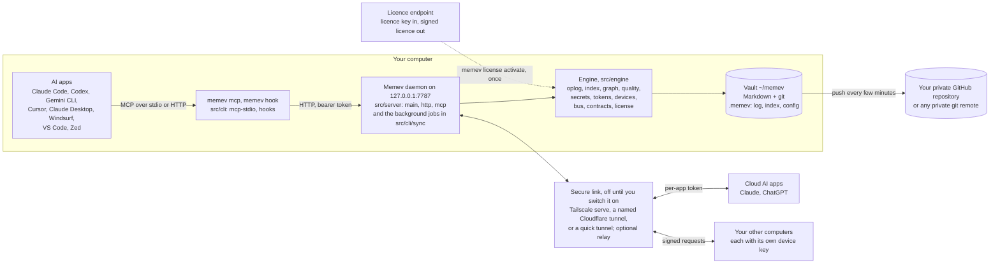
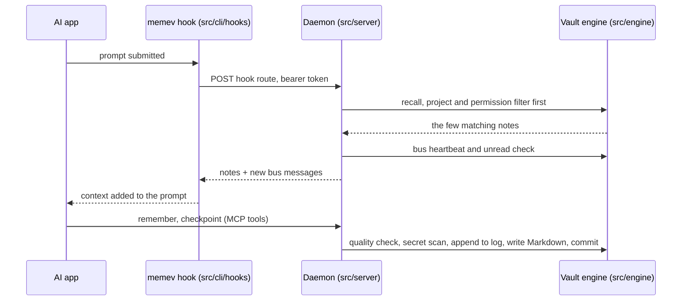
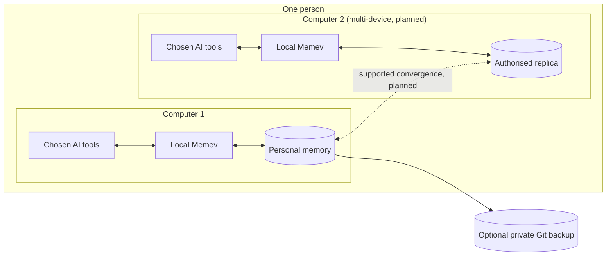
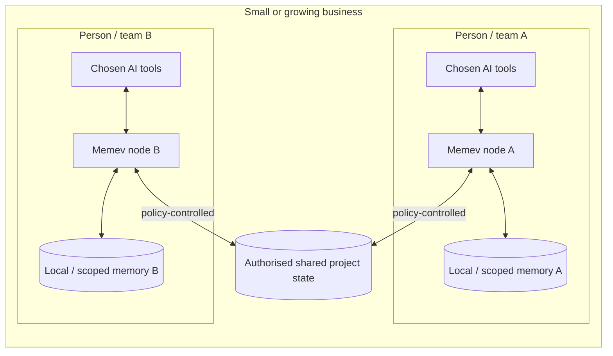
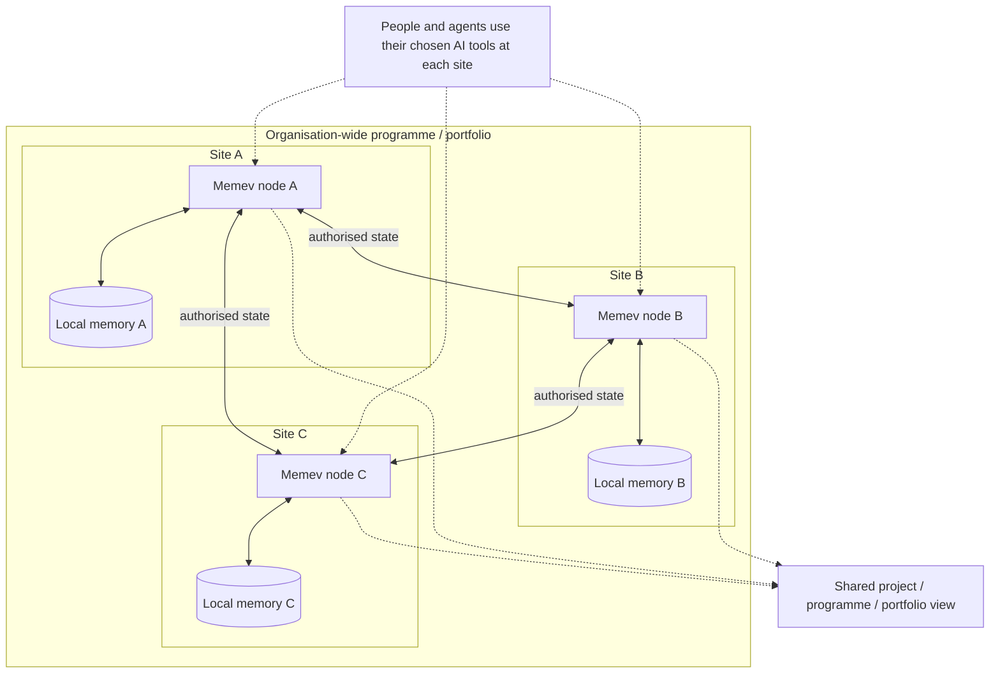
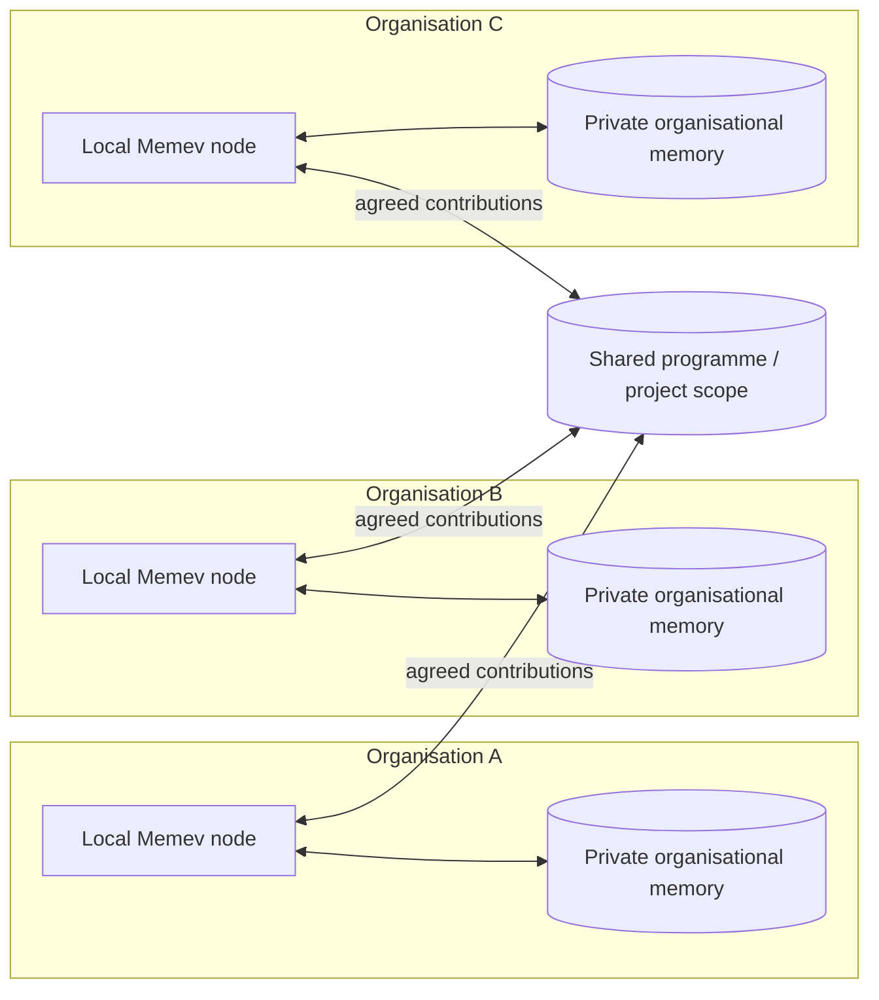
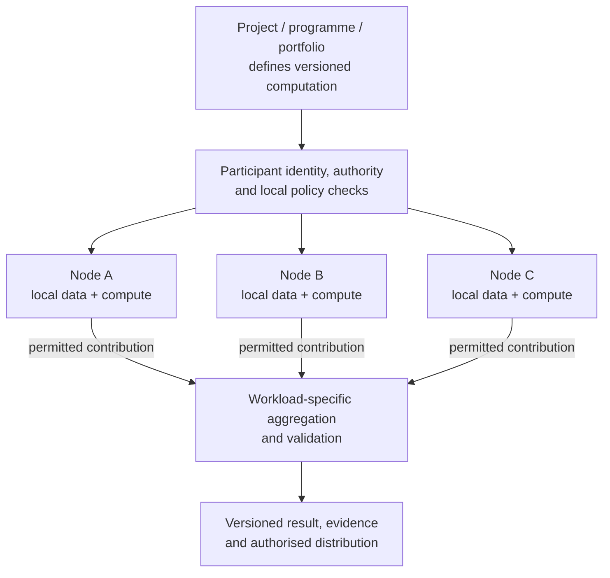

# Architecture

Part of the [Memev documentation](README.md). Up: the [README](../README.md). Down: the
[module map](MODULES.md) (generated from the real imports) and the per-topic pages linked below.

This page has two parts. The first shows what is built and running today, module by module. The
second shows the three tiers side by side with one diagram each: [Personal](#personal),
[Business](#business-coming) and [Corporate](#corporate-coming). Business and Corporate are coming; their
diagrams show the design, not shipped code.

## What runs today

Memev is one background process per vault, the daemon, and a small command that every AI app calls.
The daemon is the only writer of the vault. Everything else talks to it over HTTP on `127.0.0.1`.

| Part | Where | Documented in |
|---|---|---|
| The command and its hooks | `bin/memev.mjs`, `src/cli/main.mjs`, `src/cli/hooks.mjs`, `src/cli/mcp-stdio.mjs` | [QUICKSTART.md](QUICKSTART.md), [CLIENTS.md](CLIENTS.md) |
| App registration | `src/cli/clients.mjs` | [CLIENTS.md](CLIENTS.md), [clients/](clients/claude-code.md) |
| The daemon, HTTP and MCP | `src/server/main.mjs`, `src/server/http.mjs`, `src/server/mcp.mjs` | [DESIGN.md](DESIGN.md), [THREAT-MODEL.md](THREAT-MODEL.md) |
| The vault, log, index and graph | `src/engine/vault.mjs`, `oplog.mjs`, `index.mjs`, `graph.mjs`, `quality.mjs` | [DESIGN.md](DESIGN.md) |
| Tokens, device keys and the licence | `src/engine/tokens.mjs`, `devices.mjs`, `license.mjs`, `entitlements.mjs` | [PRICING.md](PRICING.md), [CHARTER.md](../CHARTER.md) |
| The comms bus | `src/engine/bus.mjs`, `src/cli/bus-cli.mjs` | [BUS.md](BUS.md) |
| Signed contracts | `src/engine/contracts.mjs`, `vendor/attest` | [CONTRACTS.md](CONTRACTS.md) |
| Secure link and relay | `src/cli/tunnel.mjs`, `src/cli/relay.mjs`, `src/cli/remote.mjs`, `src/cli/invite.mjs` | [CLOUD.md](CLOUD.md), [RELAY.md](RELAY.md) |
| Backup and sync | `src/cli/github.mjs`, `src/cli/sync.mjs`, `src/engine/git.mjs` | [GITHUB.md](GITHUB.md) |
| Doctor, onboarding, milestones | `src/cli/doctor.mjs`, `src/cli/onboarding.mjs`, `src/engine/milestones.mjs` | [TROUBLESHOOTING.md](TROUBLESHOOTING.md), [METRICS.md](METRICS.md) |

### What happens on one prompt

Every write is appended to the checksummed operation log before the Markdown file changes; see
[DESIGN.md](DESIGN.md).

## Deployment levels and federation

Memev uses the same core architecture from one person to a federation of organisations. These are
deployment levels and capabilities, not separate products with incompatible designs. The local
vault, daemon, MCP integrations, communications bus, project state and contracts remain the
foundation. Federation extends them with governed relationships between independently operated
nodes.

**AI-provider neutrality applies at every level.** Each person, team or organisation can use the
AI assistants, models, agent frameworks and applications it chooses, subject to its own policy.
Memev is the common architecture underneath; it does not require one AI provider for an entire
company or federation.

The diagrams distinguish the current local implementation from planned or target capabilities.
They do not imply that every multi-node feature is already shipped.

### What is shared across deployment levels

- Local memory remains attached to the user, site or organisation that owns it.
- People and agents use their chosen AI tools through supported interfaces.
- Identity, scopes, permissions and provenance determine what can be read, changed, replicated or
  acted upon.
- Projects, programmes and portfolios can connect work across teams, departments, sites and
  organisations.
- Convergence applies only to state covered by a defined engine contract.
- Approvals, exclusive commitments and business authority remain explicit; convergence does not
  replace them.

### Personal

Personal is one person. On one computer it is free. The person can connect several AI apps side by
side, and local coding tools, all to the same memory. Personal multi-device is the planned extension
for concurrent use across several computers.

Free users get one computer at a time. They move between computers through their own GitHub:
git sync is single-writer backup, it never force-pushes, and a merge that conflicts is left as it
is for the person to resolve ([CONVERGENCE.md](CONVERGENCE.md#what-free-users-get)).
Tier page: [tiers/free.md](tiers/free.md).

### Business

Business supports one or more teams, projects and business functions. A small business may operate
one Memev server; a distributed business may choose multiple nodes or sites. Members use their own
AI providers and tools. The organisation shares only the work, records and derived state authorised
by its policies. The design does not require one company-wide vault or one AI provider.

The exact business topology, identity model, administration, retention and access policies are
deployment choices to be specified and implemented. Tier page: [tiers/business.md](tiers/business.md).

### Multi-site and Corporate

A multi-site organisation can operate an independent Memev node and local memory at each office,
building, operational location or jurisdiction. Nodes exchange authorised state and references.
A regional service may help with routing, discovery or permitted replication, but it is not a
mandatory central owner or coordinator.

Each site can continue permitted local work during a network partition. Other sites may use the
authorised state they already hold, clearly marked with its freshness and source availability.
They cannot access unreplicated changes from an unavailable site. Recovery reconciles supported
state while preserving provenance, policy and unresolved decisions.

Corporate adds the operational requirements appropriate to larger deployments: identity
federation, delegated administration, audit, high availability, recovery, jurisdiction controls,
security operations and optional air-gapped operation. It is not defined by a single central vault.
Tier page: [tiers/corporate.md](tiers/corporate.md).

### Federation between organisations

Independent organisations can participate in a shared project, programme or portfolio without
joining one another's internal memory or surrendering their administration. Each participant
controls its own node, identities, policies and contributions. The shared scope contains only
agreed commitments, deliverables, evidence, references and computation results.

This is an architectural target, not a claim that cross-organisation federation is already
implemented. See [FEDERATION.md](FEDERATION.md).

### Federated computation and learning

Federation also extends beyond memory synchronisation. Memev is intended to coordinate authorised
computational work across devices, sites and organisations: distributed project execution,
analytics, optimisation, simulation, model evaluation, inference and federated learning.

Memev governs the work specification, participants, policy, coordination, approvals and evidence.
The compute runtime executes the workload. The selected algorithm defines learning or aggregation
semantics. CRDT-Merge provides convergence only for supported replicated state under its contract;
it does not replace federated-learning algorithms or establish model quality, privacy or truth.
See [FEDERATED-COMPUTATION.md](FEDERATED-COMPUTATION.md).

## Convergence and trust boundaries

The convergence engine, crdt-merge, is an external technology in its own repository and under its
own licence. The current Memev integration boundary is documented in
[EXTENSION-POINTS.md](EXTENSION-POINTS.md) and [PAID-CONVERGENCE.md](PAID-CONVERGENCE.md).
The current note-conflict adapter must not be presented as a completed general structured-state
federation engine.

ACFA-RS and E4 have separate responsibilities as their contracts mature: accountable contribution
admission and evidence on one side, distributed trust governance on the other. Memev defines the
business semantics, ownership, authority, permissions, approvals and user-facing workflow.

See [FEDERATION.md](FEDERATION.md), [ORGANISATIONAL-INTELLIGENCE.md](ORGANISATIONAL-INTELLIGENCE.md)
and [DATA-SOVEREIGNTY.md](DATA-SOVEREIGNTY.md).

## Where each deployment level is documented

| | Individual | Personal multi-device | Business | Corporate / Federation |
|---|---|---|---|---|
| Overview | [tiers/free.md](tiers/free.md) | [tiers/free.md](tiers/free.md#personal-with-more-computers-draft) | [tiers/business.md](tiers/business.md) | [tiers/corporate.md](tiers/corporate.md) |
| Architecture | local-first | multi-device convergence | one or multiple business nodes | multi-site, sovereign and cross-organisation nodes |
| AI providers | user chooses | user chooses | each user/team chooses | provider-neutral across sites |
| Status | built | planned | planned | architectural target |
