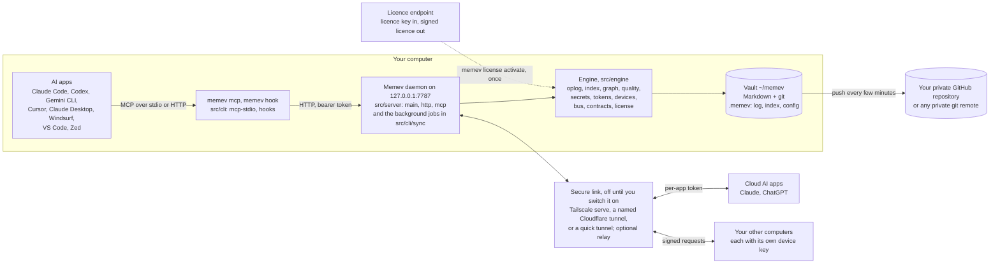
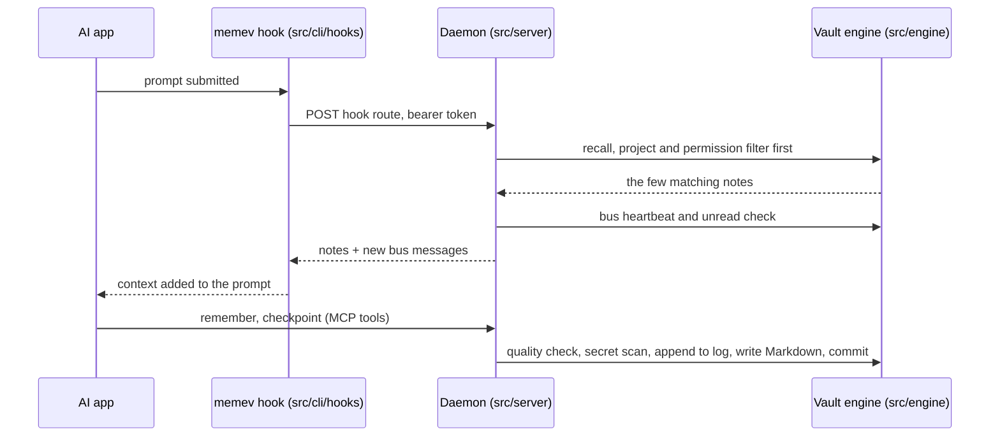
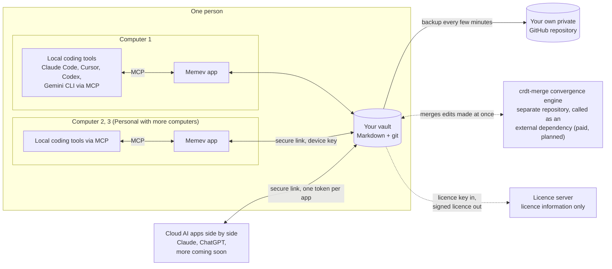
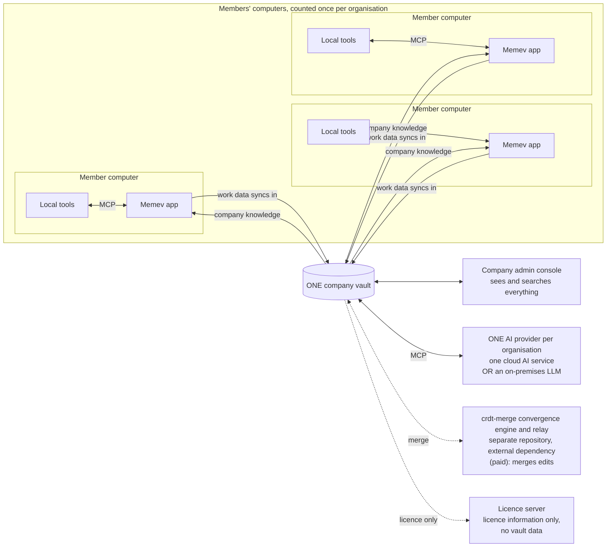
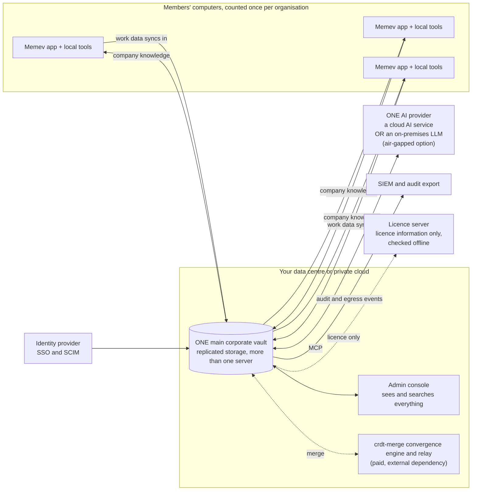

# Architecture

Part of the [Memev documentation](README.md). Up: the [README](../README.md). Down: the
[module map](MODULES.md) (generated from the real imports) and the per-topic pages linked below.

This page has two parts. The first shows what is built and running today, module by module. The
second shows the three tiers side by side with one diagram each: [Personal](#personal),
[Business](#business-coming) and [Corporate](#corporate-coming). Business and Corporate are coming; their
diagrams show the design, not shipped code.

## What runs today

Memev is one background process per vault, the daemon, and a small command that every AI app calls.
The daemon is the only writer of the vault. Everything else talks to it over HTTP on `127.0.0.1`.

| Part | Where | Documented in |
|---|---|---|
| The command and its hooks | `bin/memev.mjs`, `src/cli/main.mjs`, `src/cli/hooks.mjs`, `src/cli/mcp-stdio.mjs` | [QUICKSTART.md](QUICKSTART.md), [CLIENTS.md](CLIENTS.md) |
| App registration | `src/cli/clients.mjs` | [CLIENTS.md](CLIENTS.md), [clients/](clients/claude-code.md) |
| The daemon, HTTP and MCP | `src/server/main.mjs`, `src/server/http.mjs`, `src/server/mcp.mjs` | [DESIGN.md](DESIGN.md), [THREAT-MODEL.md](THREAT-MODEL.md) |
| The vault, log, index and graph | `src/engine/vault.mjs`, `oplog.mjs`, `index.mjs`, `graph.mjs`, `quality.mjs` | [DESIGN.md](DESIGN.md) |
| Tokens, device keys and the licence | `src/engine/tokens.mjs`, `devices.mjs`, `license.mjs`, `entitlements.mjs` | [PRICING.md](PRICING.md), [CHARTER.md](../CHARTER.md) |
| The comms bus | `src/engine/bus.mjs`, `src/cli/bus-cli.mjs` | [BUS.md](BUS.md) |
| Signed contracts | `src/engine/contracts.mjs`, `vendor/attest` | [CONTRACTS.md](CONTRACTS.md) |
| Secure link and relay | `src/cli/tunnel.mjs`, `src/cli/relay.mjs`, `src/cli/remote.mjs`, `src/cli/invite.mjs` | [CLOUD.md](CLOUD.md), [RELAY.md](RELAY.md) |
| Backup and sync | `src/cli/github.mjs`, `src/cli/sync.mjs`, `src/engine/git.mjs` | [GITHUB.md](GITHUB.md) |
| Doctor, onboarding, milestones | `src/cli/doctor.mjs`, `src/cli/onboarding.mjs`, `src/engine/milestones.mjs` | [TROUBLESHOOTING.md](TROUBLESHOOTING.md), [METRICS.md](METRICS.md) |

### What happens on one prompt

Every write is appended to the checksummed operation log before the Markdown file changes; see
[DESIGN.md](DESIGN.md).

## The three tiers

All three tiers use the same engine. Personal on one computer is the free core and is complete
([CHARTER.md](../CHARTER.md)). Anything marked *coming* or *planned* is not built, and nothing is
sold before it is built ([tiers/README.md](tiers/README.md#what-is-built-and-what-is-planned)).

Three things are the same in every tier:

- **Memev core is open source (Apache-2.0) and free.** It lives in this repository.
- **The convergence engine, crdt-merge, is not in this repository.** It lives in its own repository under
  its own licence, is never vendored into Memev, and Memev calls it as an external dependency. It
  powers the paid features: automatic merge when several computers edit at once, and vault convergence
  for a company. See [CONVERGENCE.md](CONVERGENCE.md).
- **Only licence information passes between an install and our side.** The licence server hands out a
  signed licence and nothing else; vault data never goes there.

### Personal

Personal is one person. On one computer it is free. Personal with more computers is the paid step:
several computers edit at once and the convergence engine merges them (planned). A person can connect
several cloud AI apps side by side, and local coding tools, all to the same memory.

Free users get one computer at a time. They move between computers through their own GitHub: git sync
is single-writer backup, it never force-pushes, and a merge that conflicts is left as it is for you to
resolve ([CONVERGENCE.md](CONVERGENCE.md#what-free-users-get)). Tier page: [tiers/free.md](tiers/free.md).

### Business (coming)

Business is one organisation. Every member's computer runs Memev and their local tools. All members'
work data syncs into **one company vault**, which the company can see and search everything in
through the admin console. The organisation connects to **one AI provider**, either one cloud AI
service or an on-premises LLM, over MCP. Members keep private work outside Memev.

Licences count once per organisation, by person and by computer. The trial is 5 members and 10 computers.
Details: [tiers/business.md](tiers/business.md).

### Corporate (coming)

Corporate is the same model as Business at larger scale and with stricter control: one **main
corporate vault**, one AI provider (a cloud AI service or an on-premises LLM, which can be air-gapped),
identity sign-in, and audit export to your own systems.

Details: [tiers/corporate.md](tiers/corporate.md).

## Where each tier is documented

| | Personal | Business | Corporate |
|---|---|---|---|
| Overview | [tiers/free.md](tiers/free.md) | [tiers/business.md](tiers/business.md) | [tiers/corporate.md](tiers/corporate.md) |
| Price and licence | [PRICING.md](PRICING.md) | contact us | contact us |
| Services | [tiers/services.md](tiers/services.md) | [tiers/services.md](tiers/services.md) | [tiers/services.md](tiers/services.md) |
