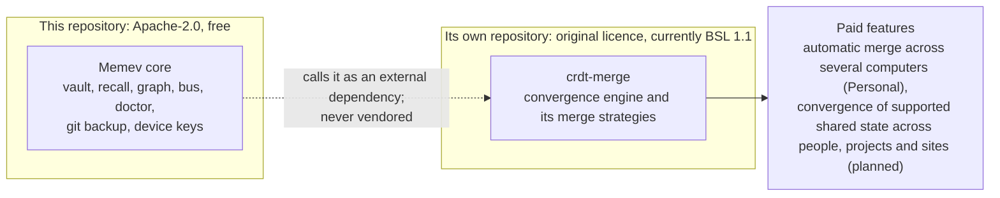

# The paid core: the crdt-merge convergence engine

Part of the [Memev documentation](README.md). Up: the [README](../README.md#the-paid-core-crdt-merge). Related:
[ARCHITECTURE.md](ARCHITECTURE.md), [PRICING.md](PRICING.md), [tiers/](tiers/README.md),
[LICENSING-NOTICE.md](LICENSING-NOTICE.md).

## CRDT-Merge implementation

The external engine is the proprietary CRDT-Merge implementation developed by Ryan Gillespie. Its
research basis is described in [Gillespie (2026), *Conflict-Free Replicated Data Types for Neural
Network Model Merging: A Two-Layer Architecture*](https://arxiv.org/abs/2605.19373). This is a
specific implementation and architecture; it is not a claim to own the general CRDT concept. The
published work addresses neural-network model merging. Memev's current adapter is a separate,
narrower note-conflict integration. Applying the technology to structured project, programme,
portfolio or organisational state requires explicit extensions and conformance tests.

## What is open and what is paid

- **Memev core is open source and free.** It is Apache-2.0 and lives in this repository. One person on
  one computer gets all of it, and that never changes ([CHARTER.md](../CHARTER.md)).
- **The convergence engine is crdt-merge**, with its merge strategies. It lives in its own repository
  under its original licence, currently BSL 1.1. It is **never vendored into Memev**: no copy of it is
  in this repository, and Memev calls it as an external dependency.
- **It powers the paid features.** crdt-merge is what merges edits when several computers change a
  vault at the same time, and, as contracts mature, may support convergence of defined shared state across people, projects and sites:
  - **Personal with more computers:** automatic merge across several computers at once.
  - **Business, Corporate and Federation:** convergence of supported structured state as schemas and authority rules are implemented (planned).

Today the engine is not built into any released Memev. The paid features that depend on it are
planned and are not sold until they are built ([tiers/README.md](tiers/README.md#what-is-built-and-what-is-planned)).

## What free users get

Free users have one computer at a time and move between computers through their own GitHub
([GITHUB.md](GITHUB.md)). Nothing is overwritten:

- Git sync is single-writer backup. It commits, pulls with a merge and pushes. It never force-pushes.
- Notes under `memory/` and `work/` are Markdown, merged with git's union driver, which keeps both
  sides' lines when two copies changed the same file (`.gitattributes` in the vault).
- A merge that still conflicts is aborted and left as it is. Both versions are kept, in your working
  copy and in the remote, and `memev doctor` reports it for you to resolve.
- When a second computer also pushes the same vault, `memev doctor` warns that concurrent edits can
  conflict. Nothing is blocked.

## What passes between an install and our side

Only licence information. The licence server takes a licence key and returns a signed licence file
(`memev license activate <key>`), which Memev then checks on your computer, offline, against a public
key built into it ([PRICING.md](PRICING.md#licences-draft)). Vault data never goes to the licence
server: no notes, no file names, no vault id, and no machine name. The one other thing Memev can send is the
anonymous milestone report, which is off unless you turn it on and holds only milestone names, days and
a random id ([METRICS.md](METRICS.md)).

## Relationship to Federation

CRDT-Merge is intended to provide the convergence mechanism for supported replicated state in
Memev's wider Federation architecture. The current integration documented in this repository is
narrower: it resolves conflicting note versions against a common base. It does not yet provide a
general synchronisation service for every organisational record, a universal project graph merge,
federated learning or policy enforcement. Those require separate schemas, authority semantics,
transport, replication policy, workload algorithms and acceptance tests. See
[FEDERATION.md](FEDERATION.md) and [FEDERATED-COMPUTATION.md](FEDERATED-COMPUTATION.md).

## What is not said here

This page states no merge strategy names, benchmark figures or release dates for the engine, because
none are published for Memev. A page for any of them is written when the feature ships.
