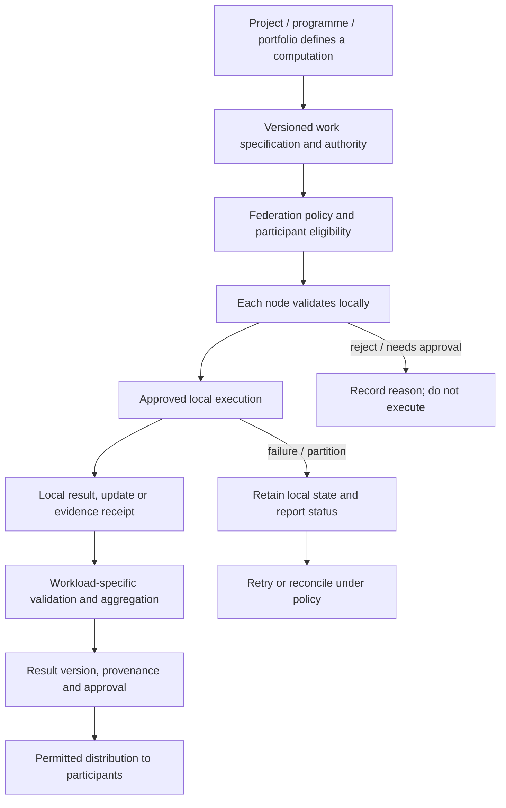

# Federated computation (planned)

Part of the [Memev documentation](README.md). Up: the [README](../README.md). Related:
[Federation](FEDERATION.md), [Organisational intelligence](ORGANISATIONAL-INTELLIGENCE.md),
[Data sovereignty](DATA-SOVEREIGNTY.md), [Convergence](CONVERGENCE.md).

> **Planned. Architectural target, not shipped code.** Federated computation is intended for
> Corporate workloads across sites within one organisation and for the fifth **Federated** tier
> across independent organisations. Business may separately scope a multi-site design service.
> Participant, workload and privacy models determine the scope; this is not a claim of a shipped
> compute service. See [tiers](tiers/README.md), [Federation](FEDERATION.md) and
> [services](tiers/services.md).

## Purpose

The planned federation is not limited to synchronising memory or distributing ordinary application
work. Memev is intended to provide the governance, coordination and evidence layer through which
independently operated computers, sites and organisations can participate in shared computational
work.

This includes project and programme execution, distributed analysis, optimisation, simulation,
scientific workloads, model evaluation, federated analytics and federated learning. A computation
may be initiated by one person, a business, a project team, a programme, a corporate
portfolio or a federation of independent participants.

Memev would not need to own every compute resource or hold every input dataset. It would
coordinate authorised work close to the systems and data that participants control.

## Workload classes

| Workload | Intended capability |
|---|---|
| Distributed task execution | decompose and assign work to authorised local or remote agents and compute nodes |
| Parallel project work | execute independent work packages across teams, sites and machines |
| Federated analytics | run approved calculations against data held at participating nodes |
| Distributed optimisation | combine locally computed proposals or updates under a defined objective |
| Simulation and scientific computation | coordinate experiments, parameter sweeps and reproducible results |
| Model evaluation | run the same evaluation protocol across different datasets, environments or hardware |
| Federated learning | train locally and combine permitted model updates or other contributions |
| Distributed inference | place inference near permitted data or compute resources and coordinate results |
| Model and artefact distribution | version, approve and distribute models, datasets metadata and work products under policy |

These workloads have different correctness, privacy, resource and convergence requirements. They
must not be treated as one generic aggregation operation.

## Execution lifecycle

A federated computation should have a signed, versioned work specification containing:

- purpose, owner and authorised participants;
- workload type and algorithm/version;
- input data references and local data-use constraints;
- permitted compute environment and resource limits;
- code, container or executable identity and integrity;
- expected outputs, evaluation criteria and stop conditions;
- privacy and security requirements;
- contribution and aggregation rules;
- provenance, evidence and receipt requirements;
- retention, deletion and export policy;
- failure, retry, cancellation and recovery behaviour.

A participant evaluates the specification locally before accepting it. Local policy may reject a
job, restrict its resources or require a human approval. The scheduler must not treat participation
as consent to export underlying data.

## Federated learning

Federated learning is one workload class, not a synonym for Federation.

A typical training round may:
1. define a model version, training objective and participant set;
2. distribute an approved model and training specification;
3. let each participant train locally against data it is authorised to use;
4. produce a model update or other protocol-defined contribution;
5. apply secure aggregation or other privacy controls where required;
6. validate participant eligibility, update format and resource limits;
7. apply the selected learning and aggregation algorithm;
8. evaluate the resulting model against agreed tests;
9. approve, version and distribute the result according to policy.

The algorithm determines how learning contributions are combined. crdt-merge does not replace
federated-learning algorithms such as FedAvg, secure aggregation or Byzantine-fault-tolerant aggregation.
It may provide convergence for supported replicated contribution state where its contract and
semantics fit the workload. The admission service may provide accountable admission and evidence
for supported contributions. The trust service may govern participant trust. Both are planned
adapter boundaries beside the merge boundary ([EXTENSION-POINTS.md](EXTENSION-POINTS.md)). Memev
defines the work, authority, policy, coordination and evidence lifecycle.

Model updates, gradients, embeddings, metrics and outputs can themselves reveal information.
Keeping raw data local is not a complete privacy guarantee. Each workload requires a threat model
and appropriate controls, potentially including secure aggregation, differential privacy,
encryption, access controls and output review.

## Component responsibilities

| Component | Responsibility |
|---|---|
| Memev | work specification, project/programme context, participant coordination, policy, identity binding, approvals, lifecycle, evidence and result distribution |
| Compute runtime | executes the authorised workload on selected resources |
| Federated algorithm | defines training, optimisation, analytics or aggregation semantics |
| crdt-merge | convergence of supported replicated state and contributions under its defined contract; the engine is in its own repository under the Business Source License 1.1 (BSL 1.1), and Memev (Apache-2.0) uses it only through its call-out boundary, never vendored ([CONVERGENCE.md](CONVERGENCE.md)) |
| The admission service (planned) | accountable admission, reconciliation and reconstruction of supported contributions and evidence |
| The trust service (planned) | trust governance across participants, operators, devices and services |
| Data-local adapters (planned) | expose approved computation to local data without granting general export access |

No component should be credited with guarantees outside its actual contract. In particular, convergence
does not establish correctness, privacy, model quality, participant honesty or approval.

## Beyond learning

The same execution and governance model can support broader distributed systems:

- distributed project and programme execution;
- compute pools spanning office workstations, private servers and cloud resources;
- multi-party simulation and optimisation;
- reproducible research and engineering experiments;
- shared model evaluation and benchmark execution;
- portfolio-wide resource and schedule analysis;
- cross-organisation work packages with evidence and acceptance criteria.

These are target capabilities. Each needs a defined workload contract, trust model, resource model,
failure semantics and measurable acceptance tests before it is represented as implemented.

## Status and staged validation

1. **Current foundation (built):** local Memev execution, MCP, communications bus, contracts,
   device identity and the merge call-out boundary. Planned beside them: the project state machine
   (code present in `src/engine/project-state.mjs`, not wired) and the one company vault of
   Business.
2. **Next integration work:** durable work specifications, remote execution contracts, node
   registration, policy evaluation, receipts and bounded multi-node task execution.
3. **Federated compute:** workload-specific scheduling, local execution adapters, resource
   accounting, retry/recovery and result validation.
4. **Federated learning:** select a concrete algorithm and threat model, then validate data locality,
   privacy, convergence, model quality, reproducibility and failure recovery.
5. **Portfolio-scale operation:** multi-project scheduling, capacity coordination, policy delegation
   and multi-organisation participation through the Federated tier.

Do not claim a generic federated compute platform or federated learning implementation until the
relevant end-to-end tests have passed.
