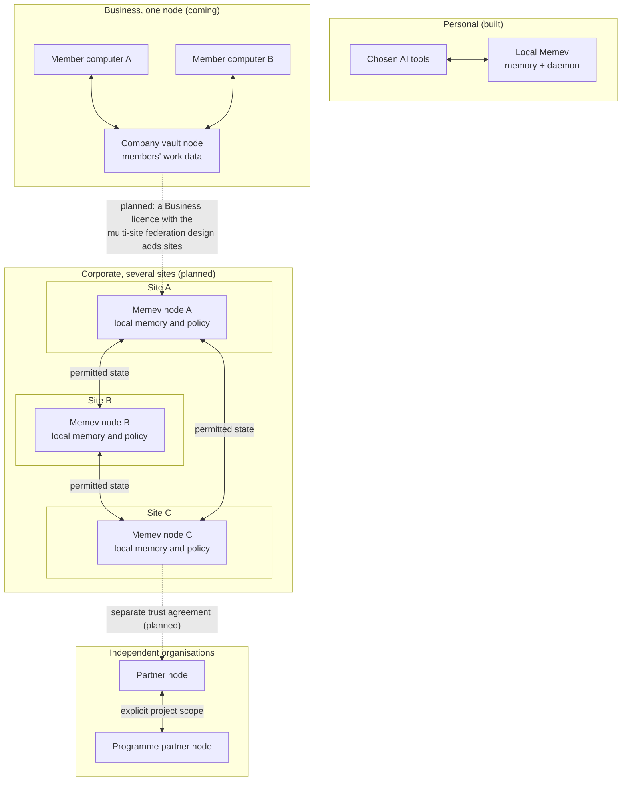

# Federation (foundations implemented; end-to-end federation planned)

Part of the [Memev documentation](README.md). Up: the [README](../README.md). Related:
[Architecture](ARCHITECTURE.md), [Organisational intelligence](ORGANISATIONAL-INTELLIGENCE.md),
[Federated computation](FEDERATED-COMPUTATION.md), [Data sovereignty](DATA-SOVEREIGNTY.md),
[Convergence](CONVERGENCE.md), [Threat model](THREAT-MODEL.md).

> **Status: partial foundations are implemented; operational multi-node federation is not shipped.**
> The repository contains contribution envelopes and signature validation, two-step local admission,
> relationship records and a relationship book, policy evaluation and deny-by-default gates. These
> are local primitives and tests, not a complete inter-node product. Cross-node transport, a complete
> external admission service, end-to-end sender-node binding and production replay/recovery guarantees
> remain subject to their own contracts and verification. Do not offer federation as an available
> Free Core capability. Business and Corporate remain planned.

## Purpose

Federation is the planned extension of the existing Memev architecture, so that independently
operated devices, servers, sites and organisations can coordinate through governed relationships.
The target is a federation of independently operated site nodes: each site owns its node and its
memory, sites converge the state they are authorised to share through the convergence engine under
its contract, and no central coordinator sequences ordinary updates. It is not a replacement
architecture, and it does not require a different AI provider or a single organisation-wide
application.

Today a person uses several AI providers and tools with one local Memev vault (built). A business
syncs its members' work data into one company vault (Business, coming): that is the one-node case
of the target. As planned work, a multi-site organisation operates its own Memev node and memory
at each site, and a Corporate deployment or a group of independent organisations connects selected
projects, programmes and portfolios across administrative and jurisdictional boundaries.

The same principles are meant to hold at every scale:

- local operation and ownership remain meaningful;
- each participant retains its own identity, authority and policy;
- sharing and replication are explicit and scoped;
- distributed state can reconcile without a mandatory central sequencing authority;
- intelligence can reason across the authorised view without requiring all source records to be
  copied to every participant;
- loss of a site does not imply loss of every other site's ability to operate.

**Memory is local to its authority. Coordination crosses boundaries by permission. The shared
view is only as broad as the participants authorise.**

## What Federation adds to the existing architecture

The current local vault, daemon, MCP interface, communications bus, contracts, device identity,
access tokens, audit trail and the convergence call-out boundary remain the foundations. The local
project state machine, ProjectStore and Coordinator are implemented and wired into the vault
([PROJECTS.md](PROJECTS.md)). Federation foundations add signed contributions, two-step local
admission, durable relationship records and deny-by-default policy evaluation around those
foundations. They do not yet provide complete inter-node operation:

1. **Node identity:** each device, server, site and organisation has an identifiable operator and
   cryptographic identity appropriate to its role.
2. **Federation membership:** participants establish a mutually recognised relationship with
   explicit scope, purpose, expiry and revocation.
3. **Policy exchange:** each participant publishes or negotiates the rules governing what may be
   discovered, read, replicated, computed on, retained or exported.
4. **State exchange:** authorised contributions and references move between nodes using versioned
   contracts, provenance and defined reconciliation semantics.
5. **Federated queries and reasoning:** a node could request an authorised view from another node
   without assuming it may retrieve that node's entire local memory.
6. **Continuity and recovery:** participants retain the permitted state needed to continue their
   own work during partitions and recover by reconciling after reconnection.
7. **Operational observability:** operators can inspect membership, freshness, replication
   status, policy decisions, rejected contributions and recovery state.

These are architectural capabilities and contracts to be implemented and tested. The current
single-vault product must not be described as already providing complete site federation.

## Deployment scopes

Federation is not reserved for large organisations. The four tier names stand; this table maps
them to the deployment scopes of the target.

| Scope | Example deployment | What is connected |
|---|---|---|
| Personal | one person, one computer | local memory and the AI tools the person chooses (built) |
| Personal with more computers | desktop, laptop and other computers, each with its own device key | the person's one vault (built); the automatic merge is planned |
| Business, one node | one office or a distributed small team | members' work data in one company vault that the company can see and search (coming); the first release |
| Business, several sites (planned, with the multi-site federation design) | several offices, workshops or operating locations | independently operated site nodes and selected shared work |
| Corporate (planned) | departments, programmes, portfolios and international offices | multiple sites, trust domains and jurisdiction policies |
| Cross-organisation federation (planned) | partners working on a shared programme or portfolio | only the commitments, evidence, work products and computations explicitly authorised by each organisation |

A small organisation may need several site nodes; a large organisation may choose one node.
Federation is a planned capability of Corporate, and of a Business licence whose services list
includes the multi-site federation design ([tiers/services.md](tiers/services.md)), not a tier.

## Topology

Memev is local-first, and the cloud acts only as a relay and a backup ([RELAY.md](RELAY.md)).
Federation keeps that: each site's node holds its own memory, and there is no central memory server
or central coordinator on which every site depends. This page is the single description of the
topology; other pages link here rather than restate it.

The planned federation does not require a single topology. Deployment designs may include:

- direct peer-to-peer site connections;
- a mesh where nodes communicate with authorised peers;
- regional services that cache or forward permitted state;
- hierarchical federation across site, region, organisation and partner domains;
- hybrid topologies combining direct links and regional services.

A regional service may improve connectivity, routing, discovery or operational management. It must
not become the owner of all memory or the sole authority for ordinary state ordering, and it is not
a relay: a relay only forwards and holds no state ([RELAY.md](RELAY.md)). If a topology chooses a
central service for a specific function, that dependency and its failure mode must be explicit.

The diagram illustrates possible relationships, not a requirement that every deployment connects
every node to every other node. Discovery, routing and replication must respect membership and
policy. A personal or home vault never federates into a company node: separate identities and
keys, no grants, mounts or mixing
([tiers/README.md](tiers/README.md#personal-and-company-vaults-never-mix)). Someone who leaves a
company loses access, their keys are revoked, their devices are removed and the local cache is
wiped; what they synced stays in the company vault.

## State, ownership and convergence

Federation must distinguish source ownership from the ability to participate in a shared view.

- A source node remains authoritative for records it owns unless an explicit contract delegates
  authority.
- A replicated copy does not grant its holder broader access or decision-making authority.
- A derived summary, index, embedding, cache, log or model update remains subject to the policy of
  the source information and the rules governing its derivation.
- Every contribution should retain origin, identity, scope, causal context, version and evidence
  references sufficient for its intended use.
- Convergence means replicas reach the defined common state under the mechanism's assumptions. It
  does not establish that the content is true, authorised, safe or approved.
- The planned replication unit is the per-scope operation-log stream, each entry carrying its
  classification and causal context; the engine converges the streams it is contracted for. Git
  stays the single-writer backup of the whole local vault for Personal and for the one-node
  Business, and there are no per-scope git repositories.

The convergence engine is crdt-merge. It lives in its own repository under the Business Source
License 1.1 (BSL 1.1); Memev (Apache-2.0) uses it only through its call-out boundary, it is never
vendored, and only licence information passes between an install and our side
([CONVERGENCE.md](CONVERGENCE.md)).
Its current Memev boundary is narrower than the federation target: today's boundary hands the
engine two conflicting versions of one note and their common base
([EXTENSION-POINTS.md](EXTENSION-POINTS.md)). Extending the contract to structured project,
programme, portfolio, policy and organisational state, and to state between sites, requires
separate schemas, authority rules, tests and integration work, all planned.

The trust service and the admission service have distinct roles, and both are planned adapter
boundaries beside the merge boundary, named generically until they are published. The admission
service concerns accountable admission and reconstruction of contributions and evidence under its
defined protocol, for the signed contributions that need it; it complements convergence and does not
replace it. The trust service concerns distributed trust governance across people, agents, devices,
services and sites. The admission path reads trust only as an eligibility input: trust does not
replace identity, access policy, data classification or independent evidence. Where an external
admission service is configured, it runs before the node's own admission and before any append.
Neither service should be described as a universal storage layer or as guaranteeing that every record
is synchronised everywhere. If the convergence, admission or trust service is unavailable, the node
keeps its local history, reports the degraded capability, and does not claim a guarantee it could not
establish.

## Contribution and admission

Planned. State crosses a boundary only as a contribution that the receiving node can verify and judge, as the state exchange and the security sections of this page require. This section describes the contribution and the node's own admission of it, the first part of the state exchange to be specified. The contribution block, its validator and the admission functions are present as library code with tests, and no running code path calls them: no network route accepts a contribution, nothing sends one, and the vault does not admit anything on its own. Like the project state machine above, the code is present and not wired, so nothing in this section is available to a user, in line with the banner at the top of the page. Transport between nodes, and federation between sites in general, stay planned, as the Status section below says.

A contribution is an [operation envelope](OPERATION-ENVELOPE.md) that carries one more block in the envelope's extension block, under the key `contribution`. The envelope stays the one record shape: its schema version, its causal context (`deps` and `hlc`), its operation id and its content hash are the contribution's own. The block is the signature and admission block, and `docs/schemas/contribution-v1.json` is its schema. The validator is `validateContribution` in `src/engine/federation/contribution.mjs`.

| Field of the block | What it holds |
|---|---|
| `schema` | `memev-contribution/1`. |
| `subject` | The subject that wrote it (a subject of the [identity model](IDENTITY-AND-SCOPES.md)). It is the origin identity of the envelope. |
| `scope` | `{ type, id }`: the scope it is written for. |
| `classification` | A string. Its values are constrained later by a classification schema; until then the node's policy lists the labels it accepts. |
| `sequence` | The per-sender sequence, a whole number of 1 or more. |
| `payload_hash` | The SHA-256 of the canonical payload of the envelope. |
| `provenance` | `{ source, derived_from }`: where it came from, and the operation ids it was derived from. |
| `signature` | `{ principal, namespace, sshsig }`: see below. |

### The signature

The signature is made with the role key of a [role binding](AGENT-IDENTITY.md), through the same ssh-keygen path, and it is checked offline with the public key the node already holds for that subject. It is made in the namespace `memev-contribution`, which is not the namespace of a role binding (`memev`). A signature made for a binding is therefore never a contribution signature, and the reverse: the validator refuses the binding namespace, and the check fails if a signature made in it is presented under the other. The signed text is a header line and the canonical text of the envelope without the signature, so it covers every other field, the payload hash included. A signature proves that a key signed. It does not say that the subject may write there.

The signing and the check live in `src/engine/agentid-bind.mjs` (`signNamespaced` and `verifyNamespaced`), so nothing under `src/engine/federation` imports a module that starts a process or opens a connection. A test scans those files for `child_process`, `node:net`, `node:http`, `node:https` and `node:dgram`.

### The two-step admission

A node admits a contribution into its own operation log in two steps before it appends anything. This two-step admission is the node's own, and it runs after an external admission service when one is configured (planned). The steps, in order:

1. **Signature.** The subject is one the node knows, it has a live key of that name, and the signature verifies with it. A revoked or expired key does not count.
2. **Authority and policy.** The scope is the scope the node holds (a personal scope and an organisational scope never mix), the subject is not revoked or expired and has a live membership in that scope in the node's own identity document, and the node's policy accepts the classification for that scope. The policy is deny by default: a scope and classification it does not list are refused.

Then the sequence is held against the high-water mark of the sender, which is the node and the subject. A sequence that is not above it is a replay and is refused. The mark is kept in the operation log: it is rebuilt from the admitted records when the node opens, so a restart does not forget it.

A contribution that passes is appended to the vault's operation log as `federation.admitted`, with the envelope as it came. A contribution that fails at either step, a malformed one, a refusal by the external service and a replay are each appended as `federation.rejected`, through the same operation log API and in no other store. The rejected event names the operation, the sender, the scope, the sequence, the step, the code and the reason, and holds nothing of the payload: not the payload, not the extension block and not the payload hash.

### What is planned in this part

- Transport: how a contribution gets from one node to another. Nothing here opens a connection.
- The external admission service that runs before the node's own two steps. The hook exists; the service does not.
- The values of the classification field, which a classification schema constrains.
- Splitting the operation log by scope.

## Relationship and policy

Planned. This section describes the first part of the federation membership and policy exchange items above: one explicit relationship between two parties, and a policy document the node evaluates against, deny by default. Like the contribution section, the schemas and validators and the evaluation function are present as library code with tests, and no running code path calls them, so nothing in this section is available to a user. A relationship among more than two parties, and the exchange of relationships and policies over a connection, are not specified here and stay planned.

The relationship is a record, `memev-membership/1`, and `src/engine/federation/membership.mjs` validates it.

| Field | What it holds |
|---|---|
| `parties` | Two parties, the proposer first. Each is a node and the scope it holds, with the time it accepted (or null while it has not). The two nodes differ. |
| `scope` | The one scope the relationship covers. A contribution for any other scope is outside it. |
| `purpose` | Why the two parties exchange state, in a short text. |
| `expires` | When it ends, after every acceptance. |
| `revocation` | `by` says who may revoke (`either_party` or `proposer`); `revoked_at` and `revoked_by` are null until a party ends it. |
| `policy_version` | The version of the policy document both parties accepted. |

A personal scope or a personal vault is never a party, and never the scope a relationship covers: personal data does not join an organisation. The validator refuses both, and the evaluation denies a personal scope whatever a record says.

One party proposes and the other accepts; a record without both acceptances is not established. Revoking makes a new value with the revocation filled in. A node holds its relationships in its own operation log as `federation.relationship` and `federation.relationship.revoked`, and rebuilds them when it opens, so a restart does not forget a revocation, and a record that was revoked cannot be added again to undo it. A book reads the log on from the last entry it read before each read or write, so several books over one log agree. A revocation takes the time the revoking party gives, past or future, as given; the relationship denies from that time on and the first revocation stands. There is no other store.

The policy is a second record, `memev-policy/1` (`src/engine/federation/policy.mjs`). For each data class it says whether each of six actions is allowed (discover, read, replicate, compute, retain, export) and gives the recovery point and recovery time objectives of the class, which the backup and recovery work reads. The list of classes is open: the classification schema of a later contract pins the names, and a class the policy does not list has no rule.

### The evaluation

`evaluate` maps a request, (subject, scope, action, class), to allow or deny with the id of the rule that decided. It denies by default and never throws (the gate built on it can throw only if the `now` it is given throws). The rules, in the order they are tried:

| Rule id | Denies when |
|---|---|
| `deny.bad_request` | the request, the policy or the list of relationships cannot be read |
| `deny.personal_scope` | the scope is a personal scope |
| `deny.no_relationship` | no valid relationship covers the scope |
| `deny.revoked` | every relationship for the scope is revoked at that time (checked before expiry) |
| `deny.expired` | every relationship for the scope has expired at that time |
| `deny.not_established` | a relationship exists but a party has not yet accepted, or acceptance is later |
| `deny.policy_version` | the live relationship did not accept this version of the policy |
| `deny.no_rule` | the policy lists no rule for the class |
| `deny.action` | the policy lists the class and does not allow the action |

An allow carries `allow:<policy id>:<class>:<action>`. The subject is checked to be a subject id of the identity model; no rule depends on which subject it is, because who may act inside a site is membership in the identity model, and a node still judges the subject itself in its own admission.

The gate (`relationshipGate`) turns the evaluation into the optional check that the node's admission runs before its two steps: a contribution is a request to replicate its class into its scope. A refusal is recorded as a rejected event, with the rule id as the code and nothing of the payload. The relationship gate does not yet bind the sending node; a non-party node with member subjects passes it. The same hook is the place for the external admission service, so a node that wants both composes them.

### What is planned for relationships

- Carrying a relationship record, an acceptance or a revocation from one node to the other. The test carries them itself.
- Binding the sending node in the gate: refusing a contribution whose `origin.node` is not a party of the live relationship.
- The classification schema that pins the class names, and enforcement of the other actions (read, compute, retain, export) at the point each happens; the evaluation only answers.

## Partitions, offline operation and recovery

A site should continue its locally authorised work when another site or a connection is unavailable,
subject to the local policy and available information. It must not pretend that remote state is
current when it cannot verify it.

During a partition, a node should expose:
- last-known remote state and its timestamp/version;
- whether the remote source is reachable;
- the freshness and completeness of the local view;
- queued contributions and their delivery status;
- unresolved conflicts or authority questions;
- operations that are unavailable because they require a remote approval or capability.

On reconnection, nodes exchange authorised changes, verify identity and policy, reconcile
supported state, retain provenance and surface unresolved semantic conflicts. Recovery must not
silently overwrite a decision, approval or exclusive commitment.

Availability targets are defined by data class and service, using explicit recovery-point objectives
(RPO) and recovery-time objectives (RTO). No design should promise zero data loss or instant
recovery without a tested mechanism that provides it.

## Security and trust boundaries

Every federation relationship needs explicit:
- participant and operator identity;
- authentication and key lifecycle;
- scopes and delegated capabilities;
- read, write, replicate, compute and administer permissions;
- policy version and acceptance;
- revocation and expiry behaviour;
- audit and evidence requirements;
- rate, resource and abuse limits.

A node must treat remote content as untrusted data, not executable instructions. A remote agent's
request is not an approval. A signed contribution proves a key signed it; authority and validity
must be checked separately.

## Relationship to the tiers

See [tiers](tiers/README.md). The four tiers stand: Personal remains local-first and complete;
Personal with more computers extends the same vault to the person's other computers; Business is
one company vault that members' work data syncs into (coming), the one-node case and the first
release; Corporate is the same model at larger scale with stricter control (coming). Federation
across sites, and federated computation on top of it, are planned capabilities of Corporate, and
of a Business licence whose services list includes the multi-site federation design
([tiers/services.md](tiers/services.md)). Federation is not a tier and not a different core.

## Acceptance criteria for a federation implementation

A release claiming a federation capability must demonstrate, at minimum:

1. two independently operated nodes can establish and revoke a scoped relationship;
2. each node can continue permitted local work while disconnected;
3. remote access is denied when the requested scope is not authorised;
4. permitted changes reconcile after reconnection without silent loss;
5. provenance and source ownership survive replication;
6. a revoked identity or capability is rejected, including for queued work not yet admitted;
7. stale and unavailable remote information is visibly distinguished from live information;
8. policy applies to derived data, indexes, caches, logs, backups and recovery copies;
9. failure of an optional regional service does not stop direct paths that are designed to operate independently;
10. recovery and reconciliation are tested against documented RPO/RTO targets;
11. no site depends on a central memory server or central coordinator for ordinary updates: with every
    other site unreachable, a site's local work and its recovery from its own permitted state continue;
12. when the convergence, admission or trust service is unavailable, the node reports degraded
    capability, keeps local history and claims no guarantee it could not establish.

## Status

- **Built:** local vault and daemon, MCP integration, device credentials, optional remote access,
  communications bus, work contracts and the merge call-out boundary.
- **Planned:** the project state machine (code present, not wired), the one company vault of
  Business and the main corporate vault of Corporate (the one-node case), the convergence
  service behind its call-out boundary, and the trust service and admission service adapter boundaries.
- **Architectural target (planned):** multi-site federation, cross-organisation federation, full
  structured state convergence and sovereign recovery.
- **Planned, code present and not wired:** the contribution block (`docs/schemas/contribution-v1.json`) and the
  node's own two-step admission, described under Contribution and admission, and the relationship record
  (`docs/schemas/membership-v1.json`), the policy document (`docs/schemas/policy-v1.json`) and the evaluation
  function, described under Relationship and policy. No running code path calls them. Federation between sites
  in general remains an architectural target.
- **Availability:** federation is a planned capability of Corporate, and of a Business licence whose services list
  includes the multi-site federation design, as above. Business and Corporate are the contact-us tiers, so it is
  available by contacting us once built. No tier table or price cell lists it.
- **Research and extension areas (planned):** federated computation and federated learning.

See [MODULES.md](MODULES.md) for the generated map of actual code imports. It is deliberately
separate from this target architecture.
