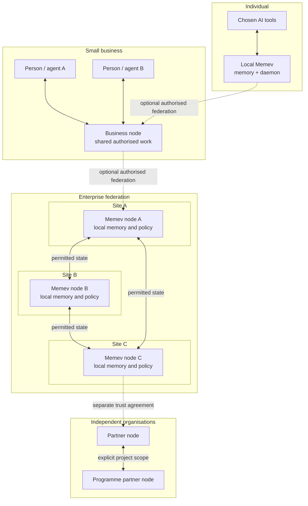

# Federation

Part of the [Memev documentation](README.md). Up: the [README](../README.md). Related:
[Architecture](ARCHITECTURE.md), [Organisational intelligence](ORGANISATIONAL-INTELLIGENCE.md),
[Federated computation](FEDERATED-COMPUTATION.md), [Data sovereignty](DATA-SOVEREIGNTY.md),
[Convergence](CONVERGENCE.md), [Threat model](THREAT-MODEL.md).

## Purpose

Federation extends the existing Memev architecture so independently operated users, devices,
servers, sites and organisations can coordinate through governed relationships. It is not a
replacement architecture and does not require a different AI provider, a central memory server or
a single organisation-wide application.

A person can use several AI providers and agent tools with one local Memev deployment. A small
business can connect its people and projects. A multi-site organisation can operate separate
Memev servers and local memories at each site. An enterprise or a group of independent
organisations can connect selected projects, programmes and portfolios across administrative and
jurisdictional boundaries.

The same principles apply at every scale:

- local operation and ownership remain meaningful;
- each participant retains its own identity, authority and policy;
- sharing and replication are explicit and scoped;
- distributed state can reconcile without a mandatory central sequencing authority;
- intelligence can reason across the authorised view without requiring all source records to be
  copied to every participant;
- loss of a site does not imply loss of every other site's ability to operate.

**Memory is local to its authority. Coordination crosses boundaries by permission. The shared
view is only as broad as the participants authorise.**

## What Federation adds to the existing architecture

The current local vault, daemon, MCP interface, communications bus, project state, contracts,
device identity, access tokens, audit trail and external convergence boundary remain the
foundations. Federation adds relationships and protocols around them:

1. **Node identity:** each device, server, site and organisation has an identifiable operator and
   cryptographic identity appropriate to its role.
2. **Federation membership:** participants establish a mutually recognised relationship with
   explicit scope, purpose, expiry and revocation.
3. **Policy exchange:** each participant publishes or negotiates the rules governing what may be
   discovered, read, replicated, computed on, retained or exported.
4. **State exchange:** authorised contributions and references move between nodes using versioned
   contracts, provenance and defined reconciliation semantics.
5. **Federated queries and reasoning:** a node can request an authorised view from another node
   without assuming it may retrieve that node's entire local memory.
6. **Continuity and recovery:** participants retain the permitted state needed to continue their
   own work during partitions and recover by reconciling after reconnection.
7. **Operational observability:** operators can inspect membership, freshness, replication
   status, policy decisions, rejected contributions and recovery state.

These are architectural capabilities and contracts to be implemented and tested. The current
single-vault product must not be described as already providing complete site federation.

## Deployment scopes

Federation is not reserved for large enterprises.

| Scope | Example deployment | What is connected |
|---|---|---|
| Individual | one person, one computer | local memory and the AI tools the person chooses |
| Individual, multi-device | desktop, laptop and other authorised devices | the person's permitted state and active work |
| Small business | one office or a distributed small team | people, agents, shared projects and business functions |
| Multi-site business | several offices, workshops or operating locations | independently operated site memories and selected shared work |
| Enterprise | departments, programmes, portfolios and international offices | multiple sites, trust domains and jurisdiction policies |
| Cross-organisation | partners working on a shared programme or portfolio | only the commitments, evidence, work products and computations explicitly authorised by each organisation |

A deployment may use any combination of these scopes. A small organisation may need multiple sovereign nodes; a large organisation may choose one site. Tier names describe service and governance packages, not fixed technical limits.

## Topology

Memev must not require a single topology. Supported deployment designs can include:

- direct peer-to-peer site connections;
- a mesh where nodes communicate with authorised peers;
- regional hubs that relay or cache permitted state;
- hierarchical federation across site, region, enterprise and partner domains;
- hybrid topologies combining direct links and regional services.

A hub may improve connectivity, routing, discovery or operational management. It must not silently become the mandatory owner of all memory or the sole authority for ordinary state ordering. If a topology chooses a central service for a specific function, that dependency and its failure mode must be explicit.

The diagram illustrates possible relationships, not a requirement that every deployment connects
every node to every other node. Discovery, routing and replication must respect membership and
policy.

## State, ownership and convergence

Federation must distinguish source ownership from the ability to participate in a shared view.

- A source node remains authoritative for records it owns unless an explicit contract delegates
  authority.
- A replicated copy does not grant its holder broader access or decision-making authority.
- A derived summary, index, embedding, cache, log or model update remains subject to the policy of
  the source information and the rules governing its derivation.
- Every contribution should retain origin, identity, scope, causal context, version and evidence
  references sufficient for its intended use.
- Convergence means replicas reach the defined common state under the mechanism's assumptions. It
  does not establish that the content is true, authorised, safe or approved.

CRDT-Merge is the proprietary external convergence technology intended for supported replicated
state. Its current Memev integration boundary is narrower than the complete federation target:
today's documented adapter resolves conflicting note versions and their common base. Extending
the contract to structured project, programme, portfolio, policy and organisational state requires
separate schemas, authority rules, tests and integration work.

ACFA-RS and E4 have distinct roles. ACFA-RS concerns accountable admission and reconstruction of
contributions and evidence under its defined protocol. E4 concerns distributed trust governance.
Neither should be described as a universal storage layer or as guaranteeing that every record is
synchronised everywhere.

## Partitions, offline operation and recovery

A site should continue its locally authorised work when another site or a connection is unavailable,
subject to the local policy and available information. It must not pretend that remote state is
current when it cannot verify it.

During a partition, a node should expose:
- last-known remote state and its timestamp/version;
- whether the remote source is reachable;
- the freshness and completeness of the local view;
- queued contributions and their delivery status;
- unresolved conflicts or authority questions;
- operations that are unavailable because they require a remote approval or capability.

On reconnection, nodes exchange authorised changes, verify identity and policy, reconcile
supported state, retain provenance and surface unresolved semantic conflicts. Recovery must not
silently overwrite a decision, approval or exclusive commitment.

Availability targets are defined by data class and service, using explicit recovery-point objectives
(RPO) and recovery-time objectives (RTO). No design should promise zero data loss or instant
recovery without a tested mechanism that provides it.

## Security and trust boundaries

Every federation relationship needs explicit:
- participant and operator identity;
- authentication and key lifecycle;
- scopes and delegated capabilities;
- read, write, replicate, compute and administer permissions;
- policy version and acceptance;
- revocation and expiry behaviour;
- audit and evidence requirements;
- rate, resource and abuse limits.

A node must treat remote content as untrusted data, not executable instructions. A remote agent's
request is not an approval. A signed contribution proves a key signed it; authority and validity
must be checked separately.

## Relationship to the tiers

See [tiers](tiers/README.md). Personal remains local-first and complete. Multi-device extends the
same personal environment. Business connects people and work under business governance. Corporate
adds multi-site, operational, identity and compliance controls. Federation describes the
cross-site and cross-organisation capabilities that can be composed into the relevant deployment;
it is not a mandatory new product tier or a different core.

## Acceptance criteria for a federation implementation

A release claiming a federation capability must demonstrate, at minimum:

1. two independently operated nodes can establish and revoke a scoped relationship;
2. each node can continue permitted local work while disconnected;
3. remote access is denied when the requested scope is not authorised;
4. permitted changes reconcile after reconnection without silent loss;
5. provenance and source ownership survive replication;
6. a revoked identity or capability is rejected, including for queued work not yet admitted;
7. stale and unavailable remote information is visibly distinguished from live information;
8. policy applies to derived data, indexes, caches, logs, backups and recovery copies;
9. failure of an optional hub does not stop direct paths that are designed to operate independently;
10. recovery and reconciliation are tested against documented RPO/RTO targets.

## Status

- **Built:** local vault and daemon, MCP integration, device credentials, optional remote access,
  communications bus, work contracts, project state and the external merge-provider boundary.
- **Specified or in progress:** broader project coordination, external convergence service and
  trust-service integrations, subject to their individual contracts and implementation status.
- **Architectural target:** general site federation, cross-organisation federation, full structured
  state convergence and sovereign recovery.
- **Research and extension areas:** federated computation and federated learning.

See [MODULES.md](MODULES.md) for the generated map of actual code imports. It is deliberately
separate from this target architecture.
