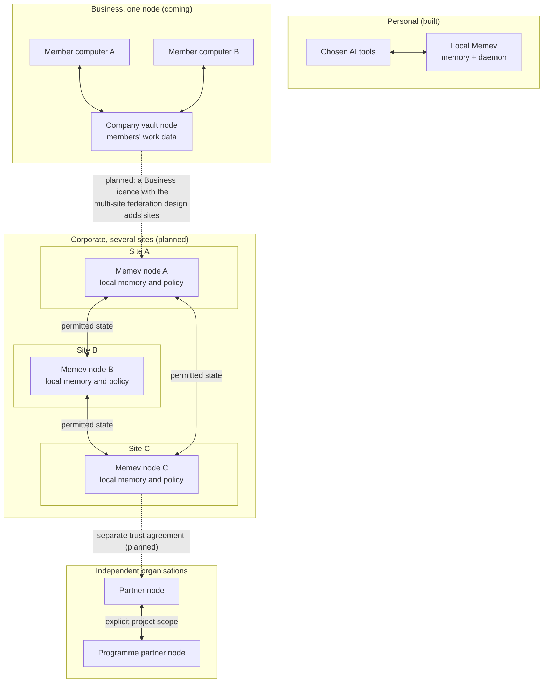

# Federation (planned)

Part of the [Memev documentation](README.md). Up: the [README](../README.md). Related:
[Architecture](ARCHITECTURE.md), [Organisational intelligence](ORGANISATIONAL-INTELLIGENCE.md),
[Federated computation](FEDERATED-COMPUTATION.md), [Data sovereignty](DATA-SOVEREIGNTY.md),
[Convergence](CONVERGENCE.md), [Threat model](THREAT-MODEL.md).

> **Planned. Architectural target, not shipped code.** Nothing on this page is built. The first
> Business release is the one-node case that the tier pages call the company vault: one
> organisation node that members' work data syncs into and that the company can see and search
> ([tiers/business.md](tiers/business.md)). Every multi-site statement on this page is planned, and
> federation is a planned capability of Corporate, and of a Business licence whose services list
> includes the multi-site federation design ([tiers/services.md](tiers/services.md)), not a tier ([tiers/README.md](tiers/README.md#several-sites-and-federation-planned)).

## Purpose

Federation is the planned extension of the existing Memev architecture, so that independently
operated devices, servers, sites and organisations can coordinate through governed relationships.
The target is a federation of independently operated site nodes: each site owns its node and its
memory, sites converge the state they are authorised to share through the convergence engine under
its contract, and no central coordinator sequences ordinary updates. It is not a replacement
architecture, and it does not require a different AI provider or a single organisation-wide
application.

Today a person uses several AI providers and tools with one local Memev vault (built). A business
syncs its members' work data into one company vault (Business, coming): that is the one-node case
of the target. As planned work, a multi-site organisation operates its own Memev node and memory
at each site, and a Corporate deployment or a group of independent organisations connects selected
projects, programmes and portfolios across administrative and jurisdictional boundaries.

The same principles are meant to hold at every scale:

- local operation and ownership remain meaningful;
- each participant retains its own identity, authority and policy;
- sharing and replication are explicit and scoped;
- distributed state can reconcile without a mandatory central sequencing authority;
- intelligence can reason across the authorised view without requiring all source records to be
  copied to every participant;
- loss of a site does not imply loss of every other site's ability to operate.

**Memory is local to its authority. Coordination crosses boundaries by permission. The shared
view is only as broad as the participants authorise.**

## What Federation adds to the existing architecture

The current local vault, daemon, MCP interface, communications bus, contracts, device identity,
access tokens, audit trail and external convergence boundary remain the foundations. The project
state machine is planned: its code is present in `src/engine/project-state.mjs` and nothing imports
it yet ([PROJECTS.md](PROJECTS.md)). Federation is planned to add relationships and protocols
around those foundations:

1. **Node identity:** each device, server, site and organisation has an identifiable operator and
   cryptographic identity appropriate to its role.
2. **Federation membership:** participants establish a mutually recognised relationship with
   explicit scope, purpose, expiry and revocation.
3. **Policy exchange:** each participant publishes or negotiates the rules governing what may be
   discovered, read, replicated, computed on, retained or exported.
4. **State exchange:** authorised contributions and references move between nodes using versioned
   contracts, provenance and defined reconciliation semantics.
5. **Federated queries and reasoning:** a node could request an authorised view from another node
   without assuming it may retrieve that node's entire local memory.
6. **Continuity and recovery:** participants retain the permitted state needed to continue their
   own work during partitions and recover by reconciling after reconnection.
7. **Operational observability:** operators can inspect membership, freshness, replication
   status, policy decisions, rejected contributions and recovery state.

These are architectural capabilities and contracts to be implemented and tested. The current
single-vault product must not be described as already providing complete site federation.

## Deployment scopes

Federation is not reserved for large organisations. The four tier names stand; this table maps
them to the deployment scopes of the target.

| Scope | Example deployment | What is connected |
|---|---|---|
| Personal | one person, one computer | local memory and the AI tools the person chooses (built) |
| Personal with more computers | desktop, laptop and other computers, each with its own device key | the person's one vault (built); the automatic merge is planned |
| Business, one node | one office or a distributed small team | members' work data in one company vault that the company can see and search (coming); the first release |
| Business, several sites (planned, with the multi-site federation design) | several offices, workshops or operating locations | independently operated site nodes and selected shared work |
| Corporate (planned) | departments, programmes, portfolios and international offices | multiple sites, trust domains and jurisdiction policies |
| Cross-organisation federation (planned) | partners working on a shared programme or portfolio | only the commitments, evidence, work products and computations explicitly authorised by each organisation |

A small organisation may need several site nodes; a large organisation may choose one node.
Federation is a planned capability of Corporate, and of a Business licence whose services list
includes the multi-site federation design ([tiers/services.md](tiers/services.md)), not a tier.

## Topology

The planned federation does not require a single topology. Deployment designs may include:

- direct peer-to-peer site connections;
- a mesh where nodes communicate with authorised peers;
- regional services that cache or forward permitted state;
- hierarchical federation across site, region, organisation and partner domains;
- hybrid topologies combining direct links and regional services.

A regional service may improve connectivity, routing, discovery or operational management. It must
not become the owner of all memory or the sole authority for ordinary state ordering, and it is not
a relay: a relay only forwards and holds no state ([RELAY.md](RELAY.md)). If a topology chooses a
central service for a specific function, that dependency and its failure mode must be explicit.

The diagram illustrates possible relationships, not a requirement that every deployment connects
every node to every other node. Discovery, routing and replication must respect membership and
policy. A personal or home vault never federates into a company node: separate identities and
keys, no grants, mounts or mixing
([tiers/README.md](tiers/README.md#personal-and-company-vaults-never-mix)). Someone who leaves a
company loses access, their keys are revoked, their devices are removed and the local cache is
wiped; what they synced stays in the company vault.

## State, ownership and convergence

Federation must distinguish source ownership from the ability to participate in a shared view.

- A source node remains authoritative for records it owns unless an explicit contract delegates
  authority.
- A replicated copy does not grant its holder broader access or decision-making authority.
- A derived summary, index, embedding, cache, log or model update remains subject to the policy of
  the source information and the rules governing its derivation.
- Every contribution should retain origin, identity, scope, causal context, version and evidence
  references sufficient for its intended use.
- Convergence means replicas reach the defined common state under the mechanism's assumptions. It
  does not establish that the content is true, authorised, safe or approved.
- The planned replication unit is the per-scope operation-log stream, each entry carrying its
  classification and causal context; the engine converges the streams it is contracted for. Git
  stays the single-writer backup of the whole local vault for Personal and for the one-node
  Business, and there are no per-scope git repositories.

The convergence engine is crdt-merge. It lives in its own repository under its original licence,
currently BSL 1.1, it is never vendored into Memev, and Memev calls it as an external dependency;
only licence information passes between an install and our side ([CONVERGENCE.md](CONVERGENCE.md)).
Its current Memev boundary is narrower than the federation target: today's boundary hands the
engine two conflicting versions of one note and their common base
([EXTENSION-POINTS.md](EXTENSION-POINTS.md)). Extending the contract to structured project,
programme, portfolio, policy and organisational state, and to state between sites, requires
separate schemas, authority rules, tests and integration work, all planned.

The trust service and the admission service have distinct roles, and both are planned adapter
boundaries beside the merge boundary, named generically until they are published. The admission
service concerns accountable admission and reconstruction of contributions and evidence under its
defined protocol. The trust service concerns distributed trust governance. Neither should be
described as a universal storage layer or as guaranteeing that every record is synchronised
everywhere.

## Partitions, offline operation and recovery

A site should continue its locally authorised work when another site or a connection is unavailable,
subject to the local policy and available information. It must not pretend that remote state is
current when it cannot verify it.

During a partition, a node should expose:
- last-known remote state and its timestamp/version;
- whether the remote source is reachable;
- the freshness and completeness of the local view;
- queued contributions and their delivery status;
- unresolved conflicts or authority questions;
- operations that are unavailable because they require a remote approval or capability.

On reconnection, nodes exchange authorised changes, verify identity and policy, reconcile
supported state, retain provenance and surface unresolved semantic conflicts. Recovery must not
silently overwrite a decision, approval or exclusive commitment.

Availability targets are defined by data class and service, using explicit recovery-point objectives
(RPO) and recovery-time objectives (RTO). No design should promise zero data loss or instant
recovery without a tested mechanism that provides it.

## Security and trust boundaries

Every federation relationship needs explicit:
- participant and operator identity;
- authentication and key lifecycle;
- scopes and delegated capabilities;
- read, write, replicate, compute and administer permissions;
- policy version and acceptance;
- revocation and expiry behaviour;
- audit and evidence requirements;
- rate, resource and abuse limits.

A node must treat remote content as untrusted data, not executable instructions. A remote agent's
request is not an approval. A signed contribution proves a key signed it; authority and validity
must be checked separately.

## Relationship to the tiers

See [tiers](tiers/README.md). The four tiers stand: Personal remains local-first and complete;
Personal with more computers extends the same vault to the person's other computers; Business is
one company vault that members' work data syncs into (coming), the one-node case and the first
release; Corporate is the same model at larger scale with stricter control (coming). Federation
across sites, and federated computation on top of it, are planned capabilities of Corporate, and
of a Business licence whose services list includes the multi-site federation design
([tiers/services.md](tiers/services.md)). Federation is not a tier and not a different core.

## Acceptance criteria for a federation implementation

A release claiming a federation capability must demonstrate, at minimum:

1. two independently operated nodes can establish and revoke a scoped relationship;
2. each node can continue permitted local work while disconnected;
3. remote access is denied when the requested scope is not authorised;
4. permitted changes reconcile after reconnection without silent loss;
5. provenance and source ownership survive replication;
6. a revoked identity or capability is rejected, including for queued work not yet admitted;
7. stale and unavailable remote information is visibly distinguished from live information;
8. policy applies to derived data, indexes, caches, logs, backups and recovery copies;
9. failure of an optional regional service does not stop direct paths that are designed to operate independently;
10. recovery and reconciliation are tested against documented RPO/RTO targets.

## Status

- **Built:** local vault and daemon, MCP integration, device credentials, optional remote access,
  communications bus, work contracts and the external merge boundary.
- **Planned:** the project state machine (code present, not wired), the one company vault of
  Business and the main corporate vault of Corporate (the one-node case), the external convergence
  service, and the trust service and admission service adapter boundaries.
- **Architectural target (planned):** multi-site federation, cross-organisation federation, full
  structured state convergence and sovereign recovery.
- **Research and extension areas (planned):** federated computation and federated learning.

See [MODULES.md](MODULES.md) for the generated map of actual code imports. It is deliberately
separate from this target architecture.
