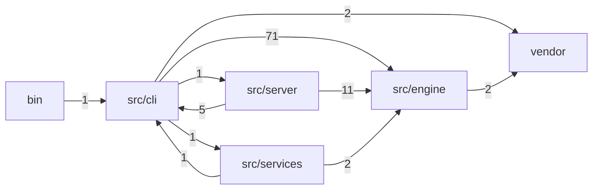

# Module map

Part of the [Memev documentation](README.md). Written by `node scripts/docs/module-graph.mjs` from the real imports in `bin/` and `src/`; do not edit it by hand. `node scripts/docs/module-graph.mjs --check` (and `test/docs-module-map.test.mjs`) fail when it is out of date. How the parts fit at a higher level: [ARCHITECTURE.md](ARCHITECTURE.md).

54 modules and 219 import edges (56 of them are loaded on demand with `import()`, drawn dashed). Memev has no runtime dependencies: only Node built-ins and the code under `vendor/`.

## Layers

`bin/memev.mjs` starts the command line. `src/cli` holds the commands, `src/server` the HTTP and MCP server the daemon runs, `src/engine` the vault, log, index, graph, tokens, licence and bus, and `src/services` the list of service providers. The numbers are import edges between layers.

## Every module

Solid arrows are imports at load time, dashed arrows are imports on demand.

```mermaid
flowchart LR
  subgraph bin["bin (launcher)"]
    bin_memev["memev.mjs"]
  end
  subgraph cli["src/cli"]
    src_cli_bus_cli["bus-cli.mjs"]
    src_cli_clients["clients.mjs"]
    src_cli_common["common.mjs"]
    src_cli_contracts_cli["contracts-cli.mjs"]
    src_cli_daemon["daemon.mjs"]
    src_cli_deployment["deployment.mjs"]
    src_cli_doctor["doctor.mjs"]
    src_cli_github["github.mjs"]
    src_cli_hooks["hooks.mjs"]
    src_cli_invite["invite.mjs"]
    src_cli_licensing["licensing.mjs"]
    src_cli_main["main.mjs"]
    src_cli_mcp_stdio["mcp-stdio.mjs"]
    src_cli_memory_cli["memory-cli.mjs"]
    src_cli_onboarding["onboarding.mjs"]
    src_cli_pathsetup["pathsetup.mjs"]
    src_cli_preflight["preflight.mjs"]
    src_cli_ready["ready.mjs"]
    src_cli_relay["relay.mjs"]
    src_cli_remote["remote.mjs"]
    src_cli_runner["runner.mjs"]
    src_cli_service["service.mjs"]
    src_cli_sync["sync.mjs"]
    src_cli_transcript["transcript.mjs"]
    src_cli_tunnel["tunnel.mjs"]
    src_cli_upgrade["upgrade.mjs"]
  end
  subgraph engine["src/engine"]
    src_engine_bus["bus.mjs"]
    src_engine_card["card.mjs"]
    src_engine_contracts["contracts.mjs"]
    src_engine_devices["devices.mjs"]
    src_engine_diff["diff.mjs"]
    src_engine_entitlements["entitlements.mjs"]
    src_engine_git["git.mjs"]
    src_engine_graph["graph.mjs"]
    src_engine_index["index.mjs"]
    src_engine_jsonc["jsonc.mjs"]
    src_engine_license["license.mjs"]
    src_engine_milestones["milestones.mjs"]
    src_engine_net["net.mjs"]
    src_engine_oplog["oplog.mjs"]
    src_engine_quality["quality.mjs"]
    src_engine_secrets["secrets.mjs"]
    src_engine_tokens["tokens.mjs"]
    src_engine_tournament["tournament.mjs"]
    src_engine_tuning["tuning.mjs"]
    src_engine_util["util.mjs"]
    src_engine_vault["vault.mjs"]
  end
  subgraph server["src/server"]
    src_server_http["http.mjs"]
    src_server_main["main.mjs"]
    src_server_mcp["mcp.mjs"]
    src_server_oauth["oauth.mjs"]
    src_server_relay_dev["relay-dev.mjs"]
  end
  subgraph services["src/services"]
    src_services_providers["providers.mjs"]
  end
  subgraph vendor["vendor (bundled)"]
    vendor_qr["vendor/qr.mjs"]
    vendor_attest["vendor/attest"]
    vendor_jsonc["vendor/jsonc"]
  end
  bin_memev --> src_cli_main
  src_cli_bus_cli --> src_cli_common
  src_cli_bus_cli --> src_cli_daemon
  src_cli_bus_cli -.-> src_cli_remote
  src_cli_bus_cli --> src_engine_bus
  src_cli_bus_cli -.-> src_engine_devices
  src_cli_bus_cli --> src_engine_git
  src_cli_bus_cli --> src_engine_util
  src_cli_bus_cli --> src_engine_vault
  src_cli_clients -.-> src_cli_bus_cli
  src_cli_clients --> src_cli_common
  src_cli_clients -.-> src_cli_daemon
  src_cli_clients -.-> src_cli_main
  src_cli_clients -.-> src_cli_remote
  src_cli_clients -.-> src_cli_service
  src_cli_clients --> src_engine_jsonc
  src_cli_clients --> src_engine_util
  src_cli_clients --> src_engine_vault
  src_cli_common --> src_engine_net
  src_cli_common --> src_engine_tokens
  src_cli_common --> src_engine_util
  src_cli_contracts_cli -.-> src_cli_clients
  src_cli_contracts_cli --> src_cli_common
  src_cli_contracts_cli --> src_cli_daemon
  src_cli_contracts_cli --> src_engine_card
  src_cli_daemon --> src_cli_common
  src_cli_deployment --> src_engine_util
  src_cli_doctor -.-> src_cli_bus_cli
  src_cli_doctor -.-> src_cli_clients
  src_cli_doctor --> src_cli_common
  src_cli_doctor -.-> src_cli_daemon
  src_cli_doctor --> src_cli_github
  src_cli_doctor --> src_cli_licensing
  src_cli_doctor -.-> src_cli_main
  src_cli_doctor --> src_cli_preflight
  src_cli_doctor -.-> src_cli_service
  src_cli_doctor --> src_engine_bus
  src_cli_doctor --> src_engine_net
  src_cli_doctor --> src_engine_secrets
  src_cli_doctor --> src_engine_tokens
  src_cli_doctor --> src_engine_util
  src_cli_doctor --> src_engine_vault
  src_cli_github --> src_cli_common
  src_cli_github --> src_engine_git
  src_cli_github --> src_engine_util
  src_cli_hooks --> src_cli_common
  src_cli_hooks --> src_cli_daemon
  src_cli_hooks -.-> src_cli_remote
  src_cli_hooks --> src_cli_transcript
  src_cli_hooks --> src_engine_card
  src_cli_hooks --> src_engine_util
  src_cli_hooks --> src_engine_vault
  src_cli_invite --> src_engine_devices
  src_cli_invite --> src_engine_util
  src_cli_invite --> src_engine_vault
  src_cli_invite --> vendor_qr
  src_cli_licensing --> src_cli_common
  src_cli_licensing --> src_cli_relay
  src_cli_licensing --> src_engine_bus
  src_cli_licensing --> src_engine_devices
  src_cli_licensing --> src_engine_entitlements
  src_cli_licensing --> src_engine_git
  src_cli_licensing --> src_engine_license
  src_cli_licensing --> src_engine_net
  src_cli_licensing --> src_engine_tokens
  src_cli_licensing --> src_engine_util
  src_cli_licensing --> src_engine_vault
  src_cli_main -.-> src_cli_bus_cli
  src_cli_main -.-> src_cli_clients
  src_cli_main --> src_cli_common
  src_cli_main -.-> src_cli_contracts_cli
  src_cli_main --> src_cli_daemon
  src_cli_main -.-> src_cli_deployment
  src_cli_main -.-> src_cli_doctor
  src_cli_main -.-> src_cli_github
  src_cli_main -.-> src_cli_hooks
  src_cli_main -.-> src_cli_invite
  src_cli_main -.-> src_cli_licensing
  src_cli_main -.-> src_cli_mcp_stdio
  src_cli_main -.-> src_cli_memory_cli
  src_cli_main -.-> src_cli_onboarding
  src_cli_main -.-> src_cli_pathsetup
  src_cli_main -.-> src_cli_preflight
  src_cli_main -.-> src_cli_ready
  src_cli_main -.-> src_cli_remote
  src_cli_main -.-> src_cli_runner
  src_cli_main -.-> src_cli_service
  src_cli_main -.-> src_cli_tunnel
  src_cli_main -.-> src_cli_upgrade
  src_cli_main --> src_engine_card
  src_cli_main -.-> src_engine_git
  src_cli_main --> src_engine_net
  src_cli_main --> src_engine_tokens
  src_cli_main --> src_engine_util
  src_cli_main --> src_engine_vault
  src_cli_main -.-> src_server_main
  src_cli_mcp_stdio --> src_cli_common
  src_cli_mcp_stdio --> src_cli_daemon
  src_cli_mcp_stdio --> src_engine_net
  src_cli_memory_cli --> src_cli_common
  src_cli_memory_cli --> src_cli_daemon
  src_cli_onboarding -.-> src_cli_bus_cli
  src_cli_onboarding -.-> src_cli_clients
  src_cli_onboarding --> src_cli_common
  src_cli_onboarding -.-> src_cli_daemon
  src_cli_onboarding -.-> src_cli_doctor
  src_cli_onboarding -.-> src_cli_pathsetup
  src_cli_onboarding -.-> src_cli_service
  src_cli_onboarding --> src_cli_tunnel
  src_cli_onboarding -.-> src_engine_git
  src_cli_onboarding --> src_engine_milestones
  src_cli_onboarding --> src_engine_net
  src_cli_onboarding --> src_engine_util
  src_cli_pathsetup --> src_cli_common
  src_cli_pathsetup --> src_engine_util
  src_cli_preflight --> src_cli_common
  src_cli_preflight -.-> src_cli_daemon
  src_cli_preflight -.-> src_cli_service
  src_cli_preflight -.-> src_cli_tunnel
  src_cli_preflight --> src_engine_util
  src_cli_ready --> src_cli_clients
  src_cli_ready --> src_cli_daemon
  src_cli_ready --> src_engine_util
  src_cli_ready --> src_engine_vault
  src_cli_relay --> src_cli_common
  src_cli_relay --> src_engine_license
  src_cli_relay --> src_engine_util
  src_cli_remote -.-> src_cli_clients
  src_cli_remote --> src_cli_common
  src_cli_remote -.-> src_cli_main
  src_cli_remote --> src_engine_devices
  src_cli_remote --> src_engine_net
  src_cli_remote --> src_engine_util
  src_cli_runner --> src_engine_bus
  src_cli_runner --> src_engine_util
  src_cli_runner --> src_engine_vault
  src_cli_service --> src_cli_clients
  src_cli_service --> src_cli_common
  src_cli_service --> src_engine_util
  src_cli_sync -.-> src_cli_clients
  src_cli_sync --> src_cli_github
  src_cli_sync --> src_engine_devices
  src_cli_sync --> src_engine_git
  src_cli_sync -.-> src_engine_tuning
  src_cli_sync --> src_engine_util
  src_cli_sync -.-> src_services_providers
  src_cli_transcript --> src_engine_oplog
  src_cli_tunnel --> src_cli_common
  src_cli_tunnel -.-> src_cli_relay
  src_cli_tunnel --> src_cli_sync
  src_cli_tunnel --> src_engine_entitlements
  src_cli_tunnel --> src_engine_license
  src_cli_tunnel --> src_engine_net
  src_cli_tunnel --> src_engine_tokens
  src_cli_tunnel --> src_engine_util
  src_cli_tunnel --> vendor_qr
  src_cli_upgrade --> src_cli_common
  src_cli_upgrade --> src_cli_licensing
  src_cli_upgrade --> src_engine_entitlements
  src_engine_bus --> src_engine_secrets
  src_engine_bus --> src_engine_tokens
  src_engine_bus --> src_engine_util
  src_engine_card --> src_engine_tokens
  src_engine_card --> src_engine_util
  src_engine_contracts --> src_engine_git
  src_engine_contracts --> src_engine_util
  src_engine_contracts --> vendor_attest
  src_engine_devices --> src_engine_entitlements
  src_engine_devices --> src_engine_git
  src_engine_devices --> src_engine_util
  src_engine_git --> src_engine_util
  src_engine_graph --> src_engine_index
  src_engine_graph --> src_engine_util
  src_engine_index --> src_engine_oplog
  src_engine_index --> src_engine_util
  src_engine_jsonc --> vendor_jsonc
  src_engine_license --> src_engine_util
  src_engine_milestones --> src_engine_oplog
  src_engine_milestones --> src_engine_util
  src_engine_oplog --> src_engine_util
  src_engine_quality --> src_engine_index
  src_engine_tokens --> src_engine_util
  src_engine_tuning --> src_engine_util
  src_engine_vault --> src_engine_bus
  src_engine_vault --> src_engine_contracts
  src_engine_vault --> src_engine_devices
  src_engine_vault --> src_engine_diff
  src_engine_vault --> src_engine_git
  src_engine_vault --> src_engine_graph
  src_engine_vault --> src_engine_index
  src_engine_vault --> src_engine_oplog
  src_engine_vault --> src_engine_quality
  src_engine_vault --> src_engine_secrets
  src_engine_vault --> src_engine_tokens
  src_engine_vault --> src_engine_tournament
  src_engine_vault --> src_engine_tuning
  src_engine_vault --> src_engine_util
  src_server_http --> src_engine_card
  src_server_http --> src_engine_devices
  src_server_http --> src_engine_entitlements
  src_server_http --> src_engine_license
  src_server_http --> src_engine_util
  src_server_http --> src_engine_vault
  src_server_http --> src_server_mcp
  src_server_http --> src_server_oauth
  src_server_main --> src_cli_common
  src_server_main -.-> src_cli_sync
  src_server_main -.-> src_cli_tunnel
  src_server_main --> src_engine_util
  src_server_main --> src_engine_vault
  src_server_main --> src_server_http
  src_server_mcp --> src_cli_clients
  src_server_mcp -.-> src_cli_doctor
  src_server_mcp --> src_engine_card
  src_server_mcp --> src_engine_vault
  src_server_oauth --> src_engine_util
  src_services_providers -.-> src_cli_sync
  src_services_providers --> src_engine_entitlements
  src_services_providers --> src_engine_git
```

## Per module

Import paths are relative to `src/`. `none` under "Imported by" means no other module in `bin/` or `src/` names it: it is the entry point, or it is started as its own process or only by a test.

| Module | What it is | Imports | Imported by |
|---|---|---|---|
| `bin/memev.mjs` | The `memev` command: calls `main` in `cli/main.mjs` | `cli/main.mjs` | none |
| `src/cli/bus-cli.mjs` | `memev bus …`: the comms bus from a terminal | `cli/common.mjs`, `cli/daemon.mjs`, `cli/remote.mjs`, `engine/bus.mjs`, `engine/devices.mjs`, `engine/git.mjs`, `engine/util.mjs`, `engine/vault.mjs` | `cli/clients.mjs`, `cli/doctor.mjs`, `cli/main.mjs`, `cli/onboarding.mjs` |
| `src/cli/clients.mjs` | Zero-touch registration in AI apps | `cli/bus-cli.mjs`, `cli/common.mjs`, `cli/daemon.mjs`, `cli/main.mjs`, `cli/remote.mjs`, `cli/service.mjs`, `engine/jsonc.mjs`, `engine/util.mjs`, `engine/vault.mjs` | `cli/contracts-cli.mjs`, `cli/doctor.mjs`, `cli/main.mjs`, `cli/onboarding.mjs`, `cli/ready.mjs`, `cli/remote.mjs`, `cli/service.mjs`, `cli/sync.mjs`, `server/mcp.mjs` |
| `src/cli/common.mjs` | Shared CLI plumbing: where the vault is, the client tokens, talking to the daemon | `engine/net.mjs`, `engine/tokens.mjs`, `engine/util.mjs` | `cli/bus-cli.mjs`, `cli/clients.mjs`, `cli/contracts-cli.mjs`, `cli/daemon.mjs`, `cli/doctor.mjs`, `cli/github.mjs`, `cli/hooks.mjs`, `cli/licensing.mjs`, `cli/main.mjs`, `cli/mcp-stdio.mjs`, `cli/memory-cli.mjs`, `cli/onboarding.mjs`, `cli/pathsetup.mjs`, `cli/preflight.mjs`, `cli/relay.mjs`, `cli/remote.mjs`, `cli/service.mjs`, `cli/tunnel.mjs`, `cli/upgrade.mjs`, `server/main.mjs` |
| `src/cli/contracts-cli.mjs` | `memev contract …`, `memev verify`, `memev gate`: the same operations the MCP tools offer, from a terminal | `cli/clients.mjs`, `cli/common.mjs`, `cli/daemon.mjs`, `engine/card.mjs` | `cli/main.mjs` |
| `src/cli/daemon.mjs` | Start, stop and find the daemon | `cli/common.mjs` | `cli/bus-cli.mjs`, `cli/clients.mjs`, `cli/contracts-cli.mjs`, `cli/doctor.mjs`, `cli/hooks.mjs`, `cli/main.mjs`, `cli/mcp-stdio.mjs`, `cli/memory-cli.mjs`, `cli/onboarding.mjs`, `cli/preflight.mjs`, `cli/ready.mjs` |
| `src/cli/deployment.mjs` | `memev deployment`: where this vault runs (local, on-prem or cloud-hosted), what kind of AI provider it uses (hosted-api, internal-llm or mixed), and... | `engine/util.mjs` | `cli/main.mjs` |
| `src/cli/doctor.mjs` | `memev doctor`: checks everything Memev depends on and says what to do | `cli/bus-cli.mjs`, `cli/clients.mjs`, `cli/common.mjs`, `cli/daemon.mjs`, `cli/github.mjs`, `cli/licensing.mjs`, `cli/main.mjs`, `cli/preflight.mjs`, `cli/service.mjs`, `engine/bus.mjs`, `engine/net.mjs`, `engine/secrets.mjs`, `engine/tokens.mjs`, `engine/util.mjs`, `engine/vault.mjs` | `cli/main.mjs`, `cli/onboarding.mjs`, `server/mcp.mjs` |
| `src/cli/github.mjs` | `memev github setup`: back the vault up to your own private GitHub repository | `cli/common.mjs`, `engine/git.mjs`, `engine/util.mjs` | `cli/doctor.mjs`, `cli/main.mjs`, `cli/sync.mjs` |
| `src/cli/hooks.mjs` | Session hooks | `cli/common.mjs`, `cli/daemon.mjs`, `cli/remote.mjs`, `cli/transcript.mjs`, `engine/card.mjs`, `engine/util.mjs`, `engine/vault.mjs` | `cli/main.mjs` |
| `src/cli/invite.mjs` | `memev invite` mints a one-time enrolment secret and prints a code, a link and a QR code | `engine/devices.mjs`, `engine/util.mjs`, `engine/vault.mjs`, `vendor/qr.mjs` | `cli/main.mjs` |
| `src/cli/licensing.mjs` | `memev license …` and `memev devices …` | `cli/common.mjs`, `cli/relay.mjs`, `engine/bus.mjs`, `engine/devices.mjs`, `engine/entitlements.mjs`, `engine/git.mjs`, `engine/license.mjs`, `engine/net.mjs`, `engine/tokens.mjs`, `engine/util.mjs`, `engine/vault.mjs` | `cli/doctor.mjs`, `cli/main.mjs`, `cli/upgrade.mjs` |
| `src/cli/main.mjs` | The memev command | `cli/bus-cli.mjs`, `cli/clients.mjs`, `cli/common.mjs`, `cli/contracts-cli.mjs`, `cli/daemon.mjs`, `cli/deployment.mjs`, `cli/doctor.mjs`, `cli/github.mjs`, `cli/hooks.mjs`, `cli/invite.mjs`, `cli/licensing.mjs`, `cli/mcp-stdio.mjs`, `cli/memory-cli.mjs`, `cli/onboarding.mjs`, `cli/pathsetup.mjs`, `cli/preflight.mjs`, `cli/ready.mjs`, `cli/remote.mjs`, `cli/runner.mjs`, `cli/service.mjs`, `cli/tunnel.mjs`, `cli/upgrade.mjs`, `engine/card.mjs`, `engine/git.mjs`, `engine/net.mjs`, `engine/tokens.mjs`, `engine/util.mjs`, `engine/vault.mjs`, `server/main.mjs` | `memev.mjs`, `cli/clients.mjs`, `cli/doctor.mjs`, `cli/remote.mjs` |
| `src/cli/mcp-stdio.mjs` | `memev mcp`: an MCP server on stdio for clients that launch one | `cli/common.mjs`, `cli/daemon.mjs`, `engine/net.mjs` | `cli/main.mjs` |
| `src/cli/memory-cli.mjs` | `memev why`, `memev review` and `memev audit`: the same operations as the memev_why, memev_review and memev_audit tools, from a terminal, through the... | `cli/common.mjs`, `cli/daemon.mjs` | `cli/main.mjs` |
| `src/cli/onboarding.mjs` | The onboarding checklist: what Memev did, what is ready, and the few things only you can do | `cli/bus-cli.mjs`, `cli/clients.mjs`, `cli/common.mjs`, `cli/daemon.mjs`, `cli/doctor.mjs`, `cli/pathsetup.mjs`, `cli/service.mjs`, `cli/tunnel.mjs`, `engine/git.mjs`, `engine/milestones.mjs`, `engine/net.mjs`, `engine/util.mjs` | `cli/main.mjs` |
| `src/cli/pathsetup.mjs` | Getting the memev command on PATH | `cli/common.mjs`, `engine/util.mjs` | `cli/main.mjs`, `cli/onboarding.mjs` |
| `src/cli/preflight.mjs` | `memev preflight`: what this machine allows | `cli/common.mjs`, `cli/daemon.mjs`, `cli/service.mjs`, `cli/tunnel.mjs`, `engine/util.mjs` | `cli/doctor.mjs`, `cli/main.mjs` |
| `src/cli/ready.mjs` | `memev ready`: the end of setup, seen from the apps | `cli/clients.mjs`, `cli/daemon.mjs`, `engine/util.mjs`, `engine/vault.mjs` | `cli/main.mjs` |
| `src/cli/relay.mjs` | The relay client: a stable address for this vault through a relay (docs/RELAY.md) | `cli/common.mjs`, `engine/license.mjs`, `engine/util.mjs` | `cli/licensing.mjs`, `cli/tunnel.mjs` |
| `src/cli/remote.mjs` | Using a vault that lives on another computer | `cli/clients.mjs`, `cli/common.mjs`, `cli/main.mjs`, `engine/devices.mjs`, `engine/net.mjs`, `engine/util.mjs` | `cli/bus-cli.mjs`, `cli/clients.mjs`, `cli/hooks.mjs`, `cli/main.mjs` |
| `src/cli/runner.mjs` | `memev runner`: an opt-in background runner per seat | `engine/bus.mjs`, `engine/util.mjs`, `engine/vault.mjs` | `cli/main.mjs` |
| `src/cli/service.mjs` | Start Memev at login: a systemd user unit on Linux, a launchd plist on macOS, a per-user Task Scheduler entry on Windows | `cli/clients.mjs`, `cli/common.mjs`, `engine/util.mjs` | `cli/clients.mjs`, `cli/doctor.mjs`, `cli/main.mjs`, `cli/onboarding.mjs`, `cli/preflight.mjs` |
| `src/cli/sync.mjs` | Background jobs the daemon runs, so nothing needs a person to remember it: git sync every sync.interval_min: commit, pull (merge, never force),... | `cli/clients.mjs`, `cli/github.mjs`, `engine/devices.mjs`, `engine/git.mjs`, `engine/tuning.mjs`, `engine/util.mjs`, `services/providers.mjs` | `cli/tunnel.mjs`, `server/main.mjs`, `services/providers.mjs` |
| `src/cli/transcript.mjs` | Read a session transcript (JSON lines) to recover progress: the latest todo list, files edited, the last user request and the last assistant reply | `engine/oplog.mjs` | `cli/hooks.mjs` |
| `src/cli/tunnel.mjs` | Remote access for cloud AI apps, off by default, one command to switch on (`memev cloud on`) | `cli/common.mjs`, `cli/relay.mjs`, `cli/sync.mjs`, `engine/entitlements.mjs`, `engine/license.mjs`, `engine/net.mjs`, `engine/tokens.mjs`, `engine/util.mjs`, `vendor/qr.mjs` | `cli/main.mjs`, `cli/onboarding.mjs`, `cli/preflight.mjs`, `server/main.mjs` |
| `src/cli/upgrade.mjs` | `memev upgrade` and `memev plan`, shown only when asked: the plans and what each adds, how to buy, and the usage of this vault | `cli/common.mjs`, `cli/licensing.mjs`, `engine/entitlements.mjs` | `cli/main.mjs` |
| `src/engine/bus.mjs` | The agent comms bus: how the AI apps using one vault talk to each other and to you | `engine/secrets.mjs`, `engine/tokens.mjs`, `engine/util.mjs` | `cli/bus-cli.mjs`, `cli/doctor.mjs`, `cli/licensing.mjs`, `cli/runner.mjs`, `engine/vault.mjs` |
| `src/engine/card.mjs` | The resume card: the session-start state rendered as plain text, short enough to inject into a session's context before its first turn (and again... | `engine/tokens.mjs`, `engine/util.mjs` | `cli/contracts-cli.mjs`, `cli/hooks.mjs`, `cli/main.mjs`, `server/http.mjs`, `server/mcp.mjs` |
| `src/engine/contracts.mjs` | Signed task contracts in the vault | `engine/git.mjs`, `engine/util.mjs`, `vendor/attest` | `engine/vault.mjs` |
| `src/engine/devices.mjs` | The device registry: every computer and client that uses this vault, each with its own credential | `engine/entitlements.mjs`, `engine/git.mjs`, `engine/util.mjs` | `cli/bus-cli.mjs`, `cli/invite.mjs`, `cli/licensing.mjs`, `cli/remote.mjs`, `cli/sync.mjs`, `engine/vault.mjs`, `server/http.mjs` |
| `src/engine/diff.mjs` | A lossless line splice: the smallest single replaced range between two texts (common prefix and suffix kept) | none | `engine/vault.mjs` |
| `src/engine/entitlements.mjs` | What each tier includes, and the one thing a licence limits: how many computers may use a vault | none | `cli/licensing.mjs`, `cli/tunnel.mjs`, `cli/upgrade.mjs`, `engine/devices.mjs`, `server/http.mjs`, `services/providers.mjs` |
| `src/engine/git.mjs` | Git as the durable, human-readable history | `engine/util.mjs` | `cli/bus-cli.mjs`, `cli/github.mjs`, `cli/licensing.mjs`, `cli/main.mjs`, `cli/onboarding.mjs`, `cli/sync.mjs`, `engine/contracts.mjs`, `engine/devices.mjs`, `engine/vault.mjs`, `services/providers.mjs` |
| `src/engine/graph.mjs` | The memory graph: what is connected to what, how sure the vault is of each claim, and where each memory came from and was used | `engine/index.mjs`, `engine/util.mjs` | `engine/vault.mjs` |
| `src/engine/index.mjs` | The recall index: BM25 over note sections (a section = a heading and the text under it) | `engine/oplog.mjs`, `engine/util.mjs` | `engine/graph.mjs`, `engine/quality.mjs`, `engine/vault.mjs` |
| `src/engine/jsonc.mjs` | Settings files that hold comments or trailing commas (JSONC: VS Code, Zed, often Gemini CLI) | `vendor/jsonc` | `cli/clients.mjs` |
| `src/engine/license.mjs` | Offline licence files | `engine/util.mjs` | `cli/licensing.mjs`, `cli/relay.mjs`, `cli/tunnel.mjs`, `server/http.mjs` |
| `src/engine/milestones.mjs` | Activation milestones, worked out on this computer from what the vault already keeps: its operation log, the comms bus and the invites file | `engine/oplog.mjs`, `engine/util.mjs` | `cli/onboarding.mjs` |
| `src/engine/net.mjs` | Every request Memev makes goes through fetchOut, which honours the usual proxy settings: HTTPS_PROXY for https, HTTP_PROXY for http (either case),... | none | `cli/common.mjs`, `cli/doctor.mjs`, `cli/licensing.mjs`, `cli/main.mjs`, `cli/mcp-stdio.mjs`, `cli/onboarding.mjs`, `cli/remote.mjs`, `cli/tunnel.mjs` |
| `src/engine/oplog.mjs` | The operation log: append-only, segmented, snapshotted, streamed | `engine/util.mjs` | `cli/transcript.mjs`, `engine/index.mjs`, `engine/milestones.mjs`, `engine/vault.mjs` |
| `src/engine/quality.mjs` | The write gate for memories | `engine/index.mjs` | `engine/vault.mjs` |
| `src/engine/secrets.mjs` | The secrets guard: text that looks like a credential is refused unless the caller says allow_secrets | none | `cli/doctor.mjs`, `engine/bus.mjs`, `engine/vault.mjs` |
| `src/engine/tokens.mjs` | Capability tokens: mv_<id>_<secret> | `engine/util.mjs` | `cli/common.mjs`, `cli/doctor.mjs`, `cli/licensing.mjs`, `cli/main.mjs`, `cli/tunnel.mjs`, `engine/bus.mjs`, `engine/card.mjs`, `engine/vault.mjs` |
| `src/engine/tournament.mjs` | Tournaments: when there are competing answers (designs, explanations, hypotheses), sessions record head-to-head judgements and Elo ratings sort them | none | `engine/vault.mjs` |
| `src/engine/tuning.mjs` | Recall tuning from use | `engine/util.mjs` | `cli/sync.mjs`, `engine/vault.mjs` |
| `src/engine/util.mjs` | Small shared helpers: hashing, atomic files, private files, time, paths | none | `cli/bus-cli.mjs`, `cli/clients.mjs`, `cli/common.mjs`, `cli/deployment.mjs`, `cli/doctor.mjs`, `cli/github.mjs`, `cli/hooks.mjs`, `cli/invite.mjs`, `cli/licensing.mjs`, `cli/main.mjs`, `cli/onboarding.mjs`, `cli/pathsetup.mjs`, `cli/preflight.mjs`, `cli/ready.mjs`, `cli/relay.mjs`, `cli/remote.mjs`, `cli/runner.mjs`, `cli/service.mjs`, `cli/sync.mjs`, `cli/tunnel.mjs`, `engine/bus.mjs`, `engine/card.mjs`, `engine/contracts.mjs`, `engine/devices.mjs`, `engine/git.mjs`, `engine/graph.mjs`, `engine/index.mjs`, `engine/license.mjs`, `engine/milestones.mjs`, `engine/oplog.mjs`, `engine/tokens.mjs`, `engine/tuning.mjs`, `engine/vault.mjs`, `server/http.mjs`, `server/main.mjs`, `server/oauth.mjs` |
| `src/engine/vault.mjs` | The vault: Markdown notes you own, in git, with an append-only operation log as the write-ahead log, a recall index over sections and a memory graph | `engine/bus.mjs`, `engine/contracts.mjs`, `engine/devices.mjs`, `engine/diff.mjs`, `engine/git.mjs`, `engine/graph.mjs`, `engine/index.mjs`, `engine/oplog.mjs`, `engine/quality.mjs`, `engine/secrets.mjs`, `engine/tokens.mjs`, `engine/tournament.mjs`, `engine/tuning.mjs`, `engine/util.mjs` | `cli/bus-cli.mjs`, `cli/clients.mjs`, `cli/doctor.mjs`, `cli/hooks.mjs`, `cli/invite.mjs`, `cli/licensing.mjs`, `cli/main.mjs`, `cli/ready.mjs`, `cli/runner.mjs`, `server/http.mjs`, `server/main.mjs`, `server/mcp.mjs` |
| `src/server/http.mjs` | HTTP: the MCP endpoint (/mcp), the hook routes the session hooks call, and a health check | `engine/card.mjs`, `engine/devices.mjs`, `engine/entitlements.mjs`, `engine/license.mjs`, `engine/util.mjs`, `engine/vault.mjs`, `server/mcp.mjs`, `server/oauth.mjs` | `server/main.mjs` |
| `src/server/main.mjs` | The daemon: one per vault | `cli/common.mjs`, `cli/sync.mjs`, `cli/tunnel.mjs`, `engine/util.mjs`, `engine/vault.mjs`, `server/http.mjs` | `cli/main.mjs` |
| `src/server/mcp.mjs` | MCP (JSON-RPC 2.0): one handler shared by HTTP (/mcp) and the stdio proxy | `cli/clients.mjs`, `cli/doctor.mjs`, `engine/card.mjs`, `engine/vault.mjs` | `server/http.mjs` |
| `src/server/oauth.mjs` | OAuth 2.1 for cloud AI apps: dynamic client registration, authorization code with PKCE, a consent page served by this server, refresh and revocation | `engine/util.mjs` | `server/http.mjs` |
| `src/server/relay-dev.mjs` | A relay for development and tests: it runs on this computer and shows the relay protocol (docs/RELAY.md) end to end | none | none |
| `src/services/providers.mjs` | Service providers: where sync, remote access and backup come from | `cli/sync.mjs`, `engine/entitlements.mjs`, `engine/git.mjs` | `cli/sync.mjs` |
