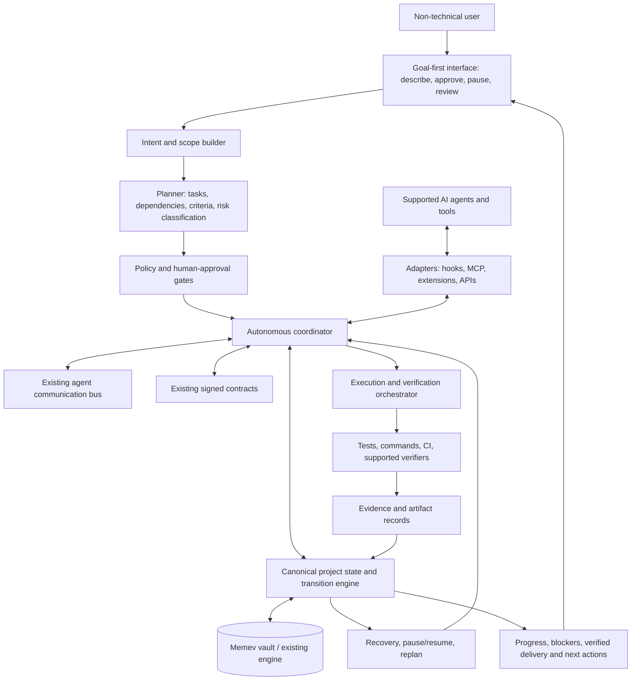

# Scope One — Autonomous Product Architecture & Developer Handoff

**Document class:** TEAM DEVELOPMENT  
**Status:** Proposed architecture and acceptance plan; not yet implemented as a complete product  
**Repository:** `mgillr/memev`  
**Reviewed baseline:** `main` at `76b1ce698140983c874036088ab50d3d2b0e3e00`  
**Audience:** Product owner, architecture, implementation, integration, QA, and future builders

## Mandatory takeover protocol — audit, reconcile, contract, then build

This is the first instruction for the agent or developer taking over Scope One. Do not treat this handoff as a greenfield build spec. The repository, code, tests, current development contracts, issues/PRs, and in-flight work are the evidence of what exists and what remains.

### Required sequence

1. **Establish the real baseline.** Inspect the current branch/commit, working tree, repository instructions, source tree, package scripts, CI, tests, issues/PRs, existing development contracts, and recorded in-progress work. Do not assume the baseline SHA elsewhere in this document is still current.
2. **Inventory existing development contracts.** Find outstanding, accepted, blocked, completed, superseded, and unowned contracts relevant to Memev and Scope One. Record IDs, owners, status, scope, dependencies, acceptance criteria, touched modules, and evidence. Do not create a duplicate contract for already-owned or delivered work.
3. **Audit code and integration.** Trace each requirement to implementation, runtime wiring, and tests—not just filenames or documentation. Classify each as EXISTS_AND_VERIFIED, EXISTS_BUT_INCOMPLETE, DOCUMENTED_ONLY, MISSING, CONFLICTING, or UNKNOWN. A partial function does not prove end-to-end integration.
4. **Build a requirement reconciliation matrix.** For every requirement, record the user outcome, code/test evidence, existing contract and owner, gap, dependencies, proposed disposition (KEEP, INTEGRATE, EXTEND, REPAIR, REPLACE, or NEW), required tests, and acceptance evidence.
5. **Decompose into development contracts.** Every contract must define objective, scope and exclusions, interfaces, modules, dependencies, one accountable owner, invariants, failure modes, security implications, compatibility/migration, test plan, measurable acceptance criteria, closure evidence, and rollback/recovery. Link dependencies explicitly.
6. **Resolve ownership and sequencing.** Amend existing contracts rather than cloning them. Define file/API boundaries and coordinate shared changes. Parallel implementation begins only when interfaces and ownership are clear.
7. **Report the plan before broad implementation.** Provide the baseline report, contract inventory, reconciliation matrix, dependency map, proposed contract amendments/new contracts, risks, and unresolved product-owner decisions. Resolve engineering details from repository evidence wherever possible.
8. **Build in vertical slices.** Deliver the smallest complete end-to-end flow first. Integrate existing components and add regression tests; do not build isolated panels or duplicate subsystems before the delivery path works.
9. **Verify integration.** Run unit, integration, regression, security, packaging, and end-to-end checks appropriate to the slice. Test restart/recovery, duplicate dispatch, stale lead, permission boundaries, local workspace safety, GitHub operations, and evidence-backed completion. Record exact commands/results; never claim unrun tests passed.
10. **Maintain the record.** Update contracts, ownership, dependencies, evidence, known limitations, and handoff docs. A contract closes only when acceptance criteria are met and evidence is linked.

### Non-negotiable engineering rules

- **No duplicate work:** search existing code, contracts, issues, branches, PRs, and tests before opening work or changing a module.
- **No partial integration:** where a requirement overlaps existing capability, prove the complete end-to-end behaviour and contract only the missing integration seams.
- **One source of truth:** do not create competing project state, lead authority, permissions, task ownership, or verification stores without a documented decision and migration plan.
- **Evidence-based status:** distinguish code that exists, is wired into runtime, passes tests, and has been verified end to end.
- **Safe changes:** preserve user files, repository history, compatibility, and data. Replacements/removals require rationale, migration, and rollback.
- **Unknown means unknown:** cite paths, symbols, test names, contract IDs, and commits. If evidence is inaccessible, mark it UNKNOWN rather than guessing.

### Required takeover deliverables

Before broad implementation, create or update the repository's established equivalents of:

1. Baseline and existing-contract inventory.
2. Requirement-to-code/test reconciliation matrix.
3. Contract dependency map with ownership and safe sequencing.
4. Contract backlog containing amended existing contracts and only genuinely new contracts.
5. Risk and decision register.
6. Vertical-slice delivery plan with tests and definition of done.

The audit is not the final outcome: once the plan is reconciled and accepted under repository governance, proceed with implementation and report verified progress.

## Release and installation readiness — no broken first-run experience

Deployability is a required product deliverable, not post-launch polish. A user or lead agent must be able to install Memev using documented, tested methods, verify the installation, connect the supported tools, and start a real project without guessing or relying on undocumented developer knowledge.

### Required distribution and install paths

- **npm:** define the supported package name, versioning, build/publish workflow, package contents, executable entry points, supported Node.js versions and operating systems, and clean-machine install smoke test. Publish only after the release gate passes.
- **Docker:** provide a maintained Dockerfile and, where useful, Compose configuration; publish versioned images and a clear pull/run example; document persistent data, ports, environment variables, permissions, health checks, upgrades, and safe shutdown. Test the published image, not only a local build.
- **Source installation:** document prerequisites and exact commands for clone/install/build/test/run. Test from a clean checkout with no untracked developer files.
- **Supported agent-led setup:** provide an agent instruction/runbook that lets the chosen lead agent inspect prerequisites, select a supported installation path, install or start Memev, verify health, configure only user-approved access, and report the outcome. The agent must not claim success without checking the actual installed version and running health/smoke tests.
- **Local development and upgrades:** document development setup, configuration, data persistence, upgrade/rollback, backup/recovery, and uninstall. Clearly label any experimental or unsupported paths.
- **Release documentation:** publish a concise quick start, full installation guide, configuration reference, troubleshooting guide, supported-platform matrix, and versioned release notes. Commands must match the actual shipped version.

### Release engineering and CI gates

- Establish one reproducible build and test process used locally and in CI. Pin or constrain supported runtime/dependency versions and commit lockfiles where appropriate.
- CI must run lint/static checks where configured, unit and integration tests, build/package validation, CLI smoke tests, container build and runtime smoke tests, and security/secret checks.
- Test installation from the published npm package and published Docker image in a clean environment after publishing to a release candidate/staging tag; verify package contents and executable permissions.
- Test first-run configuration with no existing data, upgrade from the previous supported version, persistent data across container restart, invalid/missing configuration, unavailable provider, expired GitHub authorization, and graceful failure/recovery.
- Validate that published instructions work copy-paste as written. A release must not depend on private files, a developer's local environment, undeclared secrets, or unpublished build artifacts.
- Use semantic versions and immutable release tags; produce checksums/provenance where practical. Never publish secrets, local configuration, private test fixtures, or unintended repository contents.
- Keep credentials out of agent instructions, environment dumps, logs, images, and package artifacts. Agent-led installation must request permission before privileged operations and must not weaken local security controls.
- Make releases repeatable and recoverable. Define release owner, release checklist, failure/rollback steps, and a post-release verification record.

### Agent installation contract

The lead-agent instruction must be provider-neutral and version-aware. It must tell the agent to: identify the user's OS and supported runtime; explain the chosen installation path; obtain permission for required actions; install the pinned/stable release; verify the installed version and health endpoint/CLI check; run a minimal end-to-end smoke test; configure only connections explicitly approved by the user; and report exact results and any limitation. If a step fails, the agent must diagnose and recover or stop safely—not repeat destructive commands or announce success.

### Release acceptance criteria

- Every advertised install method has been executed successfully in a clean environment using the published artifact.
- npm package installs and its documented executable runs on each claimed supported platform/runtime.
- Published Docker image starts, passes its health check, preserves configured data across restart, and follows documented configuration and permission requirements.
- A clean source checkout builds and passes the documented test suite without relying on local developer state.
- The lead agent can follow the installation runbook, verify the result, and clearly report success or failure without hard-coded provider assumptions.
- Quick-start commands, package versions, image tags, environment variables, ports, and prerequisites match the actual release.
- CI and release records provide traceable evidence; failed mandatory gates block publication.
- Upgrade, backup/recovery, and rollback instructions are tested for the supported release path.
- No release is called production-ready while a mandatory advertised installation path is broken or unverified.

## Executive decision

Scope One is the first end-to-end implementation of a **provider-neutral autonomous project-delivery system** built on Memev's existing foundation. It is not a new memory product and must not duplicate capabilities already implemented or described in Memev.

The intended experience is accessible to a non-technical user: describe a project in ordinary language; the product clarifies material ambiguities, builds a scope and delivery plan, asks for approval at the right boundary, then autonomously coordinates supported agents and tools to execute, test, recover, and deliver the result. The user should not need to understand MCP, memory stores, task queues, contracts, or state machines.

**North-star outcome:** A user can state what they want, approve a clear plan, and receive a working deliverable with a trustworthy explanation of what was done, what was tested, what remains, and what evidence supports completion.

The ambition is autonomous execution with low user effort—not unlimited authority. The system must pause for consequential decisions, missing permissions, irreversible actions, unclear requirements that materially affect the result, or security-sensitive steps. Routine, reversible work should proceed without repeated user approval.

This document distinguishes existing capabilities from proposed Scope One work. It does not claim the proposed state layer or complete autonomous experience already exists, that every AI client supports automatic registration/cancellation, or that product-market fit is established.

## 1. Product principles

1. **Outcome-first UX:** users express goals, not implementation instructions.
2. **Autonomous by default:** plan, dispatch, execute, test, recover, and report without requiring the user to supervise each step.
3. **Human control at meaningful boundaries:** ask only when a decision is consequential, unsafe, irreversible, or cannot be inferred reliably.
4. **One canonical project state:** reuse the Memev vault and engine unless evidence justifies a separate store.
5. **State, not just memory:** track goals, scope, dependencies, ownership, attempts, artifacts, verification, and next actions.
6. **Claims are not proof:** agent-reported completion is distinct from evidence-backed verification.
7. **Provider-neutral:** agents are replaceable participants; project state and evidence belong to the user.
8. **Safe recovery:** interruption, restart, stale ownership, and conflicting edits must be detectable and recoverable.
9. **Visible uncertainty:** missing evidence and conflicts are explicit, not hidden by confident summaries.
10. **Low setup friction:** guided install, client health checks, sensible defaults, automatic supported registration, and actionable diagnostics.
11. **Local-first and least privilege:** retain existing security boundaries; remote sharing and access remain controlled.
12. **Measure outcomes:** validate lower time-to-delivery, less rework, reliable recovery, and fewer false completion claims.
13. **Command-centre clarity:** expose progress, agents, communications, plans, changes, outstanding work, and deliverables through coherent views over one canonical state—not separate dashboards with competing truths.
14. **Explicit leadership:** the user may choose the preferred supported lead agent; runtime coordination must enforce one active lead, with deterministic fallback and safe handover.
15. **Local-first, scoped access:** start from a user-selected local workspace without requiring GitHub; connect repositories through explicit least-privilege authorization and never grant agents unrestricted system or repository access.

## 2. Target user experience

### Step A — Install once
The user installs the product and follows a short guided setup. The local service starts automatically where the operating system and installation mode permit. The product detects and registers supported AI clients through their actual available mechanisms: hooks, MCP, extensions, or documented APIs. A connection screen says which clients are connected, which need one-time setup, and which are unsupported. Never pretend to have discovered or hooked a client when it has not.

### Step B — Describe the desired outcome
Example: “Build a small booking site for my restaurant. Customers should see available times, book a table, and receive confirmation. I want it deployed when it is ready.”

The product turns the request into:
- a plain-language project brief;
- assumptions and questions that materially affect the outcome;
- in-scope deliverables and explicit exclusions;
- milestones and dependencies;
- acceptance criteria and test strategy;
- required credentials, external services, costs, or deployment permissions;
- a proposed delivery plan.

The user sees a concise summary, not an internal technical specification. Ask questions in batches only when necessary. Infer reversible defaults and show them for correction.

### Step C — Scope and approval
The system creates a versioned project scope and task graph. It requests approval before execution when scope, cost, privacy, deployment, external communication, data deletion, financial commitment, or other consequential actions require user authorisation. After approval, routine implementation proceeds autonomously.

A changed requirement creates a visible amendment and identifies affected tasks; signed contracts are amended/superseded, never silently rewritten.

### Step D — Execute autonomously
The coordinator selects eligible tasks, chooses agents/tools according to capabilities, assigns ownership, observes progress, resolves routine dependencies, runs checks, and records outputs. Parallelise independent work; serialize work that shares mutable resources or has dependencies. Replan when new evidence invalidates the current plan.

The user sees a concise progress view: current milestone, verified progress, blockers requiring a decision, and the next expected outcome. Do not ask the user to manage individual agent messages.

### Step E — Verify and deliver
The product runs the agreed tests and acceptance checks, checks deployment health when deployment is in scope, and packages the result with a useful handoff: deliverables, how to use/run them, verification performed, known limitations, and anything still requiring attention. A task or project is not labelled complete merely because an agent claims success.

### Step F — Pause, resume, or change direction
The user can say “pause,” “continue,” “change the colour scheme,” or “stop deployment.” Pause prevents new task dispatch and requests cooperative cancellation of in-flight work where supported. State is checkpointed. On resume, the product reconstructs canonical state and continues from the last safe point. If a client cannot cancel an in-flight action, report that limitation accurately.

## Command-and-control centre — the product's primary interface

The command centre is not an optional admin panel. It is the primary user-facing product surface and the layer that makes the complex coordination architecture feel simple. Technical mechanisms run in the background; the user sees progress, decisions, deliverables, and trustworthy evidence.

### Default landing view: one clear answer to "What's happening?"

The first screen should answer, without technical knowledge:
- **Project outcome:** what the system is trying to deliver.
- **Overall status:** planning, working, waiting for me, verifying, delivered, or blocked.
- **Progress and next milestone:** what has been completed, what is active, and what happens next.
- **Needs my attention:** only real decisions, missing access, material ambiguity, or a blocker the system cannot resolve safely.
- **Latest deliverable/evidence:** working output, tests or checks completed, and anything not yet verified.

Use plain language and progressive disclosure. Avoid exposing raw event streams, protocol names, vector clocks, task IDs, or infrastructure details on the default screen. Those belong in an optional technical view.

### Navigation and views

Keep a small, consistent navigation model. Names are provisional, but the user jobs are required:

1. **Overview** — project health, progress, next milestone, recent activity, and the one most important action if one is needed.
2. **Agents** — visual roster of available agents and tools, their role/capability, current assignment, state (idle, working, waiting, verifying, blocked, offline), last meaningful update, and relevant output. Show why an agent is waiting or blocked. Do not imply that a displayed agent is connected or active unless the runtime confirms it.
3. **Comms** — a readable view of agent-to-agent and system communications, linked to tasks and decisions. Default to a human-readable timeline/thread, with filters by agent, task, time, and event type. Clearly distinguish a message, a proposed action, a decision, and a verified event. Sensitive content and credentials must be redacted; permissions govern who can inspect messages.
4. **Roadmap** — milestones and dependencies with status and forecast where supportable. Selecting a milestone opens the associated scope, tasks, deliverables, and blockers. Do not invent dates or present estimates as guarantees.
5. **Project plan / Work** — scoped deliverables, task breakdown, ownership, dependencies, acceptance criteria, and current status. Keep it outcome-oriented by default; expose technical task detail on demand.
6. **Changes** — append-only, attributable history of scope changes, plan edits, decisions, agent handoffs, artifacts, and verification results. Show what changed, why, who or what initiated it, and which verification was invalidated by the change.
7. **Outstanding work** — remaining tasks, blockers, retries, unresolved conflicts, missing evidence, and decisions waiting for the user. Prioritize by impact and dependency, not just recency.
8. **Deliverables** — generated files, code, reports, deployments or other outputs, each with version, provenance, validation status, and a direct way to open or export it.
9. **Settings / Connections** — supported integrations, connection health, granted permissions, privacy controls, and a guided repair flow. Keep setup to a minimum and explain permissions in terms of what they allow the product to do.

These views should be different projections of the same canonical project/task/event data, not separate sources of truth. A task update should flow through to Overview, Roadmap, Agents, Changes, and Outstanding work without manual duplication.

### The interaction model

- A persistent, natural-language **"Tell the system what you want to achieve"** entry point starts a project or changes direction.
- The user can click any status, milestone, agent, communication, task, or deliverable to drill into the evidence and context behind it.
- A single **Needs your decision** queue collects only meaningful approval requests. Each request states the choice, why it matters, the recommended option, consequences, and what can proceed while waiting.
- The system updates the plan as work evolves, records the reason for changes, and makes material scope changes visible before they silently alter the promised outcome.
- Pause, resume, and cancel are easy to find. Explain whether cancellation is confirmed, what work stopped, and what may still be running in external tools.
- Notifications should be useful and sparse: material milestones, decisions required, genuine blockers, and delivery. Routine internal agent chatter should not interrupt the user.

### Visual and operational design principles

- Make the interface feel calm, responsive, and trustworthy—not like a wall of logs or a DevOps console.
- Show the next useful action, not every internal action.
- Use status labels with consistent meanings across all views.
- Every progress claim should trace back to a state transition or event; every "verified" label should link to evidence.
- Provide accessible desktop and mobile layouts; the core experience must work without requiring users to read a dense graph.
- The comms bus visualisation is a **human-readable observability view**, not the bus itself. The bus and its durable events must continue to work when the UI is closed.
- A graph/network view can be an optional advanced view, but never the only way to understand work.
- The interface must remain useful for one agent as well as many; don't make multi-agent complexity the product's prerequisite.

### Dashboard acceptance criteria

- A first-time non-technical user can identify project status, next milestone, outstanding user decisions, blockers, and latest deliverable without onboarding from an engineer.
- Clicking a milestone or task reveals dependencies, owner, acceptance criteria, latest events, and verification evidence.
- The Agents view reports actual runtime status and does not fabricate activity.
- The Comms view can filter and trace messages to the tasks/decisions they concern while respecting access controls and redacting secrets.
- Changes show scope/plan history and identify affected verification when scope or artifacts change.
- Outstanding work is derived from canonical state and includes blocked work, unresolved conflicts, and missing evidence.
- UI status remains consistent with backend state after refresh, process restart, and reconnection.
- Closing the dashboard does not stop autonomous execution; reopening it reconstructs the current state from durable project data.
- A user can start from a natural-language goal and reach the first meaningful plan without needing to configure agents, protocols, or infrastructure manually.

## Local workspace and GitHub access — zero-friction project onboarding

The system must be useful immediately on a user's computer, whether or not they already use GitHub. Local files and GitHub repositories are complementary project sources, not competing modes. The user should not need to understand repository setup, agent permissions, or filesystem configuration to start.

### Local-first access

- During onboarding, offer a clear "Choose a project folder" flow. With explicit user selection and OS/runtime permission, the product can inspect and work within that folder and its descendants according to the granted scope.
- Do not silently scan the entire computer or assume unrestricted filesystem access. Ask for a folder or workspace, explain what access enables, and offer a way to revoke it.
- The chosen project root is the default workspace boundary. Agents receive scoped tools for that workspace; access to other paths requires a separate grant or a user-visible decision.
- Detect common project markers (for example Git metadata, package manifests, README files, and known build/test configurations) to understand an existing project without forcing the user through a technical setup wizard.
- If the user chooses an existing local repository, preserve its history, remotes, branches, and uncommitted changes. Inspect status first; never overwrite or reset work silently.
- If the folder is not yet under version control, offer to initialise Git locally when appropriate. Local Git use must not require a GitHub account.

### GitHub connection and repository discovery

- Offer a guided **Connect GitHub** option through the supported GitHub authorization flow. Request least-privilege permissions, explain them in plain language, and let the user choose which repositories to grant access to where the provider supports selection.
- Once connected, discover repositories the authenticated user is actually allowed to access. Let them choose an existing repository or associate one with the selected local project. Do not assume all repositories are accessible, and do not expose repository contents to agents that have not been granted the relevant project permissions.
- Keep local filesystem authorization and GitHub authorization separate. Connecting GitHub does not grant access to arbitrary local files; selecting a local folder does not grant access to remote repositories.
- When a local Git repository already has a GitHub remote, detect and display it, verify that access works, and avoid creating a duplicate repository.
- Support local-only operation for users who do not have GitHub or do not want to connect it. Do not block first use on creating an account. If a specific feature genuinely requires a remote repository, explain the reason at that point.

### New repository and account setup

- When the user requests remote collaboration, backup, CI, or another feature that requires GitHub and has no suitable repository, guide them through creating a repository under their own authenticated account or organization, subject to their permissions.
- The product may create a repository only after the user has connected an account, selected the owner/location, chosen visibility, and confirmed the operation. Default to private when suitable; never make a repository public without explicit informed approval.
- Do not claim the product can create a GitHub account for the user automatically. Account registration, email verification, terms, MFA, and recovery may require the user to interact directly with GitHub. Provide a short handoff link and resume setup after they finish.
- Before publishing local files, show the intended repository, visibility, files to be pushed, and any sensitive-file warnings. Exclude credentials, tokens, .env files, private keys, and other detected secrets; stop and ask when uncertain.
- Before the first push, inspect the destination and local working tree. Never overwrite an existing remote history or force-push without a specific, explicit approval and a recoverable plan.
- If authorization expires, a repository is inaccessible, or the user lacks permission, explain the actual limitation and give a recovery action rather than repeatedly retrying or silently falling back.

### System-wide agent access and security boundaries

- Agents share project context through Memev's canonical state and comms bus, but they do not receive unrestricted access to every local file or every repository by default.
- The lead coordinates access requests and task assignment; it cannot grant itself or other agents permissions that the user has not approved. All agents/tools must use the same policy enforcement point for filesystem and GitHub operations.
- Represent each grant with a clear scope (project root or repository), principal/tool, permitted operations, and revocation state. Enforce the scope in tool adapters, not just in prompts.
- Record access, writes, pushes, branch changes, and permission errors in the project event history. Do not put credentials or tokens in the bus, prompts, logs, or project files.
- When a task needs a file or repository outside the current grant, request the narrow additional access needed and explain why. Never silently broaden the scope.

### Onboarding acceptance criteria

- A user with only a local folder can start a project without a GitHub account.
- A user with GitHub can connect it once, select permitted repositories, and use them from the command centre without configuring each agent separately.
- Local folder access and GitHub access are separately scoped, visible, and revocable.
- Existing Git remotes and repository history are detected and preserved; the product does not create duplicates or silently overwrite changes.
- Creating a remote repository or pushing local content requires explicit confirmation of owner, visibility, destination, and intended operation.
- The system never claims to create a GitHub account automatically; it guides the user through any required provider-owned registration steps.
- Secret scanning and destination checks run before publishing content; detected secrets block the push until resolved.
- Agents cannot access local paths or repositories outside the user's grants, even if another agent requests access.
- When setup is complete, the lead and all permitted agents use the same project-scoped access layer; users do not configure credentials separately for each agent.

## Lead agent selection and single-authority coordination

The product must have exactly one active **project lead/coordinator** for each project execution. This is the agent responsible for interpreting the user's goal, maintaining the plan, distributing work to other agents and tools, resolving routine coordination questions, tracking dependencies, and reporting back to the user. Specialist agents execute delegated tasks; they do not independently become a second project lead.

### User preference first; deterministic fallback second

- During guided setup, let the user choose a preferred lead from the supported, actually available agents—for example Codex, Claude, or Grok. Present only integrations that are configured and reachable, and explain briefly what choosing a lead means.
- If the user has already expressed a preference, respect it when that agent is supported and available. Do not ask them to choose again unnecessarily.
- If no preference is supplied, select a deterministic default from the configured/available agents using a documented policy; show the selection and allow the user to change it. Do not randomly select a lead or infer that the first agent to speak owns leadership.
- If the preferred lead is unavailable, do not silently substitute another agent. Explain the issue and offer a clear choice: retry/connect the preferred agent, select a fallback, or continue in a limited mode if that is genuinely supported.
- Store the user's choice as project configuration, including the provider/agent identity and any required connection/profile identifier. The lead is a role assigned to an agent, not a hard-coded provider or a special privileged model.
- The user can change the lead later. Make the handover explicit: stop new dispatch briefly, checkpoint in-flight work, transfer canonical plan/state and outstanding assignments, record the handover event, then resume under the new lead. Preserve specialist assignments where safe; do not replay tasks blindly.

### Enforce one lead in the runtime

- Separate **lead/coordinator** from Memev's existing bus **operator seat**. The operator seat represents who speaks for the user; it must not automatically be treated as the project lead unless an explicit, validated configuration binds those roles.
- Keep one canonical `project.lead_agent_id` (or equivalent) and a versioned assignment/lease for the active coordinator. All dispatch decisions must go through the coordinator service, not whichever agent happens to receive a prompt.
- Validate every coordination command against the current lead identity, project, and assignment version. Reject stale-lead writes and conflicting coordinator actions; record the reason in the event history.
- Use atomic compare-and-set or equivalent single-writer/lease semantics for leadership changes. A stale or partitioned lead must not continue dispatching work after its authority expires. If leadership cannot be determined safely, pause new dispatch and surface a recoverable conflict rather than allowing split-brain coordination.
- Specialist agents may suggest plan changes or request delegation, but the active lead (or an explicitly defined policy/human gate) owns the decision and canonical state transition.
- The lead is not allowed to bypass permission checks or human approval gates. Provider capabilities differ; tool access, credentials, budget, external actions, and verification remain governed by policy.
- If the lead crashes or disconnects, recover using the stored user preference and documented fallback policy. Record the failure and any reassignment. Never imply that a fallback was chosen by the user when it was automatic.

### Lead agent acceptance criteria

- Setup allows the user to select a supported available lead such as Codex, Claude, or Grok, while remaining usable with sensible defaults.
- The chosen lead is visible in the command centre, along with its provider, health, and current role.
- Exactly one lead has authority to dispatch work at a time, even when several AI clients are connected to the same Memev bus.
- Two agents attempting to coordinate the same project cannot create competing plans or dispatch the same task under different leadership.
- An unavailable preferred lead triggers an explicit recovery choice; there is no silent substitution.
- Lead handover preserves canonical project state, records an auditable event, and prevents the old lead from acting with stale authority.
- A lead failure does not erase work or trigger blind duplicate execution; recovery follows the saved preference and fallback policy.
- The bus operator seat and project lead are independently represented unless the user explicitly configures them to be the same.

## 3. Autonomy model and human gates

Classify actions by risk:

- **Routine and reversible:** proceed autonomously within approved scope (drafting, coding, local tests, refactoring, documentation).
- **Cost-bearing or externally visible:** operate only within explicit user-set limits; request approval if a limit is absent or exceeded.
- **Security-sensitive:** use least privilege; never request or expose credentials unnecessarily; ask for user action when access must be granted.
- **Irreversible or destructive:** require explicit approval (delete production data, destructive migrations, revoke access, overwrite important assets).
- **Ambiguous with material impact:** ask a concise question and explain the decision's consequence.
- **Low-impact ambiguity:** choose a reversible default, record the assumption, and continue.

Autonomy is not a licence to bypass permissions, fabricate test results, conceal failure, or take actions outside the approved scope. Every external side effect must be visible in the audit record.

## 4. Proposed project/task state machine

Task-level states:
- `PROPOSED`: identified but not accepted.
- `ACCEPTED`: scope and acceptance criteria agreed.
- `READY`: dependencies satisfied and task eligible for dispatch.
- `IN_PROGRESS`: an owner has an active assignment/lease.
- `BLOCKED`: dependency, permission, resource, or decision prevents progress.
- `PAUSED`: execution suspended with a checkpoint.
- `VERIFYING`: required checks are running or awaiting results.
- `VERIFIED`: mandatory acceptance criteria passed and evidence is stored.
- `FAILED`: a defined execution or verification attempt failed.
- `CONFLICTED`: incompatible updates require reconciliation.
- `CANCELLED`: explicitly cancelled with reason and actor.

Project status should be derived from task state and policy: `DRAFT`, `ACTIVE`, `PAUSED`, `NEEDS_ATTENTION`, `VERIFYING`, `COMPLETE`, or `CANCELLED`.

### Invariants
- Only accepted work may be dispatched.
- Agent assertions cannot alone move work to `VERIFIED`.
- Verification must bind to the current scope version and relevant artifact/commit.
- Scope changes invalidate affected checks and trigger replanning.
- Reassignment requires an expired/released lease or authorised override and inspection of prior attempts.
- Duplicate event delivery is idempotent.
- A stale agent cannot overwrite canonical state after reassignment.
- Conflicts are surfaced rather than silently resolved by last-write-wins.
- Every transition records actor, time, reason, previous/new state, scope version, and evidence references.
- “Pause” stops new dispatch; hard cancellation is claimed only if the integration confirms it.

## 5. Proposed architecture

### Components
1. **Goal intake and scope builder:** translates natural-language intent into a versioned brief, assumptions, deliverables, constraints, acceptance criteria, and risk/cost boundaries.
2. **Planner:** produces a dependency-aware task graph, selects suitable tools, and estimates required access/resources. The plan is revisable when evidence changes.
3. **Policy/approval layer:** decides which actions are allowed autonomously and which need permission or human approval.
4. **Client adapters:** register sessions and expose each client's capabilities, health, progress, cancellation semantics, and tool access.
5. **Canonical project state:** stores project/task/scope/dependency/ownership/attempt/evidence records and append-only transition events.
6. **Coordinator/dispatcher:** assigns eligible tasks, enforces ownership and dependencies, detects overlap, monitors health, and recovers stale assignments.
7. **Execution layer:** delegates bounded tasks to agents/services and collects structured outcomes and artifact references.
8. **Verification orchestrator:** runs acceptance criteria and records actual results, versions, hashes, timestamps, and receipts.
9. **Continuity projection:** presents compact project context to each agent; transcripts and memory inform state but cannot override authoritative scope or verified facts.
10. **User-facing status and delivery:** shows the next meaningful result, blockers requiring intervention, and final handoff without exposing unnecessary technical complexity.
11. **Observability and diagnostics:** integration health, transition rejections, failures, retries, stale leases, policy decisions, and auditable external side effects.

## 6. Map to existing code — reuse before adding

Based on the reviewed repository baseline; verify exact symbols and tests against the active branch before implementation.

| Requirement | Existing code/docs | Scope One action |
|---|---|---|
| Local service/runtime | `docs/ARCHITECTURE.md`, `src/server/*` | Extend the current daemon; do not introduce a second service without a demonstrated need. |
| MCP interface | `src/server/mcp.mjs` | Add typed tools to the existing handler so stdio and HTTP paths behave consistently. |
| Vault and persistence | `src/engine/vault.mjs`, `oplog.mjs`, `git.mjs` | Use the existing vault writer and add schema/version migration. |
| Resume context | `src/engine/card.mjs` | Project concise authoritative state into the existing resume card; do not create a parallel memory layer. |
| Transcript checkpoints | `src/cli/transcript.mjs` | Use as an input to recovery, not as the authoritative project state. |
| Signed contracts | `src/engine/contracts.mjs`, `docs/CONTRACTS.md` | Bind acceptance criteria to project/scope versions and verification outcomes. Confirm fresh-install enablement/configuration. |
| Agent bus | `src/engine/bus.mjs`, `docs/BUS.md` | Reuse communication messages, but implement explicit task claims/leases and transition rules separately. |
| Client registration/hooks | `src/cli/clients.mjs`, `src/cli/hooks.mjs`, MCP stdio | Build per-client capability discovery and clear status. Support automatic registration only where actually possible. |
| Security | `src/engine/tokens.mjs`, `devices.mjs`, threat-model docs | Reuse auth/device boundaries; define who can amend scope, assign, pause, deploy, and verify. |
| Existing test patterns | `test/continuity.test.mjs`, `test/proofline-flow.test.mjs`, `test/sync-conflict.test.mjs` | Extend with state-machine, autonomous recovery, concurrency, and end-to-end tests. |
| Proofline | `mgillr/proofline-action` `action.yml` | Integrate existing CI check/receipt behaviour where it fits; do not copy the Action into Memev. |
| Hivevault | `mgillr/hivevault` README and dependency map | Optional only where shared memory adds a distinct capability. Avoid dual canonical project state. |
| CRDT-Merge | `mgillr/crdt-merge` README and architecture | Not a default dependency. Evaluate only when concurrency tests prove the need; review BSL 1.1 restrictions before embedding or offering a service. |
| ACFA-RS | `mgillr/acfa-rs` README | Outside Scope One unless a concrete robust-aggregation requirement appears. |
| TrueDone | No verified API mapped in this review | Do not depend on it until repository/API, licence, ownership, and integration contract are identified. |

### Suggested module boundaries
Proposed names only; follow repository conventions:
- `src/engine/project-state.mjs`: schema and transition invariants.
- `src/engine/project-store.mjs`: persistence and migration.
- `src/engine/coordinator.mjs`: task eligibility, claims, dependencies, leases, recovery.
- `src/engine/planner.mjs`: plan representation and replan triggers.
- `src/engine/policy.mjs`: autonomy limits and human approval gates.
- `src/engine/evidence.mjs`: verification results and evidence freshness.
- `src/server/mcp.mjs`: tools wired to existing server.
- Tests: `test/project-state.test.mjs`, `test/coordinator.test.mjs`, `test/project-recovery.test.mjs`, `test/autonomy-policy.test.mjs`, `test/project-mcp.test.mjs`.

## 7. Canonical data model

Minimum entities:
- **Project:** stable ID, goal, brief, scope version, constraints, exclusions, cost/time limits, owner, policy, status projection.
- **Task:** stable ID, project ID, description, scope version, dependencies, acceptance criteria, state, priority, required capabilities.
- **Assignment/lease:** task ID, agent/session, generation token, issued/expiry time, status, release reason.
- **Attempt:** task/attempt ID, agent, timestamps, summary, changed artifacts/commits, result, errors, checkpoint.
- **Evidence:** criterion ID, verifier type/version, command/CI reference, scope/artifact hash, result, timestamp, log/receipt reference.
- **Event:** unique event ID, entity ID, actor, previous/new state, reason, time, scope version, correlation ID, evidence references.
- **Conflict:** competing source/event references, affected entities, reason, resolution, authorised resolver.
- **Integration session:** provider/client, session identity, capabilities, heartbeat, last acknowledged event, health.
- **Approval:** action/scope, risk class, requester, approver, decision, time, limits and expiry.

Avoid storing secrets in project records, transcripts, logs, or summaries. Define retention, redaction, and sharing policy before cross-device synchronisation.

## 8. Autonomous coordination and duplicate-work controls

The objective is to prevent avoidable overlap and make collisions recoverable, not to promise mathematically zero duplication under every provider/network failure.

- Use atomic claims/leases where storage supports them.
- Include a lease generation/token so stale agents cannot commit as current owners.
- Use idempotency keys for task dispatch, state changes, and external actions.
- Parallelise only independent tasks or explicitly partitioned resources.
- Keep task dependencies and shared-resource locks visible to the planner.
- When an agent disappears, inspect checkpoint, lease, changed artifacts, and outstanding side effects before reassignment.
- Preserve late results as attempt evidence but do not silently overwrite canonical state.
- Treat retries differently for idempotent and non-idempotent actions.
- Detect semantic conflicts; Git merge success is not proof of semantic correctness.
- Replan when requirements change, verification fails, or dependencies become invalid.

## 9. Security and safety requirements

- Local-first defaults and least-privilege credentials.
- Scope-bounded execution; no unapproved expansion of objectives.
- Explicit gates for destructive, irreversible, financial, externally visible, or privacy-sensitive actions.
- Do not expose credentials in prompts, transcripts, MCP outputs, logs, or sync.
- Treat agent output and transcript content as untrusted input.
- Keep signed contracts immutable; amendments supersede earlier versions.
- Bind evidence to the exact scope and artifact version.
- Require authorisation for scope amendments, deployment, cancellation, and privileged operations.
- Log external side effects and approval decisions.
- Never fabricate progress, tool access, test outcomes, or cancellation.
- Clearly distinguish inferred, reported, and verified status.

## 10. Failure tests to build

Reported community issues are useful problem signals, not proof of prevalence. Reproduce these failures in our own harness before making marketing claims.

| ID | Failure | Expected result |
|---|---|---|
| F01 | Session context is compacted | Scope, constraints, task state, and next action survive resume. |
| F02 | Different supported agent resumes the project | It receives canonical state and only eligible assignments. |
| F03 | Agent claims completion without passing checks | Work remains unverified. |
| F04 | Stale context from another project appears | Project boundaries/provenance prevent silent contamination. |
| F05 | Two agents claim an exclusive task | One claim wins; the other gets a clear conflict response. |
| F06 | Agent disconnects mid-task | Recover from checkpoint; no blind duplicate dispatch. |
| F07 | Old agent returns after reassignment | Its output is retained but cannot overwrite current state. |
| F08 | Scope changes after verification | Affected checks become stale and tasks are replanned. |
| F09 | Devices sync incompatible changes | Conflict is visible and resolvable, not silently overwritten. |
| F10 | User pauses during active execution | No new dispatch; in-flight cancellation state is reported honestly. |
| F11 | Required verifier is unavailable | Task cannot become verified; system explains why. |
| F12 | Event is delivered twice | Idempotency prevents duplicate transitions/side effects. |
| F13 | Client lacks session discovery or cancellation | Status shows the limitation accurately. |
| F14 | Evidence belongs to an old scope/artifact | It is not accepted for current scope without explicit policy. |
| F15 | Daemon restarts | Canonical state and event history reconstruct consistently. |
| F16 | Planner encounters an ambiguous high-impact choice | It asks the user and explains the consequence. |
| F17 | Routine reversible choice is underspecified | It chooses a reasonable default, records the assumption, and proceeds. |
| F18 | Action exceeds configured cost/permission boundary | It stops at the policy gate and requests approval. |
| F19 | Verification fails | System diagnoses, retries within policy, or reports a blocker; it does not claim success. |
| F20 | External side effect succeeds but acknowledgement is lost | System checks actual outcome before retrying to avoid duplicate side effects. |

## 11. Scope One acceptance criteria

Scope One is complete only when a reproducible demo proves:

1. A non-technical user can install and connect the initial supported clients through a guided flow.
2. User can describe a project in natural language and receive a comprehensible scope, assumptions, plan, and acceptance criteria.
3. Material ambiguity and consequential actions trigger the appropriate approval; routine reversible work proceeds autonomously.
4. User can approve, pause, resume, amend, or cancel the project without manually coordinating individual agents.
5. The planner decomposes scope into dependency-aware tasks with stable IDs.
6. At least two supported agent sessions execute different tasks through the shared state model.
7. Exclusive task claims and stale ownership are enforced under concurrency.
8. Daemon restart/new session reconstructs state from canonical records.
9. UI distinguishes reported, inferred, and verified state and shows provenance.
10. No task becomes verified without required checks tied to current scope/artifact versions.
11. Failed checks, blocked work, conflicts, stale evidence, and missing permissions are actionable and visible.
12. Pause stops new dispatch and accurately reports in-flight task status.
13. Duplicate events and stale results do not corrupt state or repeat non-idempotent actions blindly.
14. Existing Memev tests continue to pass; new deterministic failure cases are automated.
15. A final delivery summary includes artefacts, run/use instructions, checks performed, evidence, limitations, and unresolved items.
16. Product documentation identifies per-client capability limits and does not overclaim universal auto-registration or hard cancellation.

## 12. Implementation plan

### Phase 0 — Baseline and decisions
- Run and record the current test suite.
- Trace vault write APIs, contract verification, bus operations, MCP tool registration, hooks, and resume card.
- Choose initial supported clients and verify their real integration/cancellation capabilities.
- Decide schema/versioning, ID/event ordering, lease semantics, policy defaults, and permission matrix.
- Record a short architecture decision record.

**Exit gate:** baseline report and reviewed design decisions.

### Phase 1 — State core
- Implement schemas, persistence, migrations, event log, transition validation, and idempotency.
- Add unit tests for all transition invariants.

**Exit gate:** persistence and state-machine tests pass.

### Phase 2 — Coordination and recovery
- Implement dependencies, task claims/leases, heartbeats, stale-owner rejection, conflict records, and restart recovery.
- Connect state transitions to the existing bus.

**Exit gate:** concurrency, duplicate-event, stale-result, and recovery tests pass.

### Phase 3 — Goal-to-scope planner and policy
- Convert natural-language requests into a structured brief, task graph, assumptions, criteria, risk classification, and resource/permission requirements.
- Provide an approval boundary for material choices.
- Support re-planning after scope change or failed verification.

**Exit gate:** scenario tests cover ambiguous requests, reversible defaults, approval gates, and scope amendments.

### Phase 4 — MCP and client adapters
- Expose project/task operations through existing MCP.
- Add per-client registration/health and supported session/task handoff.
- Integrate the canonical state projection into the existing resume card.

**Exit gate:** a fresh supported session can continue the project using the shared state.

### Phase 5 — Execution and verification
- Bind tasks to existing contracts and supported verifiers.
- Record evidence and bind it to scope/artifact versions.
- Integrate Proofline where its existing CI receipts/checks are useful.

**Exit gate:** no false verified state in the required test matrix.

### Phase 6 — Command centre, end-to-end demo, and product validation
- Demonstrate a user idea flowing through scope approval, multi-agent execution, pause/resume, a failed check, recovery, and verified delivery.
- Compare against a baseline without coordination.
- Measure time-to-resume, duplicate assignments, repeated work, missed requirements, verification failures, human interventions, and completion accuracy.

**Exit gate:** recorded demo, reproducible tests, known limitations, and evidence of measurable improvement.

## 13. Metrics

Track at minimum:
- Time from project description to approved scope.
- Time from resume to useful work resumed.
- Percentage of tasks with explicit acceptance criteria.
- False-positive completion rate (target zero in deterministic tests).
- Duplicate exclusive assignments and avoidable repeated work.
- Recovery success after agent/daemon interruption.
- Verification pass/fail rate and stale-evidence detection.
- Number and reason of human interventions.
- Autonomous completion rate within the approved scope.
- Cost/time per verified deliverable.
- Setup completion and integration connection failure rates.

Do not equate a high autonomy rate with success if correctness, safety, or user trust degrades.

## 14. Market problem evidence and research discipline

Public reports suggest recurring complaints about lost context, stale memory, duplicated work, coordination failures, and unsupported completion claims. Treat each as a hypothesis to test—not as a market-size estimate.

Starting source list to re-check before external publication:
- Claude Code context/constraint reports: https://github.com/anthropics/claude-code/issues/32659 and https://github.com/anthropics/claude-code/issues/31409
- Codex context/project instruction report: https://github.com/openai/codex/issues/25792
- Mem0 memory extraction/contradiction reports: https://github.com/mem0ai/mem0/issues/5867, https://github.com/mem0ai/mem0/issues/7195, https://github.com/mem0ai/mem0/issues/5235
- Multi-agent workflow engineering discussion: https://github.blog/ai-and-ml/generative-ai/multi-agent-workflows-often-fail-heres-how-to-engineer-ones-that-dont/
- Codex duplicate-work report: https://github.com/openai/codex/issues/16900
- Complaint-post analysis (interested source; proportions of posts are not user incidence): https://openchamber.dev/blog/ai-coding-complaints/

Before using any source as a current fact, re-check its date/status and preserve the difference between an individual report, a maintainer-confirmed bug, an independent benchmark, and our own reproduction.

## 15. Scope boundaries and deferred integrations

- Do not rewrite Memev's memory/vault.
- Do not add a second canonical project database.
- Do not rebuild Proofline Action.
- Do not require Hivevault, CRDT-Merge, or ACFA-RS to ship Scope One without a demonstrated need.
- Do not assume all AI clients expose identical lifecycle hooks or cancellation semantics.
- Do not promise zero duplication, uninterrupted execution, or perfect correctness.
- Do not make enterprise controls, marketplace, billing, and every provider integration blockers for the first end-to-end release.

## 16. Repository source map

Reviewed/current baseline references:
- Memev architecture: https://github.com/mgillr/memev/blob/main/docs/ARCHITECTURE.md
- Module map: https://github.com/mgillr/memev/blob/main/docs/MODULES.md
- Contracts: https://github.com/mgillr/memev/blob/main/docs/CONTRACTS.md
- Agent bus: https://github.com/mgillr/memev/blob/main/docs/BUS.md
- Resume card: https://github.com/mgillr/memev/blob/main/src/engine/card.mjs
- Contracts implementation: https://github.com/mgillr/memev/blob/main/src/engine/contracts.mjs
- Bus implementation: https://github.com/mgillr/memev/blob/main/src/engine/bus.mjs
- MCP handler: https://github.com/mgillr/memev/blob/main/src/server/mcp.mjs
- Transcript recovery: https://github.com/mgillr/memev/blob/main/src/cli/transcript.mjs
- Continuity tests: https://github.com/mgillr/memev/blob/main/test/continuity.test.mjs
- Proofline flow tests: https://github.com/mgillr/memev/blob/main/test/proofline-flow.test.mjs
- Sync conflict tests: https://github.com/mgillr/memev/blob/main/test/sync-conflict.test.mjs
- Proofline Action: https://github.com/mgillr/proofline-action/blob/main/action.yml
- Hivevault: https://github.com/mgillr/hivevault/blob/main/README.md
- CRDT-Merge licence/architecture context: https://github.com/mgillr/crdt-merge/blob/main/README.md and https://github.com/mgillr/crdt-merge/blob/main/docs/CRDT_ARCHITECTURE.md
- ACFA-RS: https://github.com/mgillr/acfa-rs/blob/main/README.md

## Builder handoff checklist

- [ ] Confirm baseline branch, commit, working tree, and test status.
- [ ] Implement scoped local workspace selection and access checks before allowing agents to read/write project files.
- [ ] Implement GitHub authorization, repository discovery/selection, and explicit repo-creation/push confirmation; keep local-only use available.
- [ ] Add secret scanning and destination/history checks before any initial push or publish operation.
- [ ] Validate source map against current code before implementation.
- [ ] Agree the first supported clients and test them end to end.
- [ ] Implement state schema, transitions, and invariants first.
- [ ] Implement lead selection, single-authority enforcement, and safe lead handover before parallel dispatch.
- [ ] Keep the project lead distinct from the existing bus operator seat unless explicitly configured.
- [ ] Implement atomic ownership/idempotency/recovery before parallel dispatch.
- [ ] Connect contracts and verification before claiming autonomous delivery.
- [ ] Add policy and human gates before enabling external or destructive actions.
- [ ] Ship the complete vertical slice before expanding integrations.
- [ ] Record demo and metrics; update this document as implementation decisions change.

**Definition of success:** A non-technical user describes an outcome, approves the material scope and permissions, and the product coordinates supported AI agents to deliver a tested result, safely recover from interruption, and explain what is verified—without requiring the user to manage the technical machinery.

## Complete-system requirement — not an MVP

**Scope One means the complete agreed Scope One system implemented in the current Memev codebase. It does not mean a small fraction, demo, mock interface, or disconnected proof of concept.** The first end-to-end vertical slice is the first integration gate, not the final scope. Once it passes, implementation must continue until every agreed Scope One requirement is delivered and verified.

Before broad implementation, reconcile every requirement against actual code, runtime wiring, existing development contracts, tests, and evidence. Give each requirement an owner and one explicit status: verified implemented, incomplete, missing, conflicting, unknown, or explicitly deferred by product-owner decision. No requirement may disappear silently. Deferred or blocked items must state the reason, user impact, owner, and resolution path.

### The finished Scope One system

Reconcile the detailed list below against the repository and agreed requirements; these are completion obligations, not claims that they already exist.

- A complete, non-technical onboarding and project command centre.
- Local project-folder selection and safe, explicitly scoped filesystem access.
- Optional GitHub connection, repository discovery/selection, scoped permissions, safe Git operations, and secret scanning before publication.
- User-selected supported lead agent, visible fallback handling, one active coordinator, and safe lead handover.
- Natural-language goal intake, clarification of material ambiguity, plan/scope review, and approval gates for consequential actions.
- Persistent project and task state; atomic contracts; dependencies and ownership; dispatch, progress, retries, idempotency, interruption recovery, and conflict handling.
- Integrated memory and shared context based on a documented Memev/Hivevault architecture decision, with recall, provenance, retention, recovery, and migration guarantees.
- Specialist-agent coordination through reconciled existing bus/tool interfaces, not a competing orchestration subsystem.
- Build, test, integration, and evidence-backed verification. A task claim alone is not completion; changes to scope or artifacts must invalidate affected verification.
- Security and permissions enforced by runtime adapters: least privilege, revocation, secrets protection, audit records, and human approval for destructive, external, financial, privacy-sensitive, or otherwise consequential actions.
- Complete install, first-run, upgrade, backup/recovery, rollback, and uninstall paths for every advertised supported distribution.
- User-facing delivery of results, test evidence, known limitations, remaining work, and useful troubleshooting information.
- Regression, integration, security, clean-install, upgrade, restart/recovery, and end-to-end acceptance tests.

Do not expand Scope One indiscriminately into unrelated future enterprise features. The goal is complete delivery of the agreed scope, not uncontrolled scope growth. Anything genuinely outside Scope One must be named as such and must not be counted as completed Scope One work.

### First proof point versus final acceptance

The first proof point is one complete delivery loop on a clean supported machine: install Memev, select a local folder, optionally connect GitHub, choose a supported lead agent, describe a real goal, approve material decisions, let Memev coordinate the work, and receive a tested deliverable with evidence and honest limitations.

Passing that loop is necessary but not sufficient. The team must then close the entire reconciled Scope One contract backlog, including all required onboarding, memory, coordination, security, recovery, distribution, documentation, and user-facing behaviour. Dashboards and agent activity are not substitutes for a working system.

### Completion gate

Do not call Scope One complete, production-ready, or fully autonomous until all agreed requirements are mapped to implementation and evidence; all mandatory contracts are closed or explicitly excluded by the product owner; the full journey passes in a clean supported environment; mandatory integration, security, recovery, and release gates pass; and known limitations are visible. Record exact test commands and results, supported environments, artifact versions, outstanding issues, and approved exceptions. Documentation, mocked flows, isolated unit tests, and agent self-report are not sufficient evidence.

### Memory and commercial boundary: Memev Free and paid capabilities

Memev already contains more than simple note retrieval, including a local Markdown vault, recall index, graph, memory-quality gate, operation log, and agent context/coordination mechanisms. Do not describe the free core as merely "get notes" without verifying its actual user-visible behaviour. Hivevault is a separate local-first shared-memory implementation; neither project should be assumed more efficient or correct without comparative evidence.

Audit both implementations and test them against the same workloads: recall relevance and latency, write performance, storage growth, duplicate/conflicting memories, concurrent and offline writes, convergence, crash recovery, resource use, and migration. Record the results and make an explicit architecture decision to retain Memev's implementation, reuse a bounded Hivevault component, or migrate to one implementation. Document the API/data boundary, licensing/dependency implications, migration and rollback. Maintain one canonical authority for each kind of project state and memory; do not create two competing recall, graph, or merge pipelines.

Keep the free core useful and define paid entitlements precisely. Multi-device convergence, hosted sync/backup, team administration, and other paid capabilities must be labelled accurately as implemented, planned, or unavailable. Pricing documents do not prove implementation. Define upgrade/downgrade behaviour and ensure users retain access to their local notes and export options if a paid service or subscription ends.
