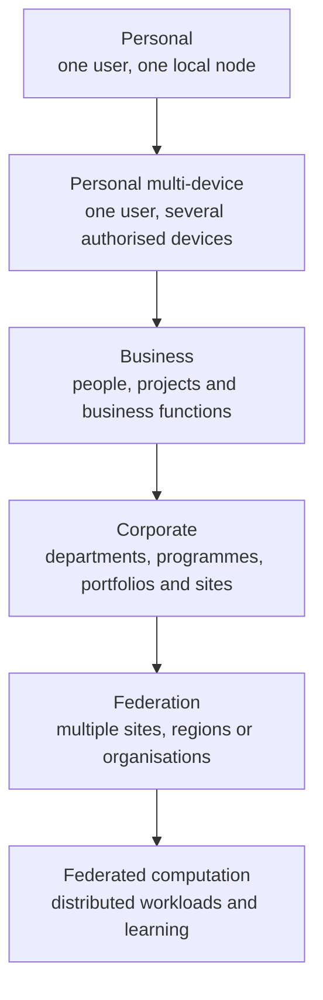

# Tiers and deployment models

Part of the [Memev documentation](../README.md). Up: the [README](../../README.md).
Architecture: [ARCHITECTURE.md](../ARCHITECTURE.md). Federation:
[FEDERATION.md](../FEDERATION.md).

> **DRAFT.** Commercial packages, limits and services on this page are proposals, not offers.
> The Personal core is built and free. Personal multi-device, Business and Corporate capabilities
> are at different stages of planning and implementation. Federation and federated computation
> describe the larger architecture and are not claims of shipped functionality. See
> [PRICING.md](../PRICING.md).

Memev uses one architecture across all deployments. The tiers describe the scope of operation,
support and governance; they do not lock users to an AI provider or require a central vault.

## Deployment levels

| Level | Intended scope | Typical topology | Status |
|---|---|---|---|
| **Personal** | One person using the AI tools they choose | One local Memev node and memory | Built |
| **Personal multi-device** | One person working across several computers | Multiple authorised devices sharing personal state | Planned convergence; device joining exists |
| **Business** | A small or growing business, including distributed teams | One node or multiple locally operated nodes, shared project and business scopes | Organisational capabilities planned |
| **Corporate** | Large or regulated organisation, departments, programmes and portfolios | Multiple servers and sites, delegated administration, high availability and jurisdiction controls | Architectural target; components planned |
| **Federation** | Multiple sites, regions or independent organisations working together | Peer, mesh, regional-hub or hierarchical federation | Architectural target |
| **Federated computation** | Distributed execution, analytics, optimisation, simulation, evaluation and federated learning | Approved workloads executed at participating nodes | Architectural target / research and integration work |

These are not fixed size bands. A small business may need multi-site sovereignty. A large organisation
may choose a single deployment. The topology and governance needs determine the appropriate package.

## Provider-neutral by design

Every person and organisation can use the AI providers, models, agent frameworks and applications
that suit them, subject to their own security and data policies. One team may use hosted assistants,
another may use local models, and a third may use a different provider. Memev supplies shared
context, identity, coordination, project state and governed interfaces underneath.

Memev does not require:
- one AI provider for the whole organisation;
- one central vault containing all organisational data;
- one central coordinator for every operation;
- every site to replicate every record;
- all participants to surrender their local administration.

## How the deployment grows

The diagram is a progression of possible capabilities, not a mandatory migration path. Federated
computation can be used by an individual project or small business as well as by an enterprise or
multi-organisation federation.

## What each level adds

### Personal

One person, one local memory, several supported AI tools. The current product runs locally, with
optional remote access and private Git backup. Personal remains complete and free under
[CHARTER.md](../../CHARTER.md).

### Personal multi-device

The same personal environment across more than one computer. The planned convergence capability
allows concurrent work against supported replicated state. The current free Git workflow remains
single-writer backup and does not provide concurrent merge.

### Business

Connect people, projects, customers, suppliers and business functions without requiring all work
to be placed in one unrestricted vault. A business may start with one node and later add sites.
Personal and business scopes remain distinct, with explicit grants and authority.

### Corporate

Extend the same model across departments, programmes, portfolios and sites. Add identity
federation, delegated administration, audit, policy, high availability, recovery and jurisdiction
controls as required. Multiple local memories can participate in shared organisational views
without requiring all source records to be copied everywhere.

### Federation

Connect independently operated sites or organisations around a defined project, programme or
portfolio. Each participant retains its own identity, administration, local memory and policy.
Only agreed state, references, evidence and contributions cross the boundary.

### Federated computation

Coordinate approved computational work across participating devices and organisations. This
includes distributed task execution, data-local analytics, simulation, optimisation, model
evaluation and federated learning. Each workload requires its own execution, privacy, aggregation,
verification and recovery contracts.

## Technology responsibilities

| Component | Role |
|---|---|
| Memev | identity and authority, project semantics, policy, permissions, workflow, coordination, approvals and organisational intelligence |
| CRDT-Merge | proprietary external convergence mechanism for supported replicated state under its defined contract |
| ACFA-RS | accountable admission, reconciliation and reconstruction of supported contributions and evidence |
| E4 | trust governance across participants, operators, devices and services |
| Workload algorithms | actual execution, learning, optimisation, analytics and aggregation semantics |

Convergence does not prove truth, correctness, permission or approval. The current Memev merge
adapter is narrower than the full federation target: it resolves conflicting note versions against
a common base. Structured project and organisational state requires further schemas, contracts and
tests. See [CONVERGENCE.md](../CONVERGENCE.md) and [FEDERATED-COMPUTATION.md](../FEDERATED-COMPUTATION.md).

## What is built and what is planned

| Capability | Status | Boundary |
|---|---|---|
| Local vault, recall, graph, hooks, contracts and doctor | Built | Current Memev core |
| Per-device and per-app credentials | Built | Current device and token model |
| Optional remote access and device joining | Built | Does not itself provide multi-site federation |
| Communications bus | Built | Current vault-scoped coordination |
| Project state and contract verification | Built / evolving | Current local project and work contracts |
| Git backup | Built | Single-writer backup; not concurrent multi-writer convergence |
| External merge-provider boundary | Built | Current note-conflict call path |
| Paid CRDT-Merge service integration | Planned / in progress | See [PAID-CONVERGENCE.md](../PAID-CONVERGENCE.md) |
| Concurrent multi-device convergence | Planned | Supported state and licence contract |
| Business identity, roles and administration | Planned | Must retain provider neutrality and scoped access |
| Independent site nodes and federation membership | Architectural target | See [FEDERATION.md](../FEDERATION.md) |
| Cross-site project/programme/portfolio reasoning | Architectural target | See [ORGANISATIONAL-INTELLIGENCE.md](../ORGANISATIONAL-INTELLIGENCE.md) |
| Jurisdiction-aware replication and recovery | Architectural target | See [DATA-SOVEREIGNTY.md](../DATA-SOVEREIGNTY.md) |
| Federated computation and learning | Architectural target | Workload-specific contracts and algorithms required |

Nothing is sold or represented as delivered before it is built and tested. Each future capability
needs acceptance criteria and a clear statement of its dependencies.

## Personal and organisational boundaries

A person's private work and an organisation's work are separate scopes. Access between them is
never implied by using the same AI application. A person may use the same AI provider in both
contexts, but Memev must enforce the identity, token, scope and policy of the relevant deployment.

## Leaving an organisation

A future business or corporate deployment must revoke access and credentials when a member leaves,
remove authorised devices, apply local cache and retention policy, and preserve organisational
records that the organisation is authorised to retain. Revocation cannot recall information already
read or copied outside Memev.

## Limits that apply to every level

- Cloud AI providers apply their own data handling terms to information sent to them.
- A server that decrypts information to index or search it can expose that information to its
  operator; encryption at rest is not end-to-end encryption.
- Replication does not grant replica operators access to raw source records.
- Derived information, embeddings, caches, logs, backups and model updates remain subject to the
  policies of their source and purpose.
- Site resilience depends on what was replicated before failure. Unreplicated changes may be
  unavailable.
- A converged state is not necessarily correct or approved.
