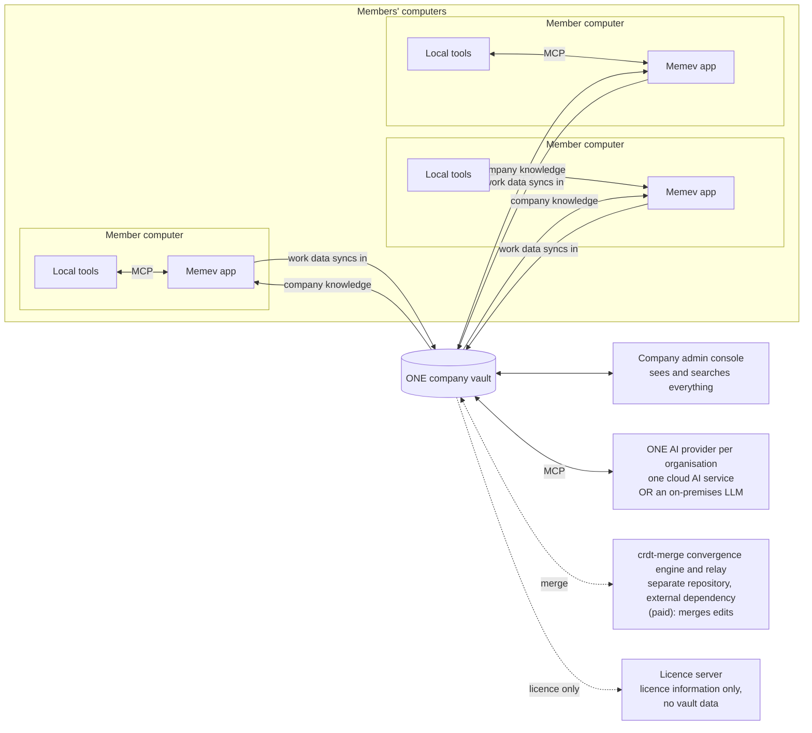
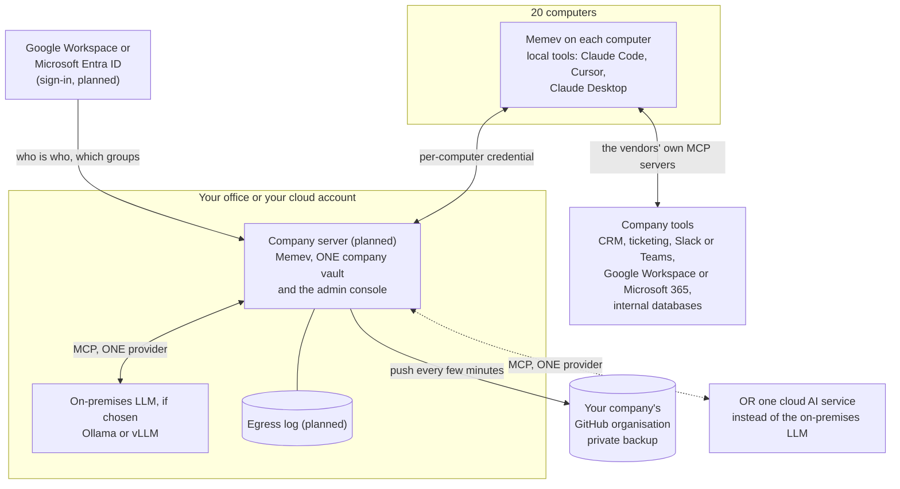
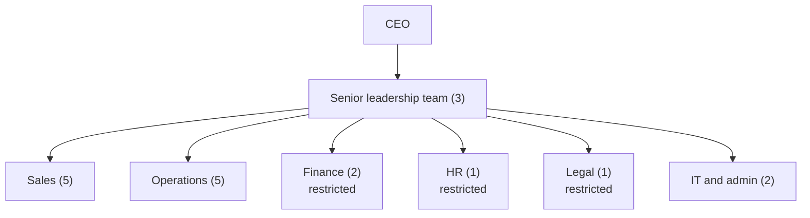

# Business (coming)

Part of the [tiers pages](README.md). Up: the [README](../../README.md#which-tier). Architecture chart:
[ARCHITECTURE.md](../ARCHITECTURE.md#business-coming).

> **DRAFT and coming.** Business is not built yet: the company vault, the admin console, the company
> server, sign-in with Google or Microsoft, departments, labels, pseudonymising and the egress log are
> all planned. Several computers can already share one vault through the secure link with a
> credential each; see the [status table](README.md#what-is-built-and-what-is-planned). A Business
> trial is planned.

For a company that wants one memory for its members and their AI apps, on its own server, with the
company able to see and search what its members' AI apps have learned.

Corporate is the same model at larger scale and with stricter control: see [Corporate](corporate.md).

## How it works

Every member's computer runs Memev and the member's local AI tools, which reach it over MCP. The
work data of all members syncs into **one company vault**. The company can see and search everything
in it through the company admin console. Members keep private work outside Memev.

The organisation connects to **one AI provider**: either one cloud AI service or an on-premises LLM.
The connection is over MCP. It is one provider for the whole organisation, not one per member.

The same chart, with all three tiers, is in [ARCHITECTURE.md](../ARCHITECTURE.md#the-three-tiers). The merge
engine is crdt-merge, in its own repository and never part of Memev; see
[CONVERGENCE.md](../CONVERGENCE.md). An org admin invites members into the company vault. There is no Team
tier: teammates belong here, on the business side.

### One company vault

There is one company vault, not a vault for each member. What members' AI apps learn at work syncs
into it, and what the company knows comes back down to each member's apps. Because it is one vault,
the company can see and search everything in it. Members keep private work outside Memev: anything a
member does not want the company to see does not go through Memev on a work computer.

### One AI provider

| Choice | What it means |
|---|---|
| One cloud AI service | the organisation connects its hosted AI provider to the company vault over MCP; a self-serve trial is planned for this case |
| An on-premises LLM | a model the organisation runs itself, connected the same way; air-gapped and compliance-led organisations choose this, and get a sales-assisted pilot |

### Personal vaults stay out

A member's personal or home vault never crosses into the company. It has its own identity and keys,
and the company side has its own. There are no grants, mounts or mixing between them.

### When a member leaves

Someone who leaves the company loses all vault access. Their access ends, their keys are revoked,
their devices are removed and the local cache on those devices is wiped. What they synced stays in
the company vault. Memev cannot recall what the person already read or copied outside it.

### Licence and trial

A licence counts once per organisation, by person and by computer. The Business trial is 5 members
and 10 computers. It is self-serve when the organisation uses a single hosted cloud AI provider.
Organisations that need an on-premises LLM, an air-gapped install or a compliance-led rollout get a
sales-assisted pilot instead. Both are planned, as is Business itself. Business has no public price:
contact us.

## Where it runs: cloud-hosted or on your own servers

| | Cloud-hosted | On your own servers |
|---|---|---|
| Who runs the server | the operator, on a host the operator manages | you, on your own servers |
| Where AI provider calls go | your own AI apps call a hosted provider with your own keys | your own AI apps call a model inside your environment |
| Which trial path | the self-serve Business trial, free with no card (planned) | the sales-assisted pilot, size set by order form, term starts at licence install (planned) |
| Status | planned, no date | the server and the container image are built; the Business trial is planned |

The two pages: [deploy-cloud.md](../deploy-cloud.md) and [deploy-on-prem.md](../deploy-on-prem.md).

## Worked example: 20 people

A firm of 20: a CEO, a senior leadership team of 3, and Sales (5), Operations (5), Finance (2), HR
(1) and Legal (1), plus 2 in IT and admin.

### Who sees what

The company sees and searches everything in the company vault through the admin console (planned).
The org chart can then become the permission map for what each member's own AI apps get back
(planned): each department gets its own area of the company vault, and a person's apps receive their
department, the company area and anything granted to them.

| Role | Member's apps receive | Writes | Notes |
|---|---|---|---|
| CEO | everything, except HR case files | company, leadership | HR files need a second approver |
| Senior leadership | company, leadership, their own departments | company, leadership | |
| Sales, Operations | company, own department | own department | |
| Finance, HR, Legal | company, own department | own department | restricted notes carry a label (planned) |
| IT and admin | company, own department | settings | run the admin console; can revoke any computer |
| Contractors | a named project area | that area | expiry date on the grant |

Today this can be approximated with path-limited tokens (`memev token issue <name> --paths 'sales/**,company/**'`):
recall and the graph already respect them. User accounts, groups from the identity provider, the
admin console and approvals need the company server.

### Sensitive work and the one AI provider

Because the organisation connects to one AI provider, notes cannot be split between a cloud model for
some people and a local model for others. An organisation whose notes must not reach a cloud AI
service chooses an on-premises LLM as its one provider. Memev does not run models: it decides which
notes the provider receives. Labels on notes and rules for what reaches the provider are planned.

If the provider is a cloud AI service, names, e-mail addresses and amounts can be replaced with
placeholders first (planned), and every note returned to the provider is written to the egress log:
which note, which person, when.

### Company tools

AI apps can already use the official MCP servers for CRM, ticketing, chat and office suites alongside
Memev; Memev keeps what was decided, the tool keeps the record. Connectors that copy selected data
into the vault, with the department label applied, are planned. Internal databases are reached
through an MCP server your team runs, with a read-only database user.

### Hardware

| Machine | Suggested spec | Notes |
|---|---|---|
| Company vault server | 4 to 8 CPU cores, 16 to 32 GB RAM, 500 GB SSD, Linux. A small VM is enough: one Memev process used 160 MB of heap after a 170-million-token growth test. | an existing server is usually enough |
| On-premises LLM, small | one 24 GB GPU (for example RTX 4090 or L4), 64 GB RAM, 1 TB NVMe. Runs 7B to 14B models with Ollama for a few people at a time. | a workstation-class machine |
| On-premises LLM, larger | one or two 48 GB GPUs (for example RTX 6000 Ada or L40S), 128 GB RAM. Runs 30B to 70B quantised models with vLLM for several people at once. | a server-class machine |
| Backup | your company's GitHub organisation, or a git server on your network | existing |

The two on-premises LLM rows apply only if the organisation chooses an on-premises LLM as its one AI provider. These are starting points. Test the model you choose with your own work before buying.

### Cost for this example (draft)

Priced on your requirements: contact us for a quote. The quote covers the Business subscription for
20 people, remote setup (the company server, sign-in, departments, computers and backup, with or
without an on-premises LLM), the support plan, and an admin training day if you want one. Hardware is
yours; see above.

## What's included

- Everything in Personal on every computer
- One company vault that all members' work data syncs into, with company knowledge coming back down to
  members' apps (planned)
- A company admin console that sees and searches everything in the company vault (planned)
- One AI provider for the organisation, a cloud AI service or an on-premises LLM, connected over MCP
  (planned)
- Merging of members' edits by the paid crdt-merge convergence engine, which lives in its own
  repository and is called as an external dependency ([CONVERGENCE.md](../CONVERGENCE.md)) (planned)
- Invites from an org admin into the company vault (planned)
- Separate identities and keys from any personal vault, with no grants, mounts or mixing (planned)
- When someone leaves: access ends, keys are revoked, devices are removed, the local cache is wiped
  and what they synced stays in the company vault (planned)
- Sign-in with Google Workspace or Microsoft Entra ID, offboarding (planned)
- Departments, roles and grants from your org chart (planned)
- Labels, rules for what reaches the AI provider, pseudonymising, egress log (planned)
- Backup to your company's GitHub organisation or your own git server (built)
- Cloud AI connectors are counted, not refused

## Limits

- A licence counts once per organisation, by person and by computer. The trial is 5 members and 10
  computers. There is no public price: contact us. For identity sync, SIEM export, retention, legal
  hold or high availability, see [Corporate](corporate.md).
- Every app on every enrolled computer gets a seat on the comms bus. IT or a team lead can run a
  comms check and hand out tasks from one session; a removed computer drops off the bus.
- Each computer has its own device key, and IT frees a computer with `memev devices remove <id>`.
  Past the licensed count the vault refuses the next one.
- One AI provider per organisation: one cloud AI service or one on-premises LLM, not both.
- One company server. If it is down, each computer keeps working on its own notes and catches up
  after; a second server for failover is Corporate.
- The company server decrypts notes to index them, so whoever runs it can read them. The company can
  see and search everything in the company vault by design.
- Pseudonymising catches patterns (names it knows, e-mail addresses, amounts). It will miss things,
  which is why organisations with sensitive notes choose an on-premises LLM.

## Setup

| Week | Remote setup |
|---|---|
| 1 | call to agree departments, roles, the one AI provider and what counts as restricted; check the server |
| 2 | install the company server (and the on-premises LLM, if that is the chosen provider), connect sign-in and the GitHub organisation |
| 3 | install Memev on the computers (IT runs one command per machine, or pushes it with their usual tool), import the org chart |
| 4 | check permissions with test accounts, hand over, one hour of training for staff |

Onsite setup is the same plan with days on site; rates and travel are in [services.md](services.md).

## Support

Without a plan: GitHub issues and paid hours. With the Business support plan: e-mail and a ticket
queue in business hours, a first reply within 4 business hours for an outage, 1 business day for a
fault and 3 business days for a question. Details in [services.md](services.md#response-times).

## Sovereignty

Notes stay on your server and computers, and in your git backup. With an on-premises LLM as the one
provider, notes never leave your network. With a cloud AI service as the provider, what it receives
leaves your control once sent, even pseudonymised; the egress log tells you what went where, and it
can't bring anything back. Only licence information passes between your install and ours, never vault
data.
