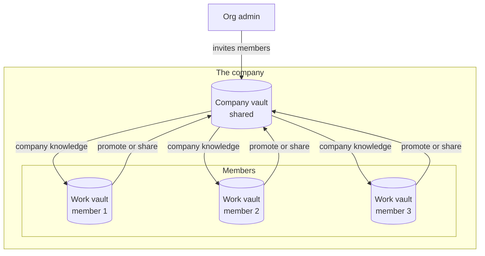
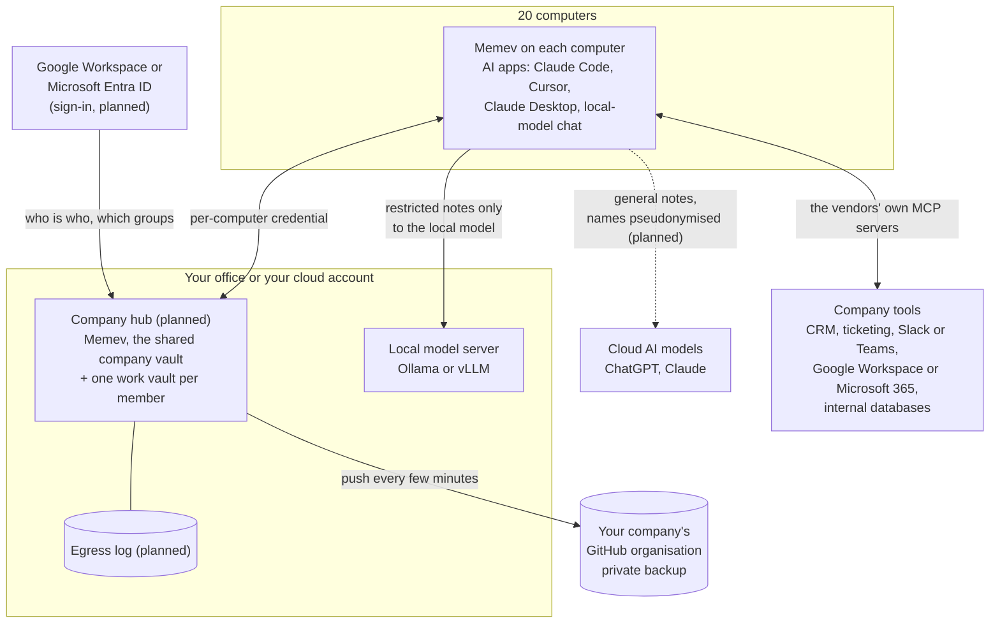
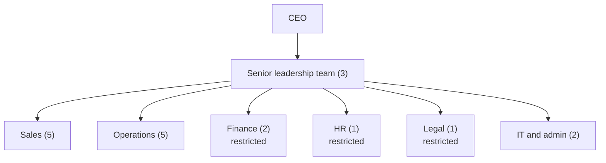

# Business (coming)

> **DRAFT and coming.** Business is not built yet: the company vault, the work vaults, the company
> hub, sign-in with Google or Microsoft, departments, labels, pseudonymising and the egress log are
> all planned. Several computers can already share one vault through the secure link with a
> credential each; see the [status table](README.md#what-is-built-and-what-is-planned). A Business
> trial is planned.

For a company that wants one memory for its members and their AI apps, on its own server, with
departments that can't read each other's notes and sensitive work kept on a local model.

Corporate is the same model at larger scale: see [Corporate](corporate.md).

## How it works

Every member has their own work vault inside the company, and the company has a shared company
vault. The two interact in two directions:

- **Up.** A member promotes or shares a note from their work vault into the company vault.
- **Down.** Company knowledge in the company vault comes down to each member's apps.

An org admin invites members into the company vault. There is no Team tier: teammates belong here,
on the business side.

### Personal vaults stay out

A member's personal or home vault never crosses into the company. It has its own identity and keys,
and the company side has its own. There are no grants, mounts or mixing between them.

### When a member leaves

Someone who leaves the company loses all vault access. Their access ends, their keys are revoked,
their devices are removed and the local cache on those devices is wiped. The work vault stays with
the company. Memev cannot recall what the person already read or copied outside it.

## Worked example: 20 people

A firm of 20: a CEO, a senior leadership team of 3, and Sales (5), Operations (5), Finance (2), HR
(1) and Legal (1), plus 2 in IT and admin.

### Who sees what

The org chart becomes the permission map (planned). Each department gets its own area of the company
vault; a person reads their own work vault, their department, the company area and anything granted
to them. Nothing is visible by default.

| Role | Reads | Writes | Notes |
|---|---|---|---|
| CEO | everything, except HR case files | company, leadership | HR files need a second approver |
| Senior leadership | company, leadership, their own departments | company, leadership | |
| Sales, Operations | company, own department | own department | |
| Finance, HR, Legal | company, own department | own department | restricted: served only to the local model |
| IT and admin | the hub's settings and logs, not note contents | settings | can revoke any computer |
| Contractors | a named project area | that area | expiry date on the grant |

Today this can be approximated with path-limited tokens (`memev token issue <name> --paths 'sales/**,company/**'`):
recall and the graph already respect them. User accounts, groups from the identity provider and
approvals need the hub.

### Sensitive departments stay on the local model

Notes in Finance, HR and Legal get the label *restricted* (planned). The hub returns restricted
notes only to apps registered as using the local model, never to a cloud app, and the request is
logged. Memev does not run models: it decides which app gets which notes. Staff in those departments
use an AI app pointed at the local model server, such as a chat app or a coding assistant that
supports Ollama or an OpenAI-compatible endpoint.

For everyone else, notes going to a cloud model can have names, e-mail addresses and amounts
replaced with placeholders first (planned), and every note returned to a cloud app is written to
the egress log: which note, which app, which person, when.

### Company tools

AI apps can already use the official MCP servers for CRM, ticketing, chat and office suites alongside
Memev; Memev keeps what was decided, the tool keeps the record. Connectors that copy selected data
into the vault, with the department label applied, are planned. Internal databases are reached
through an MCP server your team runs, with a read-only database user.

### Hardware

| Machine | Suggested spec | Notes |
|---|---|---|
| Hub | 4 to 8 CPU cores, 16 to 32 GB RAM, 500 GB SSD, Linux. A small VM is enough: one Memev process used 160 MB of heap after a 170-million-token growth test. | an existing server is usually enough |
| Local model, small | one 24 GB GPU (for example RTX 4090 or L4), 64 GB RAM, 1 TB NVMe. Runs 7B to 14B models with Ollama for a few people at a time. | a workstation-class machine |
| Local model, larger | one or two 48 GB GPUs (for example RTX 6000 Ada or L40S), 128 GB RAM. Runs 30B to 70B quantised models with vLLM for several people at once. | a server-class machine |
| Backup | your company's GitHub organisation, or a git server on your network | existing |

These are starting points. Test the model you choose with your own work before buying.

### Cost for this example (draft)

Priced on your requirements: contact us for a quote. The quote covers the Business subscription for
20 people, remote setup (the hub, sign-in, departments, computers and backup, with or without the
local model server and sensitivity rules), the support plan, and an admin training day if you want
one. Hardware is yours; see above.

## What's included

- Everything in Personal on every computer
- A work vault for each member and a shared company vault, with promote and share up and company
  knowledge down (planned)
- Invites from an org admin into the company vault (planned)
- Separate identities and keys from any personal vault, with no grants, mounts or mixing (planned)
- When someone leaves: access ends, keys are revoked, devices are removed, the local cache is wiped
  and the work vault stays with the company (planned)
- The company hub on your server (planned)
- Sign-in with Google Workspace or Microsoft Entra ID, offboarding (planned)
- Departments, roles and grants from your org chart (planned)
- Labels, local-model-only routing for restricted notes, pseudonymising, egress log (planned)
- Backup to your company's GitHub organisation or your own git server (built)
- Cloud AI connectors are counted, not refused

## Limits

- Sold per member. How computers are counted for Business is not settled, and no price is stated
  here: contact us. For identity sync, SIEM export, retention, legal hold or high availability, see
  [Corporate](corporate.md).
- Every app on every enrolled computer gets a seat on the comms bus. IT or a team lead can run a
  comms check and hand out tasks from one session; a removed computer drops off the bus.
- The licence sets how many computers can join the vault. Each one has its own device key, and IT
  frees a seat with `memev devices remove <id>`. Past the count the vault refuses the next one.
- One hub server. If it is down, each computer keeps working on its own notes and catches up after;
  a second hub for failover is Corporate.
- The hub decrypts notes to index them, so whoever runs the server can read them.
- Pseudonymising catches patterns (names it knows, e-mail addresses, amounts). It will miss things,
  which is why restricted departments use the local model instead.

## Setup

| Week | Remote setup |
|---|---|
| 1 | call to agree departments, roles and what counts as restricted; check the server |
| 2 | install the hub and the local model server, connect sign-in and the GitHub organisation |
| 3 | install Memev on the computers (IT runs one command per machine, or pushes it with their usual tool), import the org chart |
| 4 | check permissions with test accounts, hand over, one hour of training for staff |

Onsite setup is the same plan with days on site; rates and travel are in [services.md](services.md).

## Support

Without a plan: GitHub issues and paid hours. With the Business support plan: e-mail and a ticket
queue in business hours, a first reply within 4 business hours for an outage, 1 business day for a
fault and 3 business days for a question. Details in [services.md](services.md#response-times).

## Sovereignty

Notes stay on your server and computers, and in your git backup. Restricted notes go only to your
local model. General notes sent to a cloud model leave your control once sent, even pseudonymised;
the egress log tells you what went where, and it can't bring anything back.
