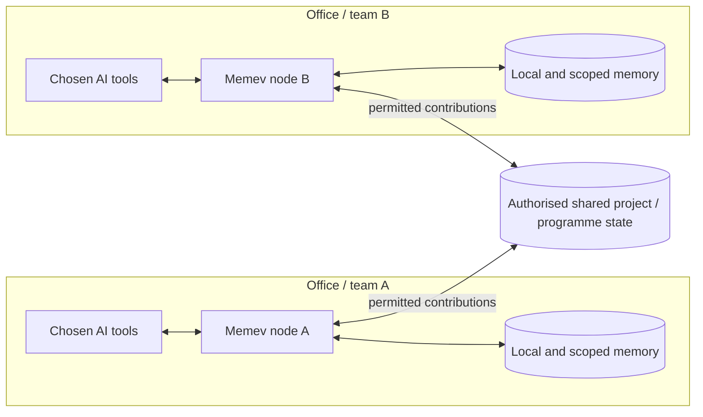

# Business (planned)

Part of the [tiers pages](README.md). Up: the [README](../../README.md). Architecture:
[ARCHITECTURE.md](../ARCHITECTURE.md#business).

> **Planned.** The full multi-person business administration, identity, policy and shared-work
> capabilities described here are not yet shipped. Current local Memev, device credentials,
> optional remote access, communications bus and work contracts are described in the main
> documentation.

Business is for a person-led or team-led organisation that wants its people, AI tools, projects and
business functions to work with shared authorised context. It can begin with one site and grow to
multiple locations. It does not require one central vault containing every member's work or one AI
provider for the entire organisation.

Each person can continue using the AI assistants, models and agent frameworks they prefer, subject
to organisational policy. Memev supplies the shared context, identity, project state, coordination
and controlled exchange underneath.

## Deployment options

A small business may choose a single server and a shared business scope. A business with multiple
offices or separate operational domains may run independent Memev nodes and connect them through
explicit federation agreements. The architecture supports both; deployment and commercial packaging
will depend on operational requirements.

## What Business is intended to provide

- people, roles, teams and business identities;
- personal, team and organisational scopes with explicit boundaries;
- project, programme and portfolio coordination;
- shared task state, contracts, evidence and approvals;
- cross-functional dependency and change-impact discovery;
- multiple AI providers and agent systems operating side by side;
- optional additional sites and local nodes;
- controlled sharing of source references, summaries and work products;
- membership, offboarding, credential revocation and audit;
- policy for data access, replication, retention and external AI use.

The organisation may use a combination of hosted AI services, local models and internally operated
agents. Memev does not choose a provider on behalf of the organisation.

## Project and portfolio example

A small business may run several customer projects at once. A change to a delivery requirement in
one project may affect staff capacity, procurement, finance and another project's milestone. Memev
should connect those relationships, identify the evidence and affected owners, and present possible
consequences for validation. It must not silently change signed commitments or approved plans.

The same mechanism scales from one person's collection of projects to a business portfolio and,
later, to programmes spanning multiple sites.

## Boundaries and status

The current repository has local project state, contracts, graph, device identity and communications
mechanisms. Full multi-user business administration, canonical organisation-wide work graph,
cross-site federation and continuous portfolio reasoning remain planned or architectural targets.
See [FEDERATION.md](../FEDERATION.md) and
[ORGANISATIONAL-INTELLIGENCE.md](../ORGANISATIONAL-INTELLIGENCE.md).

Business deployments must define who owns each record, who can read or change it, which AI tools
may receive it, what may be replicated, and which actions require human approval. A company
administrator does not automatically gain unrestricted access to every personal memory.

## Licensing and services

Business pricing, member/device accounting, trial terms, onboarding and support remain subject to
the published commercial documents and a defined delivery scope. No planned capability should be
sold as available before its implementation and acceptance tests are complete.
