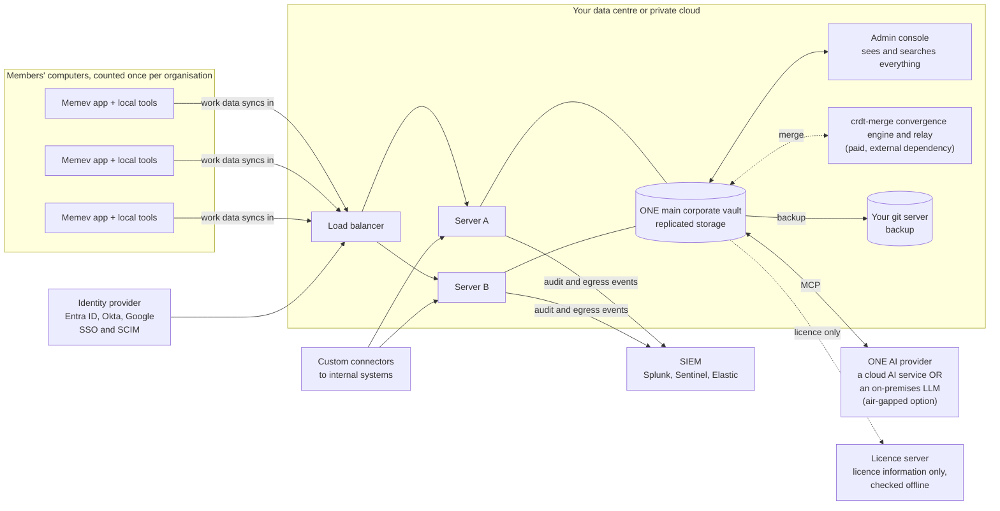

# Corporate (coming)

Part of the [tiers pages](README.md). Up: the [README](../../README.md). Architecture chart:
[ARCHITECTURE.md](../ARCHITECTURE.md#corporate-coming).

> **DRAFT and coming.** Everything specific to this tier is planned; see the
> [status table](README.md#what-is-built-and-what-is-planned).

Corporate is the same model as [Business](business.md) at larger scale and with stricter control.
There is **one main corporate vault**. The work data of every member's computer syncs into it, and
the company can see and search everything in it through the admin console. The organisation connects
to **one AI provider**: one cloud AI service or an on-premises LLM, which can be air-gapped. Members
keep private work outside Memev. An org admin invites members into the company vault. A personal or
home vault never crosses into it: separate identities and keys, with no grants, mounts or mixing.
Anyone who leaves loses all vault access: access ends, keys are revoked, devices are removed, the
local cache is wiped and what they synced stays in the main vault.

A licence counts once per organisation, by person and by computer. Corporate has no public price:
contact us. Organisations that are on-premises, air-gapped or led by compliance get a sales-assisted
pilot rather than a self-serve trial. The trial terms: [BUSINESS-TRIAL.md](../BUSINESS-TRIAL.md).

What Corporate adds is scale: identity sync by SCIM, audit export to a SIEM, retention rules, legal
hold and high availability, often with several sites or rules about where data may go:
banks, health, law firms, public bodies, defence suppliers. It is chosen by need, not by size.

The same chart, next to Personal and Business, is in [ARCHITECTURE.md](../ARCHITECTURE.md#corporate-coming).

## What's included (planned)

- Two or more servers behind a load balancer, with replicated storage for the one main vault and failover
- Private deployment: we install and maintain the server in your data centre or your cloud account
- An air-gapped package: installs without internet, updates by signed bundle, no secure link, git
  backup to a server inside the network, an on-premises LLM as the one AI provider
- Sign-in through your identity provider, with users and groups kept in step by SCIM
- Audit and egress events streamed to your SIEM, and exportable on request
- Retention rules per department and legal hold that stops deletion for named people or matters
- Custom connectors to internal systems
- A named engineer, or an engineer embedded with your team
- Source escrow and a written succession plan, on request

## Limits

- The number of computers comes from your licence, checked offline with no call home. Air-gapped
  installs work the same way.
- Everything above is planned. An offer for any of it will carry a delivery date and acceptance
  checks.
- The servers decrypt notes to index them. Admins of those servers can read them; separate duties and
  log admin access through your SIEM.
- Air-gapped installs can't use a cloud AI service or the hosted relay, by design: the one AI provider is an on-premises LLM.
- Legal hold stops Memev from deleting; it can't stop a cloud AI service keeping what it was sent
  before the hold.

## Price

Priced on your requirements: contact us. A quote usually covers onboarding, a private deployment
if we run it for you, a compliance pack, a named or embedded engineer and any custom development.
See [services.md](services.md).

## Setup

| Phase | Typical length |
|---|---|
| Discovery: architecture, identity, data classes, security review | 1 to 2 weeks |
| Build: servers, storage, identity, SIEM, the AI provider, connectors | 2 to 6 weeks |
| Pilot with one department | 2 weeks |
| Rollout by department, with training | 1 to 4 weeks |

6 to 12 weeks in total, remote, onsite or mixed.

## Support

A named engineer who knows your setup, or an embedded engineer working with your team. First reply
within 1 hour around the clock for an outage, 4 hours for a fault, 1 business day for a question
(draft). See [services.md](services.md#response-times).

## Sovereignty

All data can stay inside your network, and in the air-gapped package nothing leaves it. When the one AI provider is a
cloud AI service, what is sent to it is out of Memev's control once sent; rules decide what may
go, and the SIEM records what did. Only licence information passes between your install and ours,
never vault data.
