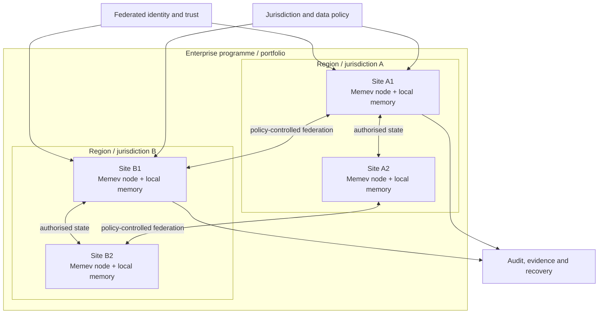

# Corporate (planned)

Part of the [tiers pages](README.md). Up: the [README](../../README.md). Architecture:
[ARCHITECTURE.md](../ARCHITECTURE.md#multi-site-and-corporate).

> **Planned architectural level.** The complete multi-site federation, delegated administration,
> sovereign replication, high availability and compliance capabilities described here are not
> shipped as one complete system. Current local capabilities and integration boundaries are
> documented separately.

Corporate extends the same Memev architecture across departments, programmes, portfolios,
offices, buildings, data centres and jurisdictions. It is not simply a larger version of one
central vault. Each site may operate its own Memev server and local memory, retaining local
administration and authority while exchanging authorised state with other sites.

People and teams remain free to use the AI providers, models, agent frameworks and applications
that fit their work and policy. Memev is the common coordination and state architecture underneath.

## Multi-site topology

A regional service can support discovery, routing or recovery where selected, but it is not a
mandatory global coordinator or the sole owner of organisational memory. Topology is selected
according to connectivity, sovereignty, trust and availability requirements.

## Intended capabilities

- multiple independently operated site nodes and federation membership;
- identity federation, delegated roles and administrative boundaries;
- project, programme, portfolio and cross-functional work graph;
- policy-controlled state exchange, replication and federated queries;
- data classification, jurisdiction-aware processing and permitted recovery copies;
- high availability and tested site recovery with explicit RPO/RTO;
- auditable approvals, provenance, contribution receipts and policy decisions;
- security operations integration, retention, legal hold and controlled deletion;
- optional air-gapped or disconnected deployments;
- distributed execution and federated computation where workloads permit;
- cross-organisation participation in selected projects and programmes.

## Sovereignty and continuity

A site outage must not cause other sites to claim access to information they never received. Other
sites can continue using their permitted last-known state, with source freshness and availability
shown. On reconnection, nodes reconcile supported changes while preserving provenance, authority,
policy and unresolved conflicts.

Replication policy applies to source records and derived summaries, embeddings, indexes, caches,
logs, backups, model context and model updates. A replica does not grant access to raw source data.
See [DATA-SOVEREIGNTY.md](../DATA-SOVEREIGNTY.md).

## Distributed computation

Corporate deployments may coordinate approved work across local compute resources, private
infrastructure and participating organisations. Workloads can include project execution,
simulation, optimisation, analytics, model evaluation and federated learning. Each workload needs
its own data-use, execution, aggregation, privacy, verification and recovery contract.
See [FEDERATED-COMPUTATION.md](../FEDERATED-COMPUTATION.md).

## Technology responsibilities

Memev owns business semantics, identity binding, policy, permissions, workflow, approvals and
user-facing coordination. CRDT-Merge provides convergence for supported replicated state under
its contract. ACFA-RS provides accountable admission and evidence for supported contributions.
E4 governs trust relationships. Workload-specific algorithms perform learning, analytics or
optimisation. None of these components should be credited with guarantees outside its defined
contract.

## Deployment and commercial status

Corporate is a deployment and service level defined by operational requirements, not a fixed
computer count. Discovery must establish topology, data classes, identity, recovery objectives,
network constraints, integrations and support requirements. Pricing, timelines and service levels
must be agreed for each scope. The architecture described here is a target; it is not a statement
that all listed features are currently available.
