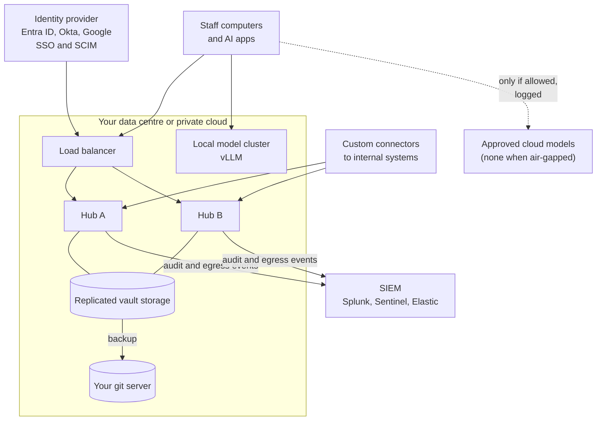

# Enterprise

> **DRAFT and planned.** Everything specific to this tier is planned; see the
> [status table](README.md#what-is-built-and-what-is-planned).

For organisations with more than about 50 computers, several sites, or rules about where data may
go: banks, health, law firms, public bodies, defence suppliers.

## What's included (planned)

- Two or more hubs behind a load balancer, with replicated storage and failover
- Private deployment: we install and maintain the hub in your data centre or your cloud account
- An air-gapped package: installs without internet, updates by signed bundle, no secure link, git
  backup to a server inside the network, local models only
- Sign-in through your identity provider, with users and groups kept in step by SCIM
- Audit and egress events streamed to your SIEM, and exportable on request
- Retention rules per department and legal hold that stops deletion for named people or matters
- Custom connectors to internal systems
- A named engineer, or an engineer embedded with your team
- Source escrow and a written succession plan, on request

## Limits

- Everything above is planned. An offer for any of it will carry a delivery date and acceptance
  checks.
- The hub decrypts notes to index them. Admins of the hub servers can read them; separate duties and
  log admin access through your SIEM.
- Air-gapped installs can't use cloud models or the hosted relay, by design.
- Legal hold stops Memev from deleting; it can't stop a cloud provider keeping what it was sent
  before the hold.

## Price

Priced on your requirements: contact us. A quote usually covers onboarding, a private deployment
if we run it for you, a compliance pack, a named or embedded engineer and any custom development.
See [services.md](services.md).

## Setup

| Phase | Typical length |
|---|---|
| Discovery: architecture, identity, data classes, security review | 1 to 2 weeks |
| Build: hubs, storage, identity, SIEM, models, connectors | 2 to 6 weeks |
| Pilot with one department | 2 weeks |
| Rollout by department, with training | 1 to 4 weeks |

6 to 12 weeks in total, remote, onsite or mixed.

## Support

A named engineer who knows your setup, or an embedded engineer working with your team. First reply
within 1 hour around the clock for an outage, 4 hours for a fault, 1 business day for a question
(draft). See [services.md](services.md#response-times).

## Sovereignty

All data can stay inside your network, and in the air-gapped package nothing leaves it. When cloud
models are allowed, what is sent to them is out of Memev's control once sent; rules decide what may
go, and the SIEM records what did.
