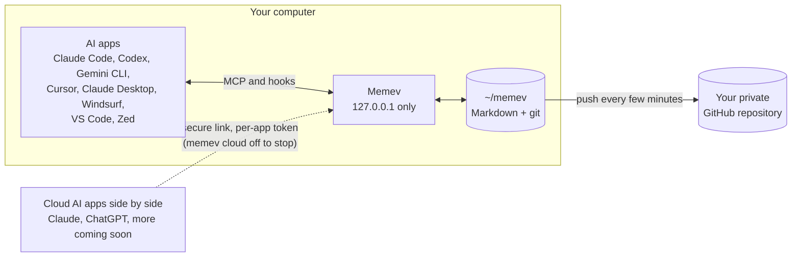

# Personal: one computer, free

Part of the [tiers pages](README.md). Up: the [README](../../README.md). Architecture chart:
[ARCHITECTURE.md](../ARCHITECTURE.md#personal).

For one person on one computer at a time. Complete, and never limited ([CHARTER.md](../../CHARTER.md)).
Switch computers, lose nothing: your notes are backed up to your own GitHub, and a new computer can
join that backup.

## Included

- The vault, recall, the knowledge graph, claims and provenance
- Hooks in Claude Code, Codex and Gemini CLI, session-start hooks in Cursor, instructions in the
  other apps
- The quality check, review inbox, audit and `memev why`
- Signed contracts with local checks
- The comms bus: every AI app on your computer gets a seat, and you can coordinate them from one
  session ([BUS.md](../BUS.md))
- `memev doctor`
- Several cloud AI apps side by side through the secure link, such as Claude and ChatGPT, next to
  your local coding tools over MCP (up to 5 connectors counted; nothing is refused)
- Backup to your own private GitHub repository

## Limits

- One computer at a time, with no licence and no network needed. Adding a second computer to the
  vault needs a licence: the vault refuses it with "This vault is licensed for 1 computer". Cloud AI
  apps through the secure link are not computers and are not refused.
- Switching computers goes through your own GitHub backup: once `memev github setup` has run on the
  old computer, `memev init` on the new one offers to join that backup.
- Git sync is single-writer backup, not a way to edit on two computers at once. If a second computer
  also pushes the same vault, `memev doctor` shows a warning that concurrent edits can conflict.
  Nothing is blocked. A merge that conflicts is left as it is and reported by `memev doctor`. Edit on
  two machines at once is what [Personal with more computers](#personal-with-more-computers-draft)
  is for.
- No user accounts: whoever has a token reaches what that token allows.
- Recall is keyword search. Paraphrases with no shared words are missed; optional local
  embeddings are planned.

## Setup

You, in a few minutes: see [Install](../../README.md#install). No account and no sign-up. GitHub
backup asks for one browser sign-in.

## Support

GitHub issues, best effort, no response time. Paid help is available by the hour: see
[services.md](services.md).

## Sovereignty

Everything stays on your computer except what you choose to send out: the GitHub backup (plain
Markdown in your private repository) and whatever recall returns to a cloud AI app through the secure
link. `memev init --local-only` keeps the secure link off, and the backup stays off until you run
`memev github setup`.

## Personal with more computers (draft)

Edit on two machines at once, nothing to resolve. One person, up to 3 computers and 10 cloud AI
connectors, for $12/month or $120/year. The licence is for that person and cannot
be passed on. The AI apps on all three computers share one memory and one comms bus, over the secure
link, with a key for each computer. The same mix of several cloud AI apps side by side and local coding
tools over MCP applies on each.

The merging of concurrent edits is done by crdt-merge, the convergence engine. It lives in its own
repository under its own licence, it is not part of this repository, and Memev calls it as an external
dependency. The free core does not contain it. See [CONVERGENCE.md](../CONVERGENCE.md).

This is an early-supporter price: it stays the same for as long as your subscription runs.

Planned, not built, and not part of the price: merging concurrent edits through the convergence engine,
end-to-end encrypted sync between the computers, a hosted encrypted backup and a stable address for
the secure link. With sync, your notes would be encrypted on your computers before they leave, so
the sync service could not read them or search them for you.

## Never mixed with a company vault

A personal vault, on one computer or on several, never crosses into a Business or Corporate vault.
The two have separate identities and keys, with no grants, mounts or mixing. See
[Personal and company vaults never mix](README.md#personal-and-company-vaults-never-mix).
