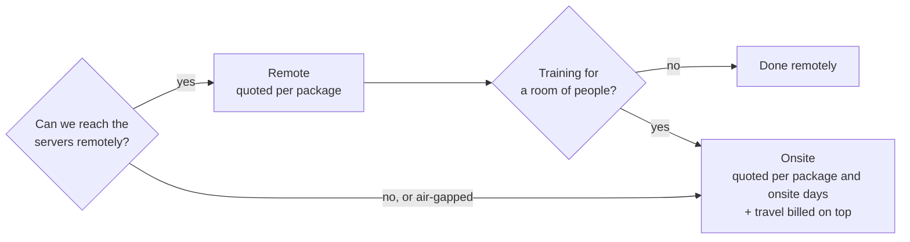

# Services, rates and response times

Part of the [tiers pages](README.md). Up: the [README](../../README.md).

> **DRAFT.** Every policy here is a proposal, not an offer. Services are priced on your requirements:
> contact us for a quote. See [PRICING.md](../PRICING.md).

## Remote or onsite

Most work is done remotely: video calls, screen sharing and access you grant to the servers involved.
It costs less and is quicker to schedule. Onsite makes sense for air-gapped networks, data centres that
allow no remote access, and training a room of people.

## Packages

Each package is priced on your requirements: contact us for a quote.

| Package | For | Remote timeline |
|---|---|---|
| Onboarding, small | Personal: install, GitHub backup, apps connected, a walkthrough | 1 to 2 days |
| Business setup | the company server, sign-in, departments, computers, backup | 2 to 3 weeks |
| Business setup with an on-premises LLM | the above plus optional locally hosted models, additional AI integrations and the rules for what information each tool may receive | 3 to 4 weeks |
| Sales-assisted pilot | Business or Corporate for an organisation that needs an on-premises LLM, an air-gapped install or a compliance-led rollout (planned) | |
| Trial setup, on-prem | the operator installs and configures the trial for you, on your servers | priced on your requirements |
| Corporate onboarding | discovery, high availability, identity, SIEM, pilot, rollout | 6 to 12 weeks |
| Private deployment | we run and maintain a dedicated company server in your data centre or cloud account | 2 to 4 weeks to start |
| Compliance pack | data-flow diagrams, records of processing, the security answers your auditors ask for, kept current, once or yearly | 2 to 3 weeks |
| Workshop | one session for staff, up to 3 hours | |
| Admin training day | a full day for the people who run the company server | |
| Custom development | connectors, integrations, features | quoted per job |

## Support plans

| Plan | Price | What you get |
|---|---|---|
| Community | free | GitHub issues, best effort |
| Business support | quoted with the tier | e-mail and tickets in business hours, response times below |
| Named engineer | contact us | one engineer who knows your setup, a monthly review, Corporate response times |
| Embedded engineer | contact us | an engineer working with your team on agreed days each week |

## Response times

First reply, not time to fix. Business hours are 9:00 to 17:00 in your time zone on weekdays, unless
agreed otherwise.

| Priority | Example | Business support | Named or embedded engineer |
|---|---|---|---|
| 1, outage | the company server is down for everyone | 4 business hours | 1 hour, around the clock |
| 2, fault | recall fails for a department | 1 business day | 4 hours |
| 3, question | how do I set up a contractor | 3 business days | 1 business day |

There is no uptime guarantee for a company server you run yourself. For a private deployment we run, the
uptime target is agreed in the contract.

## Onsite work and travel (draft policy)

Onsite days are quoted with the package, up to 8 hours on site a day, at least one day. Travel is
billed on top:

| Item | Draft |
|---|---|
| Travel days | billed when travel takes most of a working day |
| Flights, trains, hotels, local transport | at cost, no markup, booked economy or standard, approved by you beforehand |
| Meals and incidentals | at cost with receipts, or a daily allowance agreed in advance |
| Cancellation | free up to 10 working days before; after that, booked travel that can't be refunded is charged |

Example: installing a Business company server with an on-premises LLM onsite takes about two days for one engineer,
with a travel day each way. The quote covers the package, the two onsite days and the two travel
days; travel and expenses come on top at cost.

Remote work never carries travel charges.
