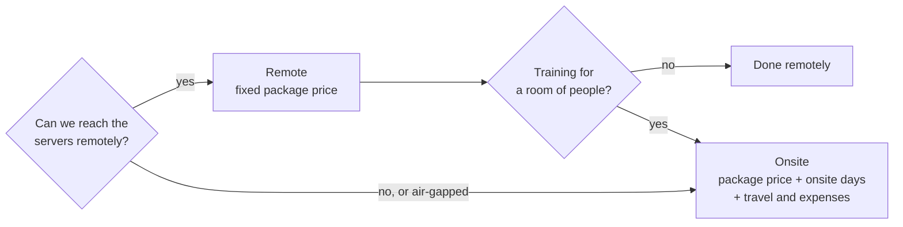

# Services, rates and response times

> **DRAFT.** Every price and policy here is a proposal, not an offer. Rates are in US dollars and
> exclude tax. They match [PRICING.md](../PRICING.md).

## Remote or onsite

Most work is done remotely: video calls, screen sharing and access you grant to the servers involved.
It is cheaper and quicker to schedule. Onsite makes sense for air-gapped networks, data centres that
allow no remote access, and training a room of people.

## Packages

| Package | For | Price (draft) | Remote timeline |
|---|---|---|---|
| Onboarding, small | Personal or a small team: install, GitHub backup, apps connected, a walkthrough | $750 | 1 to 2 days |
| Business setup | the company hub, sign-in, departments, computers, backup | $2,500 | 2 to 3 weeks |
| Business setup with a local model | the above plus the model server and the restricted-department rules | $3,500 | 3 to 4 weeks |
| Enterprise onboarding | discovery, high availability, identity, SIEM, pilot, rollout | from $12,000 | 6 to 12 weeks |
| Private deployment | we run and maintain a dedicated hub in your data centre or cloud account | from $6,000/year | 2 to 4 weeks to start |
| Compliance pack | data-flow diagrams, records of processing, the security answers your auditors ask for, kept current | $5,000 once or $15,000/year | 2 to 3 weeks |
| Workshop | one session for staff, up to 3 hours | $1,200 | |
| Admin training day | a full day for the people who run the hub | $2,400 | |
| Custom development | connectors, integrations, features | $1,600/day | quoted per job |

## Support plans

| Plan | Price (draft) | What you get |
|---|---|---|
| Community | free | GitHub issues, best effort |
| Business support | quoted with the tier | e-mail and tickets in business hours, response times below |
| Named engineer | $1,950/month | one engineer who knows your setup, a monthly review, Enterprise response times |
| Embedded engineer | $6,500/month | an engineer working with your team on agreed days each week |

## Response times

First reply, not time to fix. Business hours are 9:00 to 17:00 in your time zone on weekdays, unless
agreed otherwise.

| Priority | Example | Business support | Named or embedded engineer |
|---|---|---|---|
| 1, outage | the hub is down for everyone | 4 business hours | 1 hour, around the clock |
| 2, fault | recall fails for a department | 1 business day | 4 hours |
| 3, question | how do I set up a contractor | 3 business days | 1 business day |

There is no uptime guarantee for a hub you run yourself. For a private deployment we run, the
uptime target is agreed in the contract.

## Onsite rates and travel (draft policy)

| Item | Draft |
|---|---|
| Onsite day | $1,600 per engineer per day, up to 8 hours on site, minimum 1 day |
| Travel day | $800 (half the day rate) when travel takes most of a working day |
| Flights, trains, hotels, local transport | at cost, no markup, booked economy or standard, approved by you beforehand |
| Meals and incidentals | at cost with receipts, or a daily allowance agreed in advance |
| Cancellation | free up to 10 working days before; after that, booked travel that can't be refunded is charged |

Example: two days onsite to install a Business hub with a local model, one engineer, one travel day
each way: $3,500 package + 2 × $1,600 + 2 × $800 = $8,300, plus travel and expenses at cost.

Remote work never carries travel charges.
