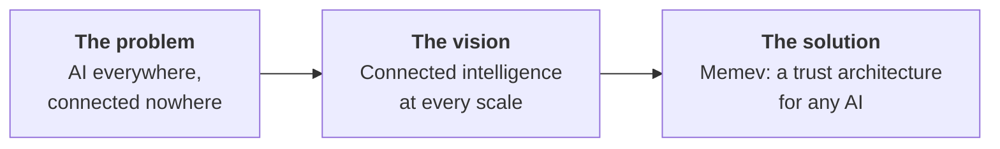
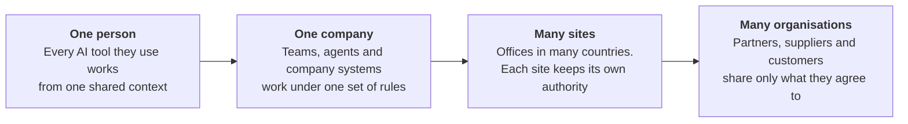
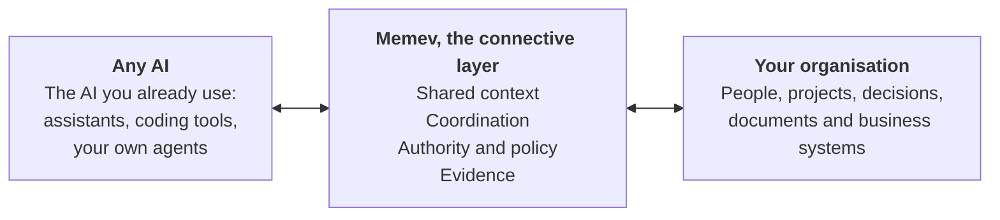
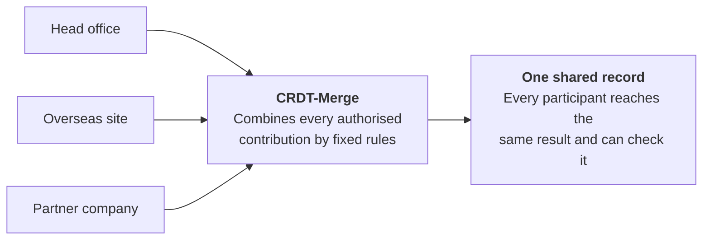

# Trust architecture for AI: an overview

Part of the [Memev documentation](../README.md). Up: the [README](../../README.md). Related:
[ARCHITECTURE.md](../ARCHITECTURE.md), [CONVERGENCE.md](../CONVERGENCE.md), [FEDERATION.md](../FEDERATION.md),
[DATA-SOVEREIGNTY.md](../DATA-SOVEREIGNTY.md), [the five tiers](../tiers/README.md).

> **Planned where it says so.** This page explains the direction in plain language. The free core is a
> development preview that runs today. The Business, Corporate and Federated tiers, and the integration of
> CRDT-Merge into the released product, are planned. [Where we are](#where-we-are) says which is which.

This is the shortest explanation of what Memev is for. It has no technical detail. The pages linked above hold
the design.

## The problem

Every team is adding AI. Nothing connects it.

- **Islands of AI.** Each tool, team and site holds its own version of the work.
- **Decisions drift.** What is agreed in one place never reaches the people and agents acting elsewhere.
- **No proof.** Nobody can show who was allowed to act, what was done, or whether it was checked.

More AI does not make an organisation smarter. Connected AI that everyone can trust does.

## The vision

One architecture for connected intelligence, at every scale.

The architecture stays the same at each step. What grows is the trust boundary it has to cross: from one
person's computers, to one company, to sites in different countries, to independent organisations that keep
their own owners, rules and data.

## The solution

Memev connects people, their work and any AI.

Memev is AI-application agnostic. It is not a model, a memory vendor or an agent framework, and it does not
require any single one of them. An organisation keeps the AI it already uses, and can change it, without
losing what connects its work.

## Why CRDT-Merge

Many contributors. No central referee. One agreed result.

When independent parties each add to shared work, in any order and at any time, they still need to end with
the same record. CRDT-Merge is the convergence engine designed to do that:

- **No central owner of everyone's data.** No participant has to hand its systems to another.
- **Any order, any timing, same result.** The outcome comes from fixed rules, so it can be reproduced.
- **No AI decides whose version wins.** A language model is not the authority that resolves conflicts.

This is what makes connected intelligence possible across sites, countries and organisations that will never
place their data under one owner. [CONVERGENCE.md](../CONVERGENCE.md) holds the detail.

## What trust needs

Agreeing on one record is necessary. It is not enough. A record that every copy agrees on can still hold a
mistaken or unauthorised contribution. A trust architecture needs four things together:

| | What it answers | |
|---|---|---|
| **1. Authority** | Who may contribute, see or act. | Identity and policy decide. |
| **2. Convergence** | Does everyone end with the same record? | This is CRDT-Merge. |
| **3. Evidence** | What was claimed, against what was checked. | Provenance and verification. |
| **4. Sovereignty** | Who controls each party's data? | Each party keeps its own data, rules and operators. |

Memev is the product layer that brings the four together.

## Where we are

| Available now, in preview | In development |
|---|---|
| The free core, for one person: one shared context across their AI tools, a coordination bus between AI sessions, and work contracts with checks. | CRDT-Merge wired into the product, then Business (one company), Corporate (many sites and countries) and Federated (many organisations). |

The tier names describe targets, not services available today. The [README](../../README.md) and
[the five tiers](../tiers/README.md) state what each one holds and what is planned.

## The slides

The same story as nine slides is in the `deck` folder beside this page: one file per slide, in the order
listed in its index file. Each file is a single slide on a 1920 by 1080 canvas, with speaker notes at the end.
