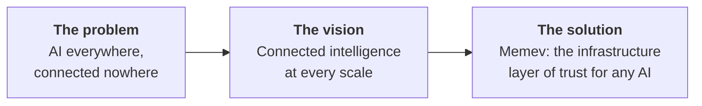
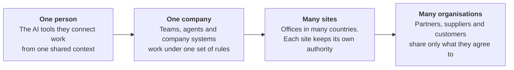
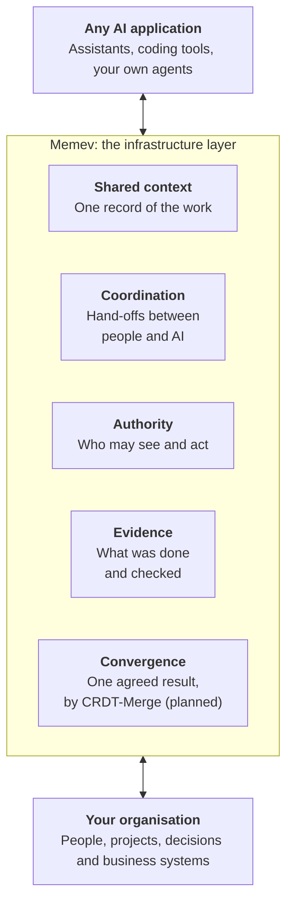
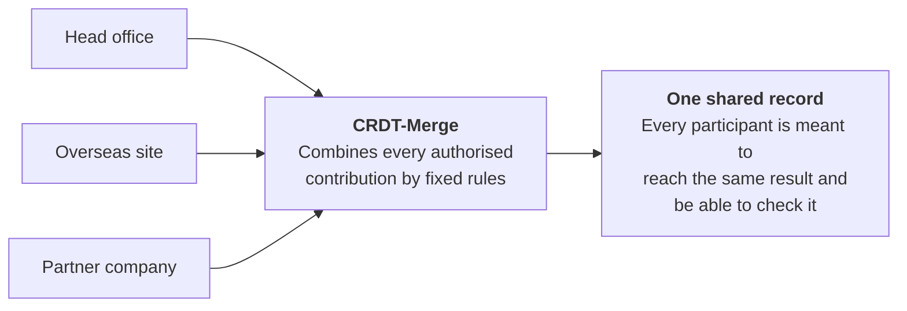

# Trust architecture for AI: an overview

Part of the [Memev documentation](../README.md). Up: the [README](../../README.md). Related:
[ARCHITECTURE.md](../ARCHITECTURE.md), [CONVERGENCE.md](../CONVERGENCE.md), [FEDERATION.md](../FEDERATION.md),
[DATA-SOVEREIGNTY.md](../DATA-SOVEREIGNTY.md), [the five tiers](../tiers/README.md).

> **Planned where it says so.** This page explains the direction in plain language. The free core is a
> development preview that runs today. The Business, Corporate and Federated tiers, and the integration of
> CRDT-Merge into the released product, are planned. [Where we are](#where-we-are) says which is which.

This is the shortest explanation of what Memev is for. It has no technical detail. The pages linked above hold
the design.

## The problem

Every team is adding AI. Nothing connects it.

- **Islands of AI.** Each tool, team and site holds its own version of the work.
- **Decisions drift.** What is agreed in one place never reaches the people and agents acting elsewhere.
- **No proof.** Nobody can show who was allowed to act, what was done, or whether it was checked.

More AI does not make an organisation smarter. Connected AI that everyone can trust does.

## The vision

One infrastructure layer for connected intelligence, at every scale.

The layer stays the same at each step. What grows is the trust boundary it has to cross: from one
person's computers, to one company, to sites in different countries, to independent organisations that keep
their own owners, rules and data.

## The solution: an infrastructure layer

Memev is infrastructure, not another AI application. It sits beneath whichever AI an organisation uses and
above the people, projects and systems that do the work.

Memev is AI-application agnostic. It is not a model, a memory vendor or an agent framework, and it does not
require any single one of them. Because it is a layer and not an application, the AI on top can change. The
layer and its record stay.

## The value at every scale

The same layer is worth something different to each kind of customer.

| Who | What the layer gives them | Status |
|---|---|---|
| **A single user** | The AI tools they connect work from the same context. No re-explaining a project to each tool, and the record stays on their own computer. | Preview today |
| **A small business** | One company record that the team and its AI tools share, under company rules. Knowledge outlasts staff changes and changes of AI vendor. | Planned |
| **A global business** | Sites in many countries run one programme. Each site keeps its own authority and can keep its data in its own jurisdiction. | Planned |
| **A federation** | Separate businesses, suppliers and vendors share only what each agreement permits. Nobody hands over its systems or its data. | Planned |

## Why CRDT-Merge

Many contributors. No central referee. One agreed result.

This picture is the planned use. Today Memev hands the engine two versions of one note and their common base.

When independent parties each add to shared work, in any order and at any time, they still need to end with
the same record. CRDT-Merge is the convergence engine designed for that. Its design aims:

- **No central owner of everyone's data.** No participant has to hand its systems to another.
- **Any order, any timing, same result.** The outcome comes from fixed rules, so it can be reproduced.
- **No AI decides whose version wins.** A language model is not the authority that resolves conflicts.

Correctness work on the engine and its end-to-end acceptance are still in progress.

This is what is intended to make connected intelligence possible across sites, countries and organisations
that will never place their data under one owner. CRDT-Merge is a separate project under its own licence
(BSL 1.1). Memev reaches it across a provider boundary, and no released Memev merges through it yet.
[CONVERGENCE.md](../CONVERGENCE.md) holds the detail.

## The technology underneath

Three technologies sit under the layer. CRDT-Merge, which contains E4, and ACFA-RS are projects separate from
Memev, each under its own licence, and each of the three has a published reference. None of them is part of
the released Memev runtime yet, and the [README](../../README.md) states the boundary for each.

| Technology | Its place in the layer | What it is designed to make possible | Reference |
|---|---|---|---|
| **CRDT-Merge** | Convergence | Independent contributions resolve to the same result in any order, with no coordinator. | Paper: [arXiv:2605.19373](https://arxiv.org/abs/2605.19373), *Conflict-Free Replicated Data Types for Neural Network Model Merging: A Two-Layer Architecture Enabling CRDT-Compliant Model Merging Across 26 Strategies* (May 2026). |
| **E4** | Authority and evidence, carried in the record | Trust becomes a dimension of the data itself, beside its causal history and its cryptographic hash, so who is trusted and what happened travel with every record. | Specification: *E4 Recursive Trust-Delta Entanglement, Master Architecture Specification*, in the crdt-merge repository. It has no arXiv paper. |
| **ACFA-RS** | Evidence: results anyone can recompute | Every party computes the identical result from the same contributions, with no coordinator. A contributor that sends conflicting versions leaves proof that anyone can check. | Paper: [arXiv:2607.10305](https://arxiv.org/abs/2607.10305), *Byzantine Accountability Without Consensus: Strong Eventual Consistency for Non-Associative, Stochastic, Robust Aggregation* (July 2026). |

The CRDT-Merge paper addresses the merging of neural-network models. Using the engine for organisational
records is the planned extension that [CONVERGENCE.md](../CONVERGENCE.md) describes. The engine carries patents
(see the PATENTS file in its repository).

**What the three are designed to make possible together.** Independent organisations reach one agreed result,
the record carries its own trust, and anyone can recompute the outcome, with no central coordinator and no AI
model acting as referee. Each paper states what its own contribution is and what it does not cover: the ACFA
paper, for example, guarantees that honest parties agree on the result, not that the result is accurate.

## What trust needs

Agreeing on one record is necessary. It is not enough. A record that every copy agrees on can still hold a
mistaken or unauthorised contribution. A trust architecture needs four things together:

| | What it answers | |
|---|---|---|
| **1. Authority** | Who may contribute, see or act. | Identity and policy decide. |
| **2. Convergence** | Does everyone end with the same record? | This is the job of CRDT-Merge. |
| **3. Evidence** | What was claimed, against what was checked. | Provenance and verification. |
| **4. Sovereignty** | Who controls each party's data? | Each party keeps its own data, rules and operators. |

Memev is the product layer that brings the four together.

## Where we are

| Available now, in preview | Planned, in stages |
|---|---|
| The free core, for one person: one shared context across the AI tools they connect, a coordination bus between AI sessions, and work contracts with checks (off until switched on). | CRDT-Merge integrated into the released product, then Business (one company), Corporate (many sites and countries) and Federated (many organisations). |

The tier names describe targets, not services available today. The [README](../../README.md) and
[the five tiers](../tiers/README.md) state what each one holds and what is planned.

## The slides

The same story as eleven slides is in the `deck` folder beside this page: one file per slide, in the order
listed in its index file. Each file is a single slide on a 1920 by 1080 canvas, with speaker notes at the end.
